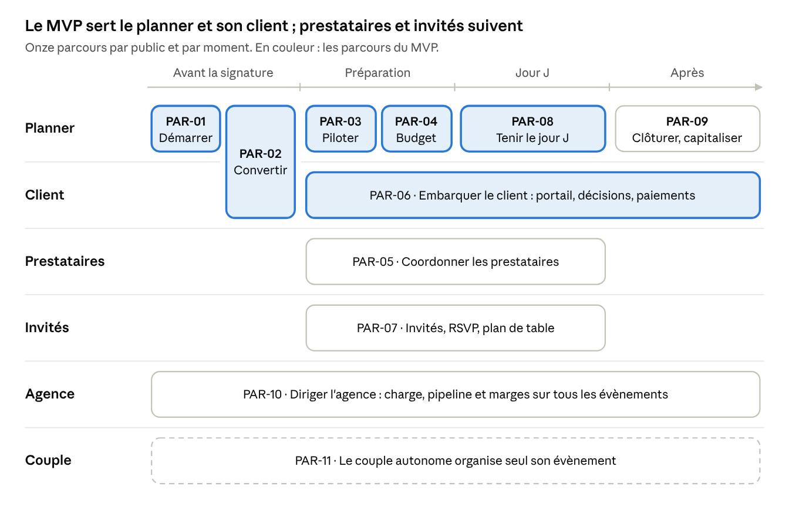
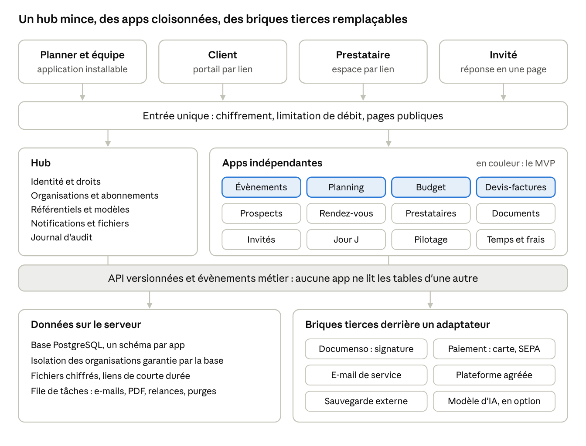
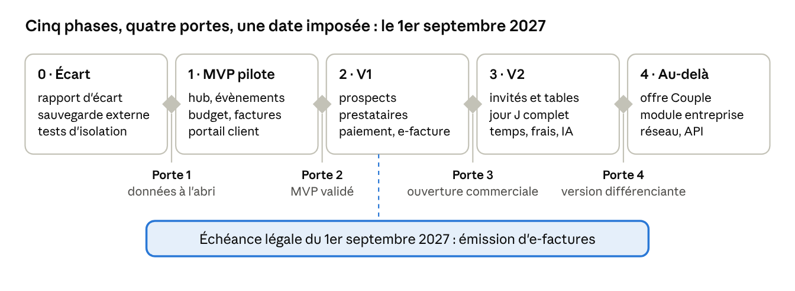

# Symbola — Cahier des charges & référentiel d'écart

Copie du 11 novembre 2026 du document en ligne · Julien

## 1. Mode d'emploi pour l'agent de code

Ce document est la cible. Ton premier livrable n'est pas du code : c'est un rapport d'écart entre l'application existante et chaque exigence numérotée ci-dessous. Tu ne modifies rien avant de l'avoir produit.

### Comment lire ce document

- Sections 2 à 6 : l'intention. Pourquoi le produit existe, pour qui, et quels parcours le font gagner.
- Sections 7 à 9 : le fonctionnel. Ce que l'application doit faire, exigence par exigence.
- Sections 10 à 15 : les contraintes. Architecture, données, sécurité, RGPD, droit, qualité de service.
- Sections 16 et 17 : la preuve. Les Synthetic Users et les scénarios qu'ils jouent de bout en bout.
- Sections 18 et 19 : l'ordre. La grille d'écart à remplir et la feuille de route.

Les verbes sont normatifs. DOIT = obligatoire. DEVRAIT = attendu sauf raison écrite. PEUT = optionnel.

### Identifiants et priorités

Chaque exigence porte un identifiant stable de la forme `PRÉFIXE-NN`. Cite-le dans les commits, les tests et le rapport d'écart.

| Préfixe | Domaine | Section |
| --- | --- | --- |
| UX | Principes de parcours | 5 |
| PAR | Parcours de bout en bout | 6 |
| HUB | Hub, comptes, onboarding, paramétrage | 7 |
| CRM, RDV | Prospects, pipeline, prise de rendez-vous | 8 |
| EVT, CHR | Cockpit d'évènement, rétroplanning, tâches, chrono | 8 |
| BUD, FAC | Budget, paiements, devis, contrats, factures | 8 |
| PRE, INV | Prestataires et lieux, invités et plan de table | 8 |
| POR, DOC, MSG | Portail client, documents et signature, messagerie | 8 |
| JRJ, RPT, TPS | Jour J, pilotage, temps et frais | 8 |
| GC, IA | Game changers, règles d'usage de l'IA | 9 |
| ARC, DAT | Architecture, modèle de données | 10, 11 |
| SEC, RGP, JUR | Sécurité, RGPD, juridique | 12, 13, 14 |
| NFR | Exigences non fonctionnelles | 15 |
| SU, SC | Synthetic Users, scénarios de recette | 16, 17 |

| Priorité | Sens | Cible |
| --- | --- | --- |
| P0 | Socle. Sans elle, un parcours clé casse ou une donnée est en danger. | MVP |
| P1 | Parité. Un planner l'attend parce que les outils en place le font. | V1 |
| P2 | Différenciant. Ce qui fait préférer Symbola. | V2 |
| P3 | Vision. À instruire, pas à construire tout de suite. | Au-delà |

### Protocole d'évaluation d'écart

1. Inventorie l'existant sans rien modifier : routes, écrans, modèles, migrations, tests, dépendances, configuration de déploiement.
2. Pour chaque exigence, attribue un statut : Conforme, Partiel, Absent, Divergent (fait autrement) ou Sans objet.
3. Joins une preuve à chaque statut : chemin de fichier, nom de test, capture d'écran ou requête rejouable. Un statut sans preuve vaut Absent.
4. Estime l'effort (S : une demi-journée au plus, M : deux jours au plus, L : au-delà) et le risque de régression.
5. Rejoue les scénarios de la section 17 avec les Synthetic Users. Note chaque étape : passe, passe avec friction, bloque.
6. Écris `docs/GAP_REPORT.md` (synthèse lisible par Julien) et `docs/gap.csv` (une ligne par exigence, colonnes de la section 18).
7. Propose un plan de comblement par lots d'une semaine au plus, dans l'ordre d'arbitrage ci-dessous.
8. Attends la validation de Julien avant tout lot qui change le schéma de données ou un parcours P0.

### Règles d'arbitrage

- Ordre de comblement : d'abord les risques de perte de données et les failles SEC en P0, puis les parcours P0 cassés de bout en bout, puis le reste des P0, puis P1, puis P2.
- Un parcours terminé vaut mieux que trois modules à moitié faits. Ferme un parcours avant d'en ouvrir un autre.
- Ne réécris pas ce qui fonctionne. Une divergence technique acceptable se documente par un ADR dans `docs/adr/`, elle ne se corrige pas.
- Si ce document se contredit, se trompe ou laisse un choix ouvert, écris la question dans `docs/QUESTIONS.md`. Ne tranche pas seul sur un point juridique ou tarifaire.
- Aucune donnée métier en dur dans le code : listes, modèles, taux, catalogues et libellés métier vivent en base et se paramètrent (HUB-20 à HUB-26).

### Définition de « terminé »

Une exigence est terminée quand ses critères d'acceptation sont couverts par un test automatisé, que le scénario Synthetic User concerné passe sans blocage, que la chaîne de contrôle sécurité est verte, et que l'aide contextuelle et les textes de l'écran sont à jour.

## 2. Vision, positionnement et hypothèses de cadrage

Symbola doit devenir l'outil dans lequel un organisateur d'évènements passe sa journée, du premier message d'un prospect au dernier paiement, sans jamais ressaisir une information.

### La promesse

« Tout l'évènement, saisi une seule fois, partagé avec chacun à sa juste mesure. » Le planner pilote. Le client décide et suit. Le prestataire confirme et livre. L'invité répond. Chacun voit ce qui le concerne, rien de plus.

### Ce que le produit est, et ce qu'il n'est pas

Symbola est une suite modulaire : un hub central et des apps indépendantes. Chaque app fonctionne seule. Ensemble, elles partagent contacts, évènements et documents sans ressaisie.

Symbola n'est pas un logiciel de comptabilité (il exporte vers le comptable), ni une billetterie grand public, ni une place de marché de prestataires au lancement.

### Principes directeurs

1. Le parcours avant la fonctionnalité. Une fonction qui ne s'insère dans aucun parcours de la section 6 ne se construit pas.
2. Paramétrable, jamais codé en dur. Le métier appartient à l'utilisateur : listes, modèles, taux, vocabulaire.
3. Sûr et conforme par défaut. Le réglage le plus prudent est celui qui s'applique sans rien toucher.
4. Modulaire pour de vrai. Retirer une app ne casse pas les autres. Ajouter une app ne demande pas de migrer les autres.
5. Maintenable par une personne et un agent. Peu de composants, des tests qui disent quoi réparer, une documentation à jour.
6. Sobre. Un seul serveur doit suffire longtemps.

### Hypothèses de cadrage

Ces hypothèses viennent du projet tel qu'il a été décrit. Chacune se corrige ici, et le reste du document suit.

| Sujet | Hypothèse retenue |
| --- | --- |
| Nom | Symbola, pour la suite entière |
| Marché | France d'abord, francophonie ensuite. Droit français et européen. |
| Première utilisatrice | Une wedding planner en activité. Elle pilote le MVP quelques semaines, puis un retour d'expérience complet valide la V2. |
| Périmètre MVP | Hub, Évènements avec chrono et budget, Devis et facturation |
| Format | Application web progressive (PWA). Les magasins d'applications viendront selon le nombre de clients. |
| Hébergement | Un VPS en Union européenne pour le pilote, puis une montée par paliers (section 3) |
| Sauvegarde | Écart assumé avec le plan initial : sauvegarde externe chiffrée exigée dès la première donnée réelle (NFR-10) |
| Briques | Open source éprouvé pour l'identité et la signature (Documenso). Sur mesure pour le cœur métier. |
| Prix | Environ 20 % sous les plateformes en place. Espaces couples en module mensuel payé par le planner, prix à chiffrer. |
| Société | Pas encore créée. Les obligations d'éditeur (CGU, accord de sous-traitance) s'imposent à l'ouverture commerciale, pas au pilote. |
| Pile technique | Libre. La section 10 décrit une référence. Un choix différent déjà en place se documente, il ne se réécrit pas. |

### Mesures de réussite

L'indicateur principal est le nombre d'évènements menés de la signature à la clôture dans Symbola, par mois. Les cibles ci-dessous sont des points de départ, à ajuster après le pilote.

| Mesure | Cible initiale | Ce qu'elle prouve |
| --- | --- | --- |
| Temps jusqu'au premier évènement prêt | Moins de 10 minutes après l'inscription | L'onboarding fonctionne (PAR-01) |
| Délai demande entrante → devis envoyé | Moins de 24 heures, en moins de 15 minutes de travail | Le parcours commercial est fluide (PAR-02) |
| Évènements avec portail client actif | 70 % et plus | Le client y trouve son compte (PAR-06) |
| Prestataires qui répondent sans créer de compte | 80 % et plus des sollicitations | Le lien magique tient sa promesse (PAR-05) |
| Ressaisies constatées dans les scénarios | 0 | La donnée circule (UX-02) |
| Planners actifs chaque semaine | 80 % des comptes payants | L'outil est devenu l'outil de travail |

## 3. Cibles, segments et modèle économique

Symbola sert d'abord la wedding planner indépendante, puis la petite agence évènementielle. Les métiers voisins et le couple autonome viennent ensuite.

### Ceux qui paient

| Segment | Qui | Ce qu'il achète | Priorité |
| --- | --- | --- | --- |
| S1 · Planner indépendant | Une personne, en micro-entreprise ou société unipersonnelle. Mariages surtout. | Du temps, une image professionnelle, la certitude de ne rien oublier. | P0 |
| S2 · Petite agence | Deux à dix personnes. Mariages et évènements d'entreprise : séminaires, soirées, lancements. | La coordination d'équipe, la délégation sans perte de contrôle, la marge par évènement. | P1 |
| S3 · Métiers voisins | Officiants, décorateurs, lieux, traiteurs, autres métiers de service sur rendez-vous. | Une ou deux apps seules : Devis et factures, Rendez-vous. | P2 |
| S4 · Couple autonome | Deux personnes qui organisent seules leur évènement. | Un fil conducteur, un budget, une liste d'invités. | P2 |

### Ceux qui ne paient pas, mais décident de la réputation du planner

| Utilisateur | Ce qu'il attend | Conséquence produit |
| --- | --- | --- |
| Client : couple, parent payeur, commanditaire d'entreprise | Savoir où on en est, décider vite, payer simplement. | Portail sans mot de passe, pensé pour le téléphone (POR). |
| Prestataire | Recevoir un brief clair, confirmer, être payé. Ne pas créer un compte de plus. | Lien magique, une action par message (PRE-04). |
| Invité | Répondre en une minute, sans installer quoi que ce soit. | RSVP en une page, accessible (INV-03). |
| Comptable | Des écritures propres, exportées sans retraitement. | Accès en lecture et exports normalisés (FAC-11). |

### Les sept tâches que le planner confie à l'outil

1. Quand une demande arrive, répondre vite et bien, pour signer avant un concurrent.
2. Chaque matin, savoir ce qui presse sur tous mes évènements, pour ne rien laisser tomber.
3. Quand le client demande « où en est-on ? », qu'il ait déjà la réponse, pour ne pas passer mes soirées au téléphone.
4. Quand un prestataire envoie un devis, l'intégrer au budget sans le retaper.
5. Le jour J, tout avoir dans la poche, même sans réseau.
6. En fin de mois, facturer et relancer sans y penser.
7. En fin d'année, savoir quels évènements m'ont fait gagner de l'argent.

### Modèle économique : hypothèses à tester

L'abonnement se prend par organisation, pour une app ou pour la suite. Les montants sont des hypothèses de travail, pas des décisions.

| Offre | Pour qui | Contenu | Prix indicatif |
| --- | --- | --- | --- |
| App seule | S3, découverte | Une app et le hub | À fixer |
| Suite Solo | S1 | Toutes les apps, un utilisateur et un assistant, portails illimités | Environ 560 € HT par an, soit 20 % sous un repère de 700 € |
| Suite Agence | S2 | La suite, utilisateurs illimités, rôles, pilotage, volume d'IA partagé entre les membres | Plusieurs forfaits selon l'usage, l'IA en premier. Aucun prix par utilisateur. Montants à fixer. |
| Module Espaces couples | S1 et S2, en supplément de leur suite | Création d'espaces couples sans limite de nombre | Forfait mensuel, à chiffrer. Départ proposé : 15 € HT par mois. |
| Couple en direct | S4 | Version allégée vendue au couple, sans planner | En suspens : à confirmer ou à abandonner |

Règles tarifaires que le produit DOIT rendre possibles :

- Clients, prestataires et invités sont toujours gratuits et illimités.
- Essai gratuit sans carte bancaire, avec données de démonstration.
- Aucune commission Symbola sur les paiements encaissés. Seuls les frais du prestataire de paiement s'appliquent.
- Export complet des données gratuit et en libre-service, à tout moment (HUB-13).
- Droits d'accès aux apps pilotés par l'abonnement, sans redéploiement (ARC-06).

### Module Espaces couples

Décision du 10 novembre 2026 : l'espace couple se vend au planner, en module mensuel, sans limite de nombre. La tarification à l'évènement est écartée.

| Point | Hypothèse de travail |
| --- | --- |
| Ce que le module ouvre | Pour chaque couple, un espace complet : rétroplanning personnel, budget, liste d'invités et réponses. Le portail client de base (suivi, décisions, documents, paiements) reste inclus dans la suite. |
| Qui paie | Le planner, chaque mois. Le couple ne paie rien à Symbola. |
| Ce qui est illimité | Le nombre d'espaces. Le stockage et les envois suivent le quota de l'offre. |
| Prix de départ à tester | 15 € HT par mois, soit environ un tiers de la Suite Solo |
| Fourchette à explorer | 9 à 25 € HT par mois |

Le prix se fixe en quatre temps, sans jamais raisonner au nombre d'évènements :

1. Plancher. Mesurer pendant le pilote ce que le module coûte par planner et par mois : stockage, e-mails, SMS, IA. Le prix vaut au moins trois fois ce coût, pour garder une marge brute d'environ 70 %.
2. Plafond. Demander à la pilote, puis aux dix premiers planners, quatre prix : trop cher, cher mais acceptable, bon marché, trop bas pour être crédible.
3. Repère. Comparer au prix de la suite. Au-delà de la moitié, le module pèse trop dans la facture. Sous un quart, il sous-évalue ce qu'il apporte.
4. Décision. Retenir le prix le plus haut que sept planners sur dix acceptent sans hésiter, s'il dépasse le plancher.

Conséquence produit : le module est un droit d'usage activable par organisation (ARC-06). Il ne compte ni les évènements, ni les espaces.

### Forfaits d'agence

Décision du 10 novembre 2026 : le nombre d'utilisateurs ne fait pas le prix. Une agence prend un forfait sans limite d'utilisateurs. Ce qui distingue les forfaits, c'est l'usage des fonctions à coût variable, l'IA en premier.

- Chaque forfait comprend un volume d'IA mensuel, alloué à l'agence. Ses membres se le partagent.
- Plusieurs forfaits existeront. Leur nombre, leur prix et leur volume restent à fixer.
- Proposé, à confirmer : la consommation est visible de tous les membres, et l'administrateur est prévenu à 80 % du volume.
- Proposé, à confirmer : une fois le volume épuisé, les fonctions d'IA s'arrêtent jusqu'au mois suivant ou jusqu'au forfait supérieur. Le reste de l'application continue (IA-01).

Conséquence produit : le volume d'IA est un compteur par organisation, jamais par utilisateur (IA-06). Aucune règle de l'application ne dépend du nombre de membres.

### Stockage et infrastructure

Le quota de stockage se fixe d'après le coût de l'infrastructure à l'échelle visée, pas d'après le serveur du pilote. Deux constats guident l'offre.

- Le volume de fichiers coûte peu. Un stockage d'objets européen se loue autour d'un centime par gigaoctet et par mois : [6,49 € HT par mois pour 1 To chez Hetzner](https://www.hetzner.com/storage/object-storage/), environ 0,014 € HT par Go chez [OVHcloud](https://www.ovhcloud.com/fr/public-cloud/prices/). Tarifs relevés le 10 novembre 2026, celui d'OVHcloud à revérifier.
- Ce qui coûte, c'est la disponibilité : serveurs redondants, infogérance, astreinte. C'est ce poste qui fait passer de 200 € par an à plusieurs milliers d'euros par mois.

| Palier | Déclencheur | Infrastructure | Ordre de grandeur |
| --- | --- | --- | --- |
| 1 · Pilote | Une organisation | Le VPS actuel. Fichiers et sauvegardes déjà hors du serveur, en stockage d'objets. | 200 € par an pour le serveur, plus le stockage au gigaoctet |
| 2 · Lancement | Premiers clients payants | Serveur dédié ou VPS plus puissant, base répliquée, supervision, sauvegardes testées | Quelques milliers d'euros par an |
| 3 · Croissance | Engagement de disponibilité, ou plusieurs centaines d'organisations | Plusieurs serveurs, infogérance, sauvegardes gérées | Plusieurs milliers d'euros par mois |

Les ordres de grandeur des paliers 2 et 3 sont les estimations de Julien. Ils restent à chiffrer par devis.

Règles proposées, à confirmer :

1. Le coût d'infrastructure reste sous 15 % du chiffre d'affaires. Repère : cent abonnements Suite Solo à 560 € font 56 000 € par an, soit 8 400 € d'infrastructure, ce qui couvre le palier 2.
2. On change de palier quand le palier courant ne tient plus la disponibilité visée (NFR-06), pas avant.
3. Chaque offre inclut un quota. Au-delà, le planner achète un supplément de stockage. Le gigaoctet vendu vaut au moins trois fois son coût complet, sauvegardes comprises.
4. Le quota se calcule sur des volumes mesurés. Le compteur de stockage par organisation tourne dès le pilote (DOC-12).
5. Aucun fichier ne vit sur le disque du serveur (ARC-11, NFR-31). Changer de palier ne déplace aucun fichier.

Questions ouvertes pour Julien : l'offre Couple se vend-elle aussi en direct aux couples, sans planner ? Quel prix mensuel pour le module Espaces couples ? Quel prix et quel volume d'IA pour chaque forfait d'agence ? Qu'est-ce qui distingue ces forfaits avant la livraison de l'IA ? Quel quota de stockage par offre, une fois les volumes mesurés pendant le pilote ?

## 4. Paysage concurrentiel et leviers de différenciation

Aucun outil en place ne réunit profondeur évènementielle, conformité française et simplicité d'entrée. C'est l'espace que Symbola doit occuper.

### Ce que font les outils en place

| Outil | Origine | Points forts relevés | Limites relevées | Prix publics relevés |
| --- | --- | --- | --- | --- |
| [WeddingPlan](https://www.weddingplan.fr/en/les-fonctionnalites) | France | Treize métiers du mariage. CRM, formulaires, devis et contrats, signature, rétroplanning, invités, plan de table 3D, déroulé du jour J, portail couple, paiements, rapprochement bancaire, assistant IA. | Deux utilisateurs inclus, les suivants en supplément. Aide au paramétrage payante. Centré mariage. | 500 - 700 € l'année. Essai de 15 jours. |
| Aisle Planner | États-Unis | Chronologies, guides de style, plans de table, gestion des invités. | Facturation et suivi du temps légers. Un seul prestataire de paiement. | 40 à 110 $ par mois selon les comparatifs |
| Planning Pod | États-Unis | Plans de salle, RSVP, modèles. Tourné vers les lieux. | Interface datée. Plafond d'évènements sur l'offre d'entrée. | 39 à 164 $ par mois selon un comparatif, sur devis selon un autre |
| HoneyBook | États-Unis | Expérience client soignée, modèles, automatisations. | Ni invités, ni budget, ni chronologie. Paiements hors dollar difficiles. Frais sur chaque paiement. | 29 à 129 $ par mois |
| Dubsado | États-Unis | Workflows conditionnels. | Apprentissage long. Pas de pipeline en colonnes. | 200 à 525 $ par an selon les sources |
| Tableur, Trello, Notion, messagerie | — | Gratuit, souple, déjà connu. | Ressaisie, aucune relance, aucune signature, aucun lien avec les paiements. | — |

Les prix viennent de comparatifs tiers de 2026 qui se contredisent parfois. Ils sont à revérifier avant toute communication commerciale. Sources : [comparatif Maroo](https://www.maroo.us/blogs/best-crm-wedding-event-planners-2026), [comparatif Agiled](https://agiled.app/blog/best-all-in-one-software-for-event-planners), [comparatif Planning Pod](https://planningpod.com/blog/aisle-planner-vs-honeybook-vs-planning-pod-wedding-planning-software-alternatives-reviews-pricing), [histoire de WeddingPlan](https://www.weddingplan.fr/en/histoire).

### Ce que les planners font encore à la main

- Ressaisir les mêmes informations entre le devis, la facture et le déroulé.
- Jongler entre six abonnements et perdre une donnée à chaque passage de l'un à l'autre.
- Oublier une facture d'échéance ou une relance en haute saison.
- Collecter les régimes alimentaires un par un.
- Suivre les attestations d'assurance et les horaires de livraison des prestataires.
- Vérifier à la main qu'une date n'est pas déjà prise.

### Sept leviers de différenciation

| Levier | Ce que Symbola fait | Exigences liées |
| --- | --- | --- |
| 1. Conforme en France par construction | Facture électronique, e-reporting, mentions légales, rétractation, données des invités. Un outil américain ne le fera pas. | Sections 13 et 14, FAC-06 à FAC-14 |
| 2. Zéro ressaisie du prospect au jour J | La demande devient devis, le devis devient évènement, budget, échéancier et déroulé. | UX-02, CRM-11, EVT-01 |
| 3. Deux comptabilités séparées | L'argent du client (budget de l'évènement) ne se mélange jamais au chiffre d'affaires du planner (ses factures). | BUD, FAC |
| 4. Trois publics sans compte | Client, prestataire et invité agissent par lien personnel, sans mot de passe. | UX-11, POR-01, PRE-04, INV-03 |
| 5. Terrain d'abord | Le jour J fonctionne sans réseau, d'une main, au soleil. | JRJ-01 à JRJ-09 |
| 6. Prêt en dix minutes | Un questionnaire configure l'espace. Tout se paramètre sans développeur. | PAR-01, HUB-09, HUB-20 à HUB-26 |
| 7. Modulaire et sans commission | On paie les apps qu'on utilise. Aucun prélèvement sur les encaissements. | ARC-01, ARC-06 |

## 5. Principes de conception des parcours

Dix-huit règles d'ergonomie s'appliquent à tous les écrans. Chacune se vérifie. Une règle violée est un écart, au même titre qu'une fonction absente. Toutes valent P0 pour tout écran livré, sauf UX-16 et UX-18, en P1.

| ID | Principe | Règle vérifiable |
| --- | --- | --- |
| UX-01 | Répondre à « que dois-je faire maintenant ? » | L'accueil et chaque cockpit affichent en premier la prochaine action, son échéance et son responsable. |
| UX-02 | Zéro ressaisie | Aucune information déjà connue n'est redemandée. Dans les scénarios SC-01 à SC-12, aucun champ n'est saisi deux fois. |
| UX-03 | Trois gestes pour l'essentiel | Les dix actions les plus fréquentes (liste ci-dessous) s'atteignent en trois clics ou touchers au plus depuis l'accueil. |
| UX-04 | De la valeur en dix minutes | Un nouvel inscrit obtient un évènement prêt et un devis en brouillon en moins de dix minutes, sans aide extérieure. |
| UX-05 | Téléphone d'abord sur le terrain | Portail client, espace prestataire, RSVP et Jour J sont conçus à 360 px de large. Cibles tactiles de 44 px au moins. Actions principales dans la zone du pouce. |
| UX-06 | Statut, suite, blocage | Tout objet montre son statut, l'étape suivante et qui la bloque. Aucun statut sans action possible. |
| UX-07 | Annuler plutôt que confirmer | Une action réversible s'exécute tout de suite et s'annule pendant dix secondes. Une action irréversible demande une confirmation qui nomme l'objet. Corbeille de 30 jours. |
| UX-08 | L'écran vide enseigne | Tout écran vide propose une action principale, un exemple et une aide de trente secondes. |
| UX-09 | Rien ne se perd | Enregistrement automatique. Brouillon restauré après fermeture. Conflit d'édition signalé, jamais écrasé en silence. |
| UX-10 | Les mots du métier | Vocabulaire du planner, paramétrable par type d'évènement. Aucun terme technique. Un message d'erreur dit ce qui s'est passé et comment en sortir. |
| UX-11 | Sans compte pour les tiers | Client, prestataire et invité agissent par lien personnel. Ni mot de passe, ni inscription. |
| UX-12 | Simple d'abord, complet ensuite | L'écran par défaut montre l'essentiel. Les options avancées sont repliées. Une app non souscrite n'encombre pas la navigation. |
| UX-13 | Un seul patron | Liste, puis fiche, puis panneau latéral d'édition. Mêmes raccourcis, mêmes emplacements, mêmes libellés partout. |
| UX-14 | Accessible | WCAG 2.2 niveau AA. Tout se fait au clavier. Contraste de texte de 4,5:1. Lecteur d'écran testé sur le RSVP et le portail. Animations réductibles. |
| UX-15 | Immédiat | Réaction visible en moins de 100 ms. Mise à jour optimiste. Squelettes d'écran plutôt que roues d'attente. |
| UX-16 | Notifier utile | Chaque notification mène à une action. Récapitulatif quotidien par défaut. Réglages par type et plages de silence. |
| UX-17 | Voir avant d'envoyer | Aperçu « vu par le client » sur tout contenu partagé. Tout envoi à plusieurs destinataires affiche leur nombre et leur liste, et propose un envoi test. |
| UX-18 | Mesurer les parcours | Chaque parcours est instrumenté : taux d'achèvement, durée, abandon par étape. Mesure sans cookie tiers ni donnée personnelle. |

### Les dix actions les plus fréquentes

Elles servent de référence à UX-03 et à la création rapide (HUB-07).

1. Ajouter un prospect.
2. Créer un devis.
3. Ajouter une tâche.
4. Enregistrer un devis de prestataire dans le budget.
5. Marquer un paiement.
6. Écrire au client.
7. Ouvrir le déroulé du jour J.
8. Trouver un contact et l'appeler.
9. Émettre une facture.
10. Partager un document.

### Patrons d'interface communs

- Navigation : barre latérale limitée aux apps souscrites. En-tête avec recherche, création rapide et notifications. Sur téléphone, barre d'onglets en bas, cinq entrées au plus.
- Cockpit d'évènement : en-tête (nom, date, compte à rebours, statut), bandeau de santé, puis onglets Synthèse, Planning, Budget, Prestataires, Invités, Documents, Jour J.
- Panneau latéral : on édite sans quitter la liste. Fermer le panneau enregistre.
- Palette de commandes : Ctrl ou Cmd + K cherche et agit.
- Interne ou partagé : tout contenu visible par le client porte la même pastille « Partagé ». Les notes internes ont un fond distinct.
- Statuts : À faire, En cours, En attente d'un tiers, Fait, En retard. Toujours un libellé et une icône, jamais la couleur seule.

### Anti-patrons interdits

- Un tableau de bord rempli de graphiques qui ne mène à aucune action.
- Une fenêtre modale ouverte par-dessus une autre.
- Un formulaire de plus de sept champs visibles d'un coup. Au-delà, on découpe en étapes.
- Un bouton « Enregistrer » dont l'oubli fait perdre le travail.
- Un envoi d'e-mail sans aperçu.
- Une date ou un montant dans un format ambigu.
- Une fonction payante affichée puis refusée au clic sans explication.

### Langage visuel

L'interface est calme, éditoriale et précise : l'outil s'efface devant l'évènement. Les jetons de design (couleurs, typographie, espacements, rayons) sont ceux de la maquette. Ils DOIVENT vivre dans un fichier `DESIGN.md` à la racine du dépôt. Aucun écran n'emploie une valeur hors jeton.

## 6. Parcours clés et maquettes

Onze parcours décrivent le produit de bout en bout. Six forment le MVP : les quatre premiers, le portail client et le jour J en lecture. S'ils sont fluides, le reste se construit dessus.

PAR-02 est le seul parcours que le planner et le client font ensemble : c'est là que la vente se gagne.

### Maquette interactive

La maquette réunit dix écrans sur un même canevas : [Symbola — Maquette des parcours](https://claude.ai/artifact/AS7JcNwpbNTSMUZ5RQxDiQ). Les trois écrans du planner sont reliés entre eux. Les valeurs affichées sont celles de l'évènement de référence de la section 16.

| Écran | Parcours | Appareil | Ce qu'il démontre | Exigences |
| --- | --- | --- | --- | --- |
| Aujourd'hui | PAR-03 | Bureau | L'accueil commence par ce qui presse, tous évènements confondus. | UX-01, HUB-08 |
| Cockpit d'évènement | PAR-03 | Bureau | Prochaine action, santé en trois indicateurs, quatorze jours à venir. | EVT-02, UX-06 |
| Budget | PAR-04 | Bureau | Cinq montants, statut par poste, honoraires du planner à part. | BUD-01, BUD-02, BUD-08 |
| Questionnaire d'accueil | PAR-01 | Bureau | Une question par écran, mots simples, rien de définitif. | HUB-09, UX-10 |
| Votre espace est prêt | PAR-01 | Bureau | Ce que les réponses ont préparé, puis deux chemins possibles. | HUB-10, HUB-26 |
| Proposition à signer | PAR-02 | Téléphone | Choisir, signer et régler l'acompte dans un seul écran. | FAC-02, FAC-03, GC-01 |
| Portail du client | PAR-06 | Téléphone | Trois prochaines actions, budget en trois chiffres. | POR-02, POR-05 |
| Demande au prestataire | PAR-05 | Téléphone | Réponse en un toucher, devis joint en photo, aucun compte. | PRE-03, PRE-04 |
| Réponse de l'invité | PAR-07 | Téléphone | Une page, gros caractères, accord explicite pour le régime. | INV-03, RGP-06 |
| Mode Jour J | PAR-08 | Téléphone | Maintenant, ensuite, appel en un toucher, décalage proposé. | JRJ-01, JRJ-05 |

Les jetons de design de la maquette sont dans le fichier `DESIGN.md` joint. La maquette ne montre pas encore le pipeline des prospects, la composition d'un devis, le plan de table ni le pilotage d'agence.

Chaque parcours se lit ainsi : qui agit, ce qui le déclenche, les étapes, le moment de vérité, la mesure de réussite, l'écueil à éviter.

### PAR-01 · Démarrer : de l'inscription au premier évènement prêt (P0)

Acteur : le planner. Déclencheur : l'inscription. Résultat : un espace configuré, un évènement prêt, un devis en brouillon.

1. Inscription : une adresse e-mail, puis un lien de confirmation. Rien d'autre.
2. Questionnaire en cinq questions, une par écran : métier, types d'évènements, régime de TVA, nombre d'évènements par an, outils à remplacer.
3. Symbola prépare l'espace : modèles, catégories, mentions adaptées. Un écran dit en clair ce qui a été préparé.
4. Choix : « Créer mon premier évènement » ou « Explorer avec un exemple ». L'exemple est étiqueté et se supprime seul.
5. Création de l'évènement : nom, date, type. Le rétroplanning et le budget type apparaissent.
6. Liste de prise en main de cinq actions, qui disparaît une fois faite : logo, premier prestataire, premier devis, invitation du client, import des contacts.

- Moment de vérité : l'écran qui suit le questionnaire. Si le planner y reconnaît son métier, il reste.
- Réussite : moins de dix minutes, aucun champ obligatoire sans valeur par défaut, aucun appel à l'aide.
- À éviter : demander le SIRET, le logo ou la carte bancaire avant d'avoir montré de la valeur.

### PAR-02 · Convertir : de la demande au contrat signé et à l'acompte encaissé (P0)

Acteurs : le planner et le prospect. Déclencheur : formulaire de contact, e-mail, appel ou prise de rendez-vous.

1. La demande crée un prospect. La disponibilité de la date s'affiche aussitôt.
2. Le planner répond en un clic depuis un modèle, avec une proposition de rendez-vous.
3. Pendant le rendez-vous, les notes se prennent dans la fiche. Elles alimenteront l'évènement.
4. Le devis se compose depuis le catalogue en moins de cinq minutes, avec des options au choix du client.
5. Le client reçoit une page de proposition. Il lit, choisit ses options, signe, paie l'acompte. Un seul enchaînement, sur téléphone.
6. La signature crée l'évènement, son rétroplanning, la facture d'acompte et l'échéancier. Le planner est prévenu.
7. Sans réponse, des relances partent à J+3 et J+7. Elles s'arrêtent dès que le client réagit.

- Moment de vérité : l'étape 5. Signer et payer tiennent en moins de trois minutes pour le client.
- Réussite : devis envoyé après moins de quinze minutes de travail. Aucune ressaisie entre prospect, devis, évènement et facture.
- À éviter : forcer le client à créer un compte pour signer. Envoyer un PDF en pièce jointe comme seul support.

### PAR-03 · Piloter : le quotidien d'un évènement (P0)

Acteur : le planner. Déclencheur : l'ouverture de l'application.

1. L'accueil « Aujourd'hui » liste ce qui presse, tous évènements confondus, par urgence.
2. Un clic ouvre le cockpit de l'évènement : compte à rebours, santé, prochaine action, échéances des quatorze jours.
3. Le planner agit depuis le cockpit : il coche une tâche, relance un prestataire, répond au client.
4. Chaque action met à jour planning, budget et portail client, sans autre saisie.
5. En fin de journée, un récapitulatif liste ce qui reste et ce qui attend un tiers.

- Moment de vérité : le lundi matin. En trente secondes, le planner sait par quoi commencer.
- Réussite : les trois actions les plus urgentes sont visibles sans défiler. Toute action du cockpit se fait en deux clics.
- À éviter : obliger à ouvrir chaque évènement pour savoir où il en est.

### PAR-04 · Maîtriser l'argent : budget du client et facturation du planner (P0)

Acteurs : le planner et le client. Déclencheur : la création de l'évènement.

1. Le budget type se remplit depuis le modèle. Le planner ajuste l'enveloppe.
2. Un devis de prestataire s'ajoute à une ligne : montant, acompte, échéances.
3. Le client valide la dépense dans son portail. La ligne passe de « devisé » à « engagé ».
4. Les échéances apparaissent dans « Aujourd'hui » et dans le portail du client, avec rappel.
5. Côté planner, la facture d'acompte part à la signature et le solde à la date prévue. Les relances partent seules.
6. À tout moment, cinq chiffres : estimé, engagé, payé, reste à payer, écart à l'enveloppe.

- Moment de vérité : le client ouvre son budget et comprend en dix secondes s'il tient l'enveloppe.
- Réussite : une ligne de budget complète saisie en moins d'une minute. Un dépassement signalé avant l'engagement, pas après.
- À éviter : mêler les honoraires du planner et les dépenses de l'évènement sans les distinguer.

### PAR-05 · Coordonner les prestataires (P1)

Acteurs : le planner et les prestataires. Déclencheur : un besoin à pourvoir.

1. Le planner choisit des prestataires dans son annuaire et envoie un brief commun.
2. Chaque prestataire ouvre un lien. Il voit la date, le lieu, le besoin. Il répond « disponible » ou non, et dépose son devis.
3. Les réponses arrivent dans un comparatif. Le planner partage une sélection au client.
4. Le choix du client engage la ligne de budget et crée les tâches de suivi : contrat, acompte, attestation.
5. À J-30 puis J-7, le prestataire reçoit sa feuille de route : horaires, accès, contact sur place.
6. Il confirme la réception. L'absence de confirmation remonte en alerte.

- Moment de vérité : le premier lien reçu par le prestataire. Une action, un écran, pas de compte.
- Réussite : réponse d'un prestataire en moins de deux minutes, sur téléphone.
- À éviter : un espace prestataire qui demande une inscription.

### PAR-06 · Embarquer le client (P0)

Acteur : le client. Déclencheur : l'invitation envoyée après la signature.

1. Le client reçoit un lien. Pas de mot de passe.
2. L'accueil du portail montre le compte à rebours, l'avancement et « vos trois prochaines actions ».
3. Le client décide : il choisit entre deux options, valide un devis, répond à un questionnaire.
4. Il retrouve ses documents, ses paiements et son budget simplifié.
5. Il écrit au planner dans le fil du sujet concerné.
6. Chaque décision est horodatée et visible des deux côtés.

- Moment de vérité : la première connexion. Le client se dit « je sais où on en est ».
- Réussite : première décision prise moins de deux minutes après l'ouverture du lien.
- À éviter : montrer au client la mécanique interne : tâches du planner, notes, marges.

### PAR-07 · Gérer les invités (P1)

Acteurs : le client, le planner, les invités. Déclencheur : la liste d'invités.

1. Le client saisit ou importe sa liste dans le portail. Foyers et accompagnants sont regroupés.
2. Les invitations à répondre partent par lien ou QR code personnel.
3. L'invité répond en une page : présence par temps fort, régime, hébergement.
4. Les relances partent seules vers ceux qui n'ont pas répondu.
5. Le plan de table se compose par glisser-déposer, avec des contraintes de placement.
6. La synthèse pour le traiteur sort en un clic : repas par type, régimes, allergènes par table.

- Moment de vérité : une invitée de 70 ans répond seule, sur téléphone, en une minute.
- Réussite : RSVP achevé en moins de soixante secondes. Export traiteur utilisable sans retouche.
- À éviter : les champs libres pour les régimes. La collecte de données dont personne n'a besoin.

### PAR-08 · Tenir le jour J (P0 en lecture, P1 pour le pointage)

Acteur : le planner et son équipe. Déclencheur : la veille de l'évènement.

1. La veille, le planner active le mode Jour J. Tout se télécharge sur le téléphone.
2. L'écran principal affiche « Maintenant » et « Ensuite », en gros caractères.
3. Un toucher appelle le prestataire de la séquence en cours.
4. Le planner pointe chaque séquence. Un retard propose de décaler la suite et d'avertir les prestataires concernés.
5. Un incident se note en dix secondes : texte dicté, photo.
6. Les documents clés restent lisibles sans réseau : plan de table, contrats, plan B.
7. Au retour du réseau, tout se synchronise. Le lendemain, un bilan est prêt.

- Moment de vérité : 16 h 40, la cérémonie a vingt minutes de retard, il n'y a pas de réseau.
- Réussite : toute information du jour J à deux touchers. Fonctionnement intégral en mode avion.
- À éviter : un écran chargé. La saisie au clavier.

### PAR-09 · Clôturer et capitaliser (P1)

Acteur : le planner. Déclencheur : le lendemain de l'évènement.

1. À J+1, Symbola propose la clôture : soldes à facturer, paiements de prestataires restants.
2. La facture de solde part. Le client reçoit un remerciement et une demande d'avis.
3. Le planner note ses prestataires et consigne trois leçons.
4. Le bilan affiche le budget final, le temps passé et la marge.
5. L'évènement s'archive. Les données des invités sont purgées à l'échéance prévue, après avertissement (RGP-08).
6. L'évènement peut devenir un modèle.

- Moment de vérité : le planner voit ce que l'évènement lui a réellement rapporté.
- Réussite : clôture complète en moins de quinze minutes.
- À éviter : laisser des données personnelles d'invités sans date de fin.

### PAR-10 · Diriger l'agence (P1)

Acteur : la dirigeante d'agence. Déclencheur : la revue hebdomadaire.

1. Elle ouvre le pilotage : pipeline, évènements par mois, charge par personne.
2. Elle affecte un évènement à un chef de projet et fixe ses droits.
3. Elle suit les alertes de tous les évènements sans les ouvrir.
4. Elle valide les devis au-dessus d'un seuil qu'elle a fixé.
5. Elle lit la marge par évènement et par type.

- Moment de vérité : un collaborateur est absent, un autre reprend son évènement en dix minutes.
- Réussite : reprise d'un dossier sans réunion. Aucune information utile hors de l'outil.
- À éviter : des droits en tout ou rien.

### PAR-11 · S'organiser seul : le couple autonome (P2)

Acteur : le couple. Déclencheur : l'achat de l'offre Couple.

1. Inscription et paiement.
2. Questionnaire : date, lieu, nombre d'invités, budget.
3. Rétroplanning et budget type personnalisés.
4. Invités et RSVP.
5. Proposition discrète de faire appel à un professionnel utilisateur de Symbola.

- Moment de vérité : le couple voit son rétroplanning personnalisé dès la troisième minute.
- À éviter : une version bridée de l'outil professionnel. C'est un produit à part, plus simple.

## 7. Exigences fonctionnelles du socle

Le hub porte ce que les apps partagent : comptes, droits, paramétrage, notifications. Il reste mince. Aucune règle métier propre à une app n'y vit.

### Comptes, organisations et droits

| ID | Exigence | P | Critère d'acceptation |
| --- | --- | --- | --- |
| HUB-01 | Inscription par e-mail avec lien de confirmation. Connexion par lien magique, mot de passe ou clé d'accès (passkey). | P0 | Un compte se crée avec une seule donnée : l'adresse e-mail. |
| HUB-02 | Une organisation est créée à l'inscription. Un utilisateur peut appartenir à plusieurs organisations et passer de l'une à l'autre. | P0 | Les données de deux organisations ne se croisent jamais (SEC-10). |
| HUB-03 | Rôles : Propriétaire, Administrateur, Planner, Assistant, Comptable en lecture. Droits réglables par app et par évènement. | P0 | Propriétaire et Planner au MVP, les autres en V1. Un Assistant affecté à un évènement ne voit pas les autres. |
| HUB-04 | Invitation d'un membre par e-mail, révocation, transfert de propriété. | P1 | La révocation coupe les sessions actives en moins d'une minute. |
| HUB-05 | Sessions et appareils : liste et déconnexion à distance. | P1 | L'utilisateur voit et ferme chacune de ses sessions. |

### Accueil, navigation, prise en main

| ID | Exigence | P | Critère d'acceptation |
| --- | --- | --- | --- |
| HUB-06 | Lanceur d'apps : seules les apps souscrites apparaissent dans la navigation. | P0 | Retirer une app de l'abonnement la retire de l'interface sans erreur ailleurs. |
| HUB-07 | Création rapide depuis tout écran : prospect, évènement, tâche, dépense, devis. | P0 | Un clic ou un raccourci clavier. |
| HUB-08 | Accueil « Aujourd'hui » : tâches dues, échéances de paiement, décisions du client en attente, rendez-vous, alertes, tous évènements confondus. | P0 | Tri par urgence. Chaque ligne mène à l'action en un clic. |
| HUB-09 | Questionnaire d'accueil qui configure l'espace : métier, types d'évènements, régime de TVA, volume, outils remplacés. | P0 | Les réponses choisissent les modèles chargés. Tout reste modifiable dans les réglages. |
| HUB-10 | Données de démonstration étiquetées, exclues des statistiques, supprimées d'un clic ou proposées à la suppression au premier évènement réel. | P0 | Aucun envoi possible vers un tiers réel depuis une donnée de démonstration. |
| HUB-11 | Aide guidée par app : visite en trois à cinq étapes, rejouable, et liste de prise en main. | P1 | La visite se relance depuis le menu d'aide. |
| HUB-12 | Recherche globale et palette de commandes. | P1 | Résultats en moins de 500 ms, limités aux droits de l'utilisateur. |

### Données de l'organisation

| ID | Exigence | P | Critère d'acceptation |
| --- | --- | --- | --- |
| HUB-13 | Export complet en libre-service : données en CSV et JSON, documents en archive. | P0 | L'export se réimporte dans un espace vide. Ce test de réversibilité est automatisé. |
| HUB-14 | Import de contacts, prestataires, invités et budgets depuis CSV ou XLSX : correspondance des colonnes, aperçu, détection des doublons, annulation. | P0 | Contacts et prestataires au MVP, le reste en V1. Un import s'annule en bloc. |
| HUB-15 | Notifications dans l'application, par e-mail et en push. Réglages par type. Récapitulatif quotidien. | P1 | Chaque type se coupe séparément. |
| HUB-16 | Journal d'activité de l'organisation, lisible par les administrateurs. | P1 | Qui, quoi, quand, sur quel objet. |
| HUB-17 | Corbeille de 30 jours avec restauration. | P1 | Un évènement supprimé se restaure avec tout son contenu. |
| HUB-18 | Identité de l'organisation sur les documents, e-mails et portails : logo, couleurs, coordonnées, mentions. | P0 | Logo et coordonnées au MVP, couleurs et polices en V1. |
| HUB-19 | Interface en français au lancement. Textes externalisés, prêts pour d'autres langues. Formats de date, d'heure et de monnaie selon la langue. | P0 | Aucun texte d'interface dans le code des composants. |

### Paramétrage sans donnée métier en dur

| ID | Exigence | P | Critère d'acceptation |
| --- | --- | --- | --- |
| HUB-20 | Référentiels modifiables : types d'évènements, catégories de budget, catégories de prestataires, étapes du pipeline, régimes alimentaires, étiquettes. | P0 | Aucune de ces listes n'existe dans le code. Un test recherche les libellés métier dans les sources et échoue s'il en trouve. |
| HUB-21 | Modèles par type d'évènement : rétroplanning, budget, déroulé, devis, contrat, e-mails, questionnaires. Duplicables et versionnés. | P0 | Modifier un modèle ne change pas les évènements déjà créés. |
| HUB-22 | Catalogue de prestations : libellé, description, unité, prix, taux de TVA. Importable. | P0 | Une prestation du catalogue s'ajoute à un devis en un geste. |
| HUB-23 | Paramètres fiscaux et légaux datés : régime de TVA, taux, mentions, numérotation, conditions de paiement, pénalités. | P0 | Un changement de régime ne modifie aucun document déjà émis. |
| HUB-24 | Vocabulaire réglable par type d'évènement : « mariés », « clients », « commanditaire ». | P1 | Le terme choisi s'applique aux écrans, e-mails et documents. |
| HUB-25 | Champs personnalisés sur contacts, évènements, prestataires et invités. | P1 | Un champ créé apparaît dans les fiches, les filtres et les exports. |
| HUB-26 | Bibliothèque de départ livrée comme données : chargée à l'onboarding, modifiable, supprimable, marquée « à adapter ». | P0 | Chaque modèle de contrat porte l'avertissement : à faire relire par un professionnel du droit. |

### Abonnement et services transverses

| ID | Exigence | P | Critère d'acceptation |
| --- | --- | --- | --- |
| HUB-27 | Abonnement en libre-service : essai, choix des apps, moyen de paiement, factures, résiliation. | P1 | Inutile au pilote, requis à l'ouverture commerciale. Résilier prend moins de trois clics. |
| HUB-28 | Automatisations prêtes à activer : contrat signé puis évènement créé, échéance à J-7 puis rappel, RSVP manquant puis relance. | P1 | Chaque automatisation s'active, se coupe et laisse une trace. L'éditeur de règles libre est en P2. |
| HUB-29 | Calendrier : flux ICS par utilisateur et par évènement. Synchronisation Google et Microsoft dans les deux sens. | P0 | Flux ICS au MVP, synchronisation en V1. |
| HUB-30 | API publique documentée et webhooks par organisation. | P2 | Contrat OpenAPI publié, clés révocables. |

## 8. Exigences fonctionnelles des modules métier

Quatorze domaines couvrent le cycle de l'évènement. Le MVP en active quatre : Évènements, Planning et chrono, Budget, Devis et facturation, avec le strict nécessaire des autres.

### Prospects et pipeline (CRM)

| ID | Exigence | P | Critère d'acceptation |
| --- | --- | --- | --- |
| CRM-01 | Formulaire de contact intégrable au site du planner ou partagé par lien. Il crée un prospect avec date, lieu, budget, nombre d'invités et source. | P1 | Protection anti-spam sans captcha visible. Mention d'information affichée (RGP-03). |
| CRM-02 | Pipeline en colonnes aux étapes paramétrables. Glisser-déposer. Motif de perte demandé. | P1 | Le déplacement d'une carte se fait aussi au clavier. |
| CRM-03 | Fiche contact unique pour personnes, foyers et entreprises, avec historique : messages, rendez-vous, documents, notes. | P0 | Un contact n'existe qu'une fois, quel que soit le nombre d'apps. |
| CRM-04 | Contrôle de disponibilité à la saisie d'une date : évènements confirmés et options le même jour. | P0 | L'alerte apparaît avant l'enregistrement. |
| CRM-05 | Réponse en un clic depuis des modèles : premier contact, brochure, proposition de rendez-vous. | P1 | Le message se relit et se modifie avant l'envoi. |
| CRM-06 | Relances automatiques réglables, arrêtées dès que le prospect répond. | P1 | Aucune relance ne part après une réponse ou un refus. |
| CRM-07 | Détection et fusion des doublons sur e-mail et téléphone. | P1 | La fusion conserve tout l'historique. |
| CRM-08 | Suivi des sources et du taux de conversion par canal. | P1 | Chaque prospect porte une source. |
| CRM-09 | Questionnaire de découverte envoyé au prospect. Ses réponses préremplissent l'évènement. | P1 | Aucune réponse n'est redemandée ensuite. |
| CRM-10 | Journalisation des e-mails par adresse de copie ou connexion de boîte. | P2 | Le planner choisit ce qui est journalisé. |
| CRM-11 | Conversion d'un prospect en évènement sans ressaisie. | P0 | Zéro champ à retaper. |

### Prise de rendez-vous (RDV)

| ID | Exigence | P | Critère d'acceptation |
| --- | --- | --- | --- |
| RDV-01 | Types de rendez-vous : durée, lieu ou visio, marge avant et après, questions préalables. | P1 | Un type se crée en moins d'une minute. |
| RDV-02 | Page publique de réservation alimentée par les disponibilités réelles des calendriers connectés. | P1 | Aucun créneau proposé sur une plage occupée. |
| RDV-03 | Confirmation, rappels, report et annulation par lien. | P1 | Le report ne demande aucun compte. |
| RDV-04 | Fonctionnement autonome. Si l'app Prospects est présente, le rendez-vous crée ou rattache le prospect. | P1 | L'app s'utilise seule, sans erreur ni écran vide. |
| RDV-05 | Fuseaux horaires et rendez-vous à plusieurs : dégustation, visite de lieu avec un prestataire. | P2 | L'heure s'affiche dans le fuseau de chaque participant. |

### Évènements (EVT)

| ID | Exigence | P | Critère d'acceptation |
| --- | --- | --- | --- |
| EVT-01 | Création d'un évènement depuis un modèle de type. Rétroplanning, budget type et listes de contrôle sont générés. | P0 | Trois champs suffisent : nom, date, type. |
| EVT-02 | Cockpit : compte à rebours, santé du planning, du budget et des décisions, prochaine action, échéances des quatorze jours, activité récente. | P0 | Les trois actions les plus urgentes sont visibles sans défiler sur un écran de 13 pouces. |
| EVT-03 | Fiche d'identité : dates, lieux multiples, nombre d'invités estimé et confirmé, interlocuteurs, style, notes. | P0 | Chaque lieu porte adresse, horaires et contact. |
| EVT-04 | Évènements sur plusieurs jours et en plusieurs temps forts : week-end de mariage, séminaire de trois jours. | P1 | Chaque temps fort a son chrono et ses invités. |
| EVT-05 | Statuts : Option, Confirmé, En préparation, Jour J, Clôturé, Reporté, Annulé. Un report décale le rétroplanning après confirmation. | P0 | Le report recalcule les échéances relatives et liste celles qui tombent dans le passé. |
| EVT-06 | Équipe et droits par évènement : planner principal, assistant, renfort du jour J. | P1 | Un renfort du jour J n'accède qu'au mode Jour J. |
| EVT-07 | Vue du portefeuille : calendrier, liste, charge par mois, filtres. | P0 | Deux évènements le même jour sont signalés. |
| EVT-08 | Duplication d'un évènement et enregistrement comme modèle. | P1 | Le modèle ne contient aucune donnée personnelle. |
| EVT-09 | Journal des décisions : qui a décidé quoi et quand. | P1 | Une décision validée par le client ne se modifie pas, elle se remplace. |
| EVT-10 | Comptes rendus de rendez-vous liés à l'évènement. Les actions deviennent des tâches. | P1 | Une action se convertit en tâche en un geste. |
| EVT-11 | Planche d'inspiration : images, palettes, liens. | P2 | Partageable avec le client et les prestataires choisis. |

### Planning, tâches et chrono (CHR)

| ID | Exigence | P | Critère d'acceptation |
| --- | --- | --- | --- |
| CHR-01 | Rétroplanning généré depuis un modèle en dates relatives au jour J, recalculé si la date change. | P0 | Les tâches déjà faites ne bougent pas. |
| CHR-02 | Tâches avec responsable (planner, client, prestataire), échéance, statut, pièces jointes, commentaires, dépendances. | P0 | Dépendances en V1. |
| CHR-03 | Vues liste et calendrier, puis colonnes et chronologie. | P0 | Liste et calendrier au MVP, les deux autres en V1. |
| CHR-04 | Tâches confiées au client, visibles dans son portail, avec rappel automatique. | P0 | Le client coche la tâche depuis son téléphone. |
| CHR-05 | Jalons, alertes de retard et indicateur de santé du planning. | P1 | L'indicateur s'explique : il liste les tâches qui le dégradent. |
| CHR-06 | Chrono du jour J : séquences à la minute avec lieu, responsable, prestataires concernés et notes techniques. Décaler une séquence propose de décaler les suivantes. | P0 | Les durées et les heures de fin se calculent seules. |
| CHR-07 | Diffusion du chrono par destinataire : chaque prestataire reçoit ses séquences et leur contexte, par lien et en PDF. Versions numérotées. | P0 | Un prestataire ne voit ni les notes internes ni les montants des autres. |
| CHR-08 | Modèles de chrono et import. | P1 | Un chrono existant s'importe depuis un tableur. |
| CHR-09 | Détection des conflits : un prestataire sur deux séquences, chevauchement, temps de trajet entre deux lieux. | P2 | Chaque conflit propose une correction. |
| CHR-10 | Tâches hors évènement et tâches récurrentes. | P1 | Elles apparaissent dans « Aujourd'hui ». |

### Budget de l'évènement (BUD)

| ID | Exigence | P | Critère d'acceptation |
| --- | --- | --- | --- |
| BUD-01 | Budget par catégories et lignes, avec cinq montants : estimé, devisé, engagé, payé, reste à payer. | P0 | Les totaux se recalculent à chaque saisie. |
| BUD-02 | Enveloppe globale du client et alerte de dépassement à un seuil réglable. | P0 | L'alerte précède l'engagement de la dépense. |
| BUD-03 | Échéancier par prestataire : acompte, paiements intermédiaires, solde, dates, statut, rappels. | P0 | Chaque échéance apparaît dans « Aujourd'hui » à l'approche de sa date. |
| BUD-04 | Lien entre ligne de budget, prestataire et documents : devis, contrat, facture. | P0 | Depuis une ligne, le document s'ouvre en un clic. |
| BUD-05 | Comparaison de devis de prestataires et scénarios d'options. | P1 | Deux scénarios se comparent côte à côte. |
| BUD-06 | Répartition par payeur : mariés, familles, entreprise. | P1 | Chaque payeur ne voit que sa part si le client le décide. |
| BUD-07 | Vue simplifiée dans le portail du client et validation des dépenses. | P0 | La validation est horodatée et nominative. |
| BUD-08 | Honoraires du planner affichés à part : forfait, pourcentage ou mixte. Commissions de prestataires tracées. | P1 | Les honoraires ne se confondent jamais avec les dépenses de l'évènement. |
| BUD-09 | Affichage TTC pour un particulier, HT et TTC pour une entreprise. | P0 | Le mode dépend du type de client, sans réglage manuel. |
| BUD-10 | Export XLSX et PDF. | P0 | L'export reprend la mise en forme de l'organisation. |
| BUD-11 | Calendrier des sorties d'argent à venir pour le client. | P1 | Vue mois par mois. |
| BUD-12 | Plusieurs devises pour un évènement à l'étranger. | P2 | Le taux utilisé et sa date sont affichés. |

### Devis, contrats et facturation du planner (FAC)

| ID | Exigence | P | Critère d'acceptation |
| --- | --- | --- | --- |
| FAC-01 | Devis composé depuis le catalogue et les modèles : sections, options, remises, conditions. | P0 | Un devis type se crée en moins de cinq minutes. |
| FAC-02 | Proposition commerciale en page web et en PDF. Le client y choisit ses options. | P1 | Le total suit les options cochées. |
| FAC-03 | Acceptation en ligne par signature électronique, avec dossier de preuve. | P0 | Le dossier de preuve est conservé avec le document signé. |
| FAC-04 | Contrat généré depuis un modèle à variables. Clauses paramétrables. | P0 | Aucune variable non remplie ne part au client. |
| FAC-05 | Factures d'acompte, intermédiaires et de solde, générées depuis l'échéancier du devis. | P0 | Le solde déduit les acomptes déjà facturés. |
| FAC-06 | Numérotation chronologique continue, sans trou. Une facture émise ne se modifie ni ne se supprime. Elle se corrige par un avoir. | P0 | Un test vérifie l'absence de trou et le refus de toute modification. |
| FAC-07 | Mentions obligatoires paramétrées (HUB-23) et contrôle bloquant avant émission. | P0 | L'émission est refusée si une mention requise manque. Le message nomme le champ. |
| FAC-08 | Paiement en ligne par lien : carte, virement, prélèvement, via un prestataire de paiement. Rapprochement automatique. | P1 | Aucune donnée de carte ne transite par Symbola. |
| FAC-09 | Relances d'impayés réglables. Pénalités de retard paramétrées. | P1 | Une relance s'arrête dès l'encaissement. |
| FAC-10 | Facture au format Factur-X. Connecteur vers une plateforme agréée pour la facturation électronique entre entreprises et l'e-reporting. | P1 | Échéance réglementaire d'émission : 1er septembre 2027 (JUR-03). |
| FAC-11 | Exports comptables : journal des ventes et encaissements, au format convenu avec le comptable. Accès en lecture pour lui. | P1 | L'export d'un mois se rapproche du total facturé au centime. |
| FAC-12 | Suivi des encaissements, chiffre d'affaires signé et encaissé, prévisionnel. | P0 | Trois chiffres en tête d'écran : signé, facturé, encaissé. |
| FAC-13 | Avoirs, annulation et report d'évènement selon les conditions du contrat. | P0 | Avoir au MVP. Calcul des frais d'annulation en V1. |
| FAC-14 | Inaltérabilité : chaque facture et chaque encaissement est chaîné au précédent par une empreinte. Journal d'audit non modifiable. | P0 | Un test détecte toute modification directe en base. |
| FAC-15 | Devis à durée de validité, versions successives, relance avant expiration. | P1 | Une version signée est figée. |
| FAC-16 | Frais refacturables et débours, alimentés par l'app Temps et frais. | P2 | Un frais refacturé est marqué comme tel. |
| FAC-17 | Plusieurs entités ou marques dans une organisation. | P2 | Chaque entité a sa numérotation et ses mentions. |

## 9. Game changers et nice-to-have

Vingt-quatre idées peuvent faire passer Symbola de bon outil à référence. Les six premières sont à engager dès que le MVP est stable : chacune supprime un travail que les planners font aujourd'hui à la main.

### À engager en premier

| ID | Idée | Ce que ça change | P | Garde-fou |
| --- | --- | --- | --- | --- |
| GC-01 | Signer et payer en un seul geste : proposition, signature et acompte dans le même enchaînement. | Raccourcit le délai entre l'accord et l'engagement. | P1 | Le droit de rétractation et son information restent respectés (JUR-07). |
| GC-02 | Radar des risques : chaque jour, détection des prestataires retenus sans contrat, décisions en attente, attestations expirées, échéances impayées, tâches critiques en retard. | Le planner n'a plus à tout surveiller. | P1 | Chaque alerte explique sa règle. Les seuils se règlent. |
| GC-03 | Assistant de conformité : avant l'envoi, signalement d'une mention manquante, d'une clause absente, d'une facture incomplète. | Évite les erreurs qui coûtent cher après coup. | P1 | Il informe. Il ne remplace pas un conseil juridique. |
| GC-04 | Lecture automatique des devis et factures de prestataires : on dépose le PDF, la ligne de budget et l'échéancier se préremplissent. | Supprime la ressaisie la plus fréquente. | P2 | Le planner valide chaque valeur. Le document source reste lié. |
| GC-05 | Copilote de rédaction : brouillons d'e-mails, résumé d'un fil, compte rendu de rendez-vous à partir de notes dictées, avec tâches et décisions proposées. | Rend des heures chaque semaine. | P2 | Rien ne part sans relecture (IA-02). |
| GC-06 | Chrono partagé en direct le jour J : chaque prestataire suit ses séquences à jour et les retards annoncés. | Met fin aux appels « où en est-on ? ». | P2 | Vue filtrée par prestataire (CHR-07). |

### Ensuite

| ID | Idée | Ce que ça change | P | Garde-fou |
| --- | --- | --- | --- | --- |
| GC-07 | Plan B météo : prévision à J-10, J-3 et J-1 pour toute séquence en extérieur, avec rappel du plan de repli. | Anticipe le premier risque des évènements en plein air. | P2 | Source météo nommée. L'alerte informe, elle ne décide pas. |
| GC-08 | Simulateur de budget au premier rendez-vous : estimation par poste selon le nombre d'invités, la région et le style, tirée de l'historique du planner. | Rend le planner crédible dès le premier échange. | P2 | Aucun chiffre en dur. Des fourchettes, pas des promesses. |
| GC-09 | Paiement partagé entre payeurs : chacun reçoit son lien et sa part. | Supprime les avances et les comptes entre familles. | P2 | Chaque payeur ne voit que sa part. |
| GC-10 | Placement assisté des invités selon les contraintes. | Divise le temps passé sur le plan de table. | P2 | Proposition à valider (INV-11). |
| GC-11 | Collecte d'avis après l'évènement, avec accord de publication, exportable vers le site du planner. | Alimente la prospection sans effort. | P2 | Publication uniquement avec accord écrit. |
| GC-12 | Carte des prestataires et des lieux, avec temps de trajet entre les lieux d'un évènement. | Sécurise la logistique du jour J. | P2 | PRE-11, CHR-09. |
| GC-13 | Dictée sur le terrain : notes, incidents et tâches à la voix. | Libère les mains le jour J. | P2 | Transcription relue avant diffusion. |
| GC-14 | Module évènement d'entreprise : inscriptions, badges, émargement, sessions, bon de commande. | Ouvre le segment des agences. | P2 | Produit à cadrer à part entière. |
| GC-15 | Mémoire d'agence : recherche en langage naturel dans les évènements passés. | Capitalise l'expérience de l'équipe. | P3 | Limitée à l'organisation. |
| GC-16 | Offre Couple avec passerelle : le couple autonome peut solliciter un planner utilisateur de Symbola, qui reçoit un dossier déjà rempli. | Crée un effet de réseau entre les deux publics. | P3 | Mise en relation à la demande du couple, jamais automatique. |
| GC-17 | Réseau de confiance : annuaire de prestataires partagé entre planners volontaires. | Donne de la valeur à chaque nouvel inscrit. | P3 | Adhésion volontaire. Droit de réponse des prestataires. |
| GC-18 | Bibliothèque de modèles partagés par la communauté : rétroplannings, chronos, questionnaires. | Accélère le démarrage des nouveaux. | P3 | Aucun modèle partagé ne contient de donnée personnelle. |
| GC-19 | Passerelle vers les messageries que les clients utilisent déjà, pour les rappels et les liens. | Rejoint le client là où il est. | P3 | Accord explicite. Aucune donnée sensible. |
| GC-20 | Plans de salle à l'échelle sur le plan du lieu. | Remplace un outil de dessin. | P3 | À instruire après le plan de table. |
| GC-21 | Bilan environnemental de l'évènement. | Répond à une demande des entreprises. | P3 | Méthode affichée. Aucun chiffre sans source. |
| GC-22 | Galerie et remerciements après l'évènement. | Prolonge la relation avec le client. | P3 | Droit à l'image respecté (RGP-14). |
| GC-23 | Parrainage entre planners. | Acquisition à faible coût. | P3 | Règles publiques et simples. |
| GC-24 | Applications dans les magasins d'applications. | Visibilité et confort d'usage. | P3 | À lancer quand le nombre de clients le justifie. |

### Règles pour toute fonction d'IA

| ID | Règle | P |
| --- | --- | --- |
| IA-01 | L'IA s'active par organisation et se coupe à tout moment. Chaque fonction d'IA a une alternative manuelle. | P2 |
| IA-02 | Une personne valide avant tout envoi à un tiers et avant toute écriture de montant. | P2 |
| IA-03 | Tout contenu généré est signalé comme tel dans l'interface. Un assistant conversationnel se présente comme une IA (JUR-16). | P2 |
| IA-04 | Seules les données nécessaires partent vers le modèle. Le fournisseur est encadré par contrat et n'entraîne aucun modèle avec ces données (RGP-15). | P2 |
| IA-05 | Un document importé est une donnée, jamais une instruction (SEC-26). | P2 |
| IA-06 | Un volume d'IA est alloué à l'organisation selon son forfait. Ses membres se le partagent. La consommation est visible et plafonnée. | P2 |
| IA-07 | Chaque suggestion peut être refusée en un geste. Les refus servent à mesurer l'utilité. | P2 |

## 10. Architecture technique cible

La cible est un monolithe modulaire : un seul dépôt, des apps aux frontières strictes, un seul serveur. C'est ce qu'une personne et un agent peuvent maintenir sans s'y perdre.

Une app indépendante n'est pas un service séparé à exploiter. L'isolation se fait par le code et les données : un schéma par app, des contrats d'API, des tests de frontière. Une app pourra devenir un service le jour où sa charge l'exige, parce que ses frontières existent déjà.

Tout passe par une entrée unique. Le hub et les apps ne se parlent que par des API et des évènements. Chaque brique tierce se remplace sans toucher au reste.

### Règles d'architecture

| ID | Règle | P | Vérification |
| --- | --- | --- | --- |
| ARC-01 | Chaque app est un module autonome : son schéma de base, ses migrations, son API, ses écrans, ses tests. | P0 | Retirer le dossier d'une app laisse les autres compiler et passer leurs tests. |
| ARC-02 | Une app ne lit jamais les tables d'une autre. Elle passe par son API ou par des évènements. | P0 | Règle d'import contrôlée à chaque intégration. Aucune jointure entre schémas d'apps. |
| ARC-03 | Noyau partagé minimal dans le hub : organisation, utilisateur, contact, évènement (identité seule), fichier. | P0 | Toute entrée nouvelle dans le noyau passe par un ADR. |
| ARC-04 | Contrats d'API décrits en OpenAPI et versionnés. Le contrat s'écrit avant le code. | P0 | Une rupture de contrat fait échouer l'intégration. |
| ARC-05 | Évènements métier (« contrat signé », « date modifiée ») publiés dans la même transaction que l'écriture en base. | P1 | Un évènement n'est ni perdu, ni appliqué deux fois. |
| ARC-06 | Droits d'usage pilotés par l'abonnement : chaque app et chaque fonction s'active par organisation, sans redéploiement. | P0 | Activer une app pour une organisation prend effet à la connexion suivante. |
| ARC-07 | Dégradation propre : une app fonctionne si une app voisine est absente. Les liens vers l'app absente disparaissent. | P0 | Tests joués avec chaque combinaison d'apps du MVP. |
| ARC-08 | Base partagée entre organisations : chaque ligne porte l'identifiant de l'organisation, et la base refuse elle-même l'accès croisé. | P0 | SEC-10 et SEC-11. |
| ARC-09 | Application web progressive : installable, cache des écrans clés, file d'actions hors ligne pour le Jour J, notifications push. | P0 | Le mode Jour J s'ouvre sans réseau après une première synchronisation. |
| ARC-10 | Tâches de fond dans une file : e-mails, PDF, relances, purges, sauvegardes. Reprise automatique, aucun doublon. | P0 | Une tâche rejouée n'envoie pas deux fois le même e-mail. |
| ARC-11 | Fichiers hors de la base, dans un stockage d'objets chiffré, servis par liens signés de courte durée. | P0 | Un lien de fichier expire en quinze minutes au plus. |
| ARC-12 | Briques tierces derrière une interface : signature (Documenso), paiement, e-mail, plateforme agréée, modèle d'IA. | P0 | Changer de fournisseur ne touche qu'un adaptateur. Chaque adaptateur a un double de test. |
| ARC-13 | Trois environnements : développement, recette, production. La recette n'emploie que des données synthétiques (section 16). | P0 | Aucune donnée réelle hors production. |
| ARC-14 | Déploiement reproductible par conteneurs, décrit dans le dépôt. Retour arrière en une commande. | P0 | Les migrations restent compatibles avec la version précédente du code. |
| ARC-15 | Configuration et secrets hors du code. | P0 | SEC-23. |
| ARC-16 | Journal d'audit commun, en ajout seul. | P0 | Aucun rôle applicatif ne peut modifier ou supprimer une entrée. |
| ARC-17 | Dates en UTC en base, affichées dans le fuseau de l'évènement. Montants en centimes entiers, devise explicite. | P0 | Aucun nombre à virgule flottante pour un montant. |
| ARC-18 | Identifiants non devinables pour tout objet exposé. | P0 | Aucun identifiant séquentiel dans une adresse ou une API. |
| ARC-19 | Documentation vivante dans le dépôt : architecture, décisions (ADR), guide d'exploitation, guide pour l'agent de code. | P0 | Une modification d'architecture sans mise à jour de la documentation est refusée en revue. |
| ARC-20 | Intégration continue : style, types, tests unitaires, d'intégration et de bout en bout, contrôles de sécurité (SEC-30 à SEC-36). | P0 | Aucune fusion si un contrôle échoue. |

### Pile de référence

Elle sert de repère. Si l'existant diffère, l'agent le documente par un ADR et ne réécrit que ce qui viole une règle ARC.

| Couche | Référence | Raison |
| --- | --- | --- |
| Langage | TypeScript de bout en bout | Un seul langage, des types partagés entre interface et API |
| Interface | React dans un cadre web complet, en PWA | Rendu serveur pour les pages publiques, hors-ligne pour le terrain |
| API | Node.js, contrats OpenAPI | Contrat avant code, clients générés |
| Base de données | PostgreSQL avec sécurité au niveau des lignes | L'isolation des organisations est garantie par la base |
| File de tâches | Portée par PostgreSQL | Un composant de moins à exploiter |
| Fichiers | Stockage compatible S3, chiffré | Sauvegarde et liens signés simples |
| Identité | Fournisseur OpenID Connect open source | L'authentification ne s'écrit pas soi-même |
| Signature | Documenso auto-hébergé, appelé par API | Brique éprouvée, données gardées sur le serveur |
| Paiement | Prestataire de paiement européen avec carte et SEPA | Aucune donnée de carte chez Symbola |
| E-mail | Service d'envoi hébergé en Union européenne | Délivrabilité et conformité |
| Entrée réseau | Proxy inverse avec TLS automatique | Certificats renouvelés sans intervention |
| Déploiement | Conteneurs orchestrés par un fichier de composition | Reproductible sur un seul VPS |
| Sauvegarde | Outil de sauvegarde chiffrée vers un stockage externe | NFR-10 à NFR-12 |
| Observabilité | Journaux structurés, suivi d'erreurs auto-hébergé, sonde de disponibilité externe | Savoir avant le client qu'un service est tombé |
| Tests | Tests unitaires, tests de bout en bout dans un navigateur piloté, contrôle d'accessibilité automatisé | Sections 17 et 18 |

Avant d'intégrer une brique, l'agent vérifie sa licence. Une licence à copyleft fort crée des obligations si le code est modifié ou redistribué (JUR-18).

## 11. Modèle de données

Vingt-six entités suffisent au cycle complet. Chacune appartient à une seule app, qui est seule à l'écrire.

### Noyau partagé, porté par le hub

| Entité | Contenu essentiel | Liée à |
| --- | --- | --- |
| Organisation | Nom, identité légale, régime fiscal, réglages, abonnement | — |
| Membre | Identité, rôle, droits par app et par évènement | Organisation |
| Contact | Personne, foyer ou entreprise. Coordonnées, consentements. | Organisation |
| Évènement | Identité seule : nom, type, dates, statut, fuseau horaire | Organisation, contacts clients |
| Fichier | Empreinte, type, taille, emplacement, état de partage | Organisation, objet porteur |
| Référentiel et modèle | Listes et modèles paramétrables, versionnés | Organisation |
| Entrée d'audit | Qui, quoi, quand, sur quel objet, valeur avant et après | Organisation |
| Accès externe | Jeton haché d'un lien personnel, portée, expiration, révocation | Contact, évènement |

### Entités des apps

| Entité | App propriétaire | Contenu essentiel | Liée à |
| --- | --- | --- | --- |
| Prospect | Prospects | Étape, source, date souhaitée, budget annoncé, motif de perte | Contact, évènement après conversion |
| Rendez-vous | Rendez-vous | Type, créneau, lieu, participants | Contact |
| Temps fort | Évènements | Séquence d'un évènement : cérémonie, dîner, plénière. Lieu, horaires. | Évènement |
| Décision | Évènements | Sujet, options, choix, auteur, date | Évènement |
| Tâche | Planning | Titre, responsable, échéance relative et absolue, statut, dépendances | Évènement |
| Séquence de chrono | Planning | Heure, durée, lieu, responsable, prestataires, notes | Temps fort |
| Ligne de budget | Budget | Catégorie, cinq montants, payeur | Évènement, prestataire |
| Échéance de paiement | Budget | Montant, date, statut | Ligne de budget |
| Prestataire | Prestataires | Fiche, catégorie, zone, pièces, évaluation | Contact |
| Engagement de prestataire | Prestataires | Statut pour un évènement, brief, confirmation | Prestataire, évènement |
| Devis | Devis et factures | Lignes, options, version, validité, statut | Contact, évènement |
| Document signé | Documents | Modèle, variables, signataires, dossier de preuve | Devis, évènement |
| Facture et avoir | Devis et factures | Numéro, lignes, TVA, mentions figées, empreinte chaînée | Devis, contact |
| Encaissement | Devis et factures | Montant, moyen, date, référence, empreinte chaînée | Facture |
| Invité et foyer | Invités | Nom, contact, groupe, réponse par temps fort, régime | Évènement |
| Table et placement | Invités | Forme, capacité, invités placés | Temps fort |
| Fil et message | Messagerie | Sujet, visibilité interne ou partagée, pièces jointes | Évènement |
| Temps et frais | Temps et frais | Durée, trajet, montant, caractère refacturable | Évènement |

### Règles d'intégrité

| ID | Règle | P |
| --- | --- | --- |
| DAT-01 | Toute table métier porte l'identifiant de l'organisation, obligatoire et indexé. | P0 |
| DAT-02 | Clés primaires non devinables. Clés étrangères déclarées en base, pas seulement dans le code. | P0 |
| DAT-03 | Suppression logique datée, puis purge réelle par tâche de fond selon les durées de la section 13. | P0 |
| DAT-04 | Une facture émise fige une copie de ses données : client, lignes, taux, mentions. Modifier le contact ensuite ne change pas la facture. | P0 |
| DAT-05 | Montants en centimes entiers. TVA calculée par ligne puis totalisée, avec une règle d'arrondi unique et documentée. | P0 |
| DAT-06 | Date de création, date de modification et auteur sur chaque ligne. | P0 |
| DAT-07 | Une tâche de rétroplanning garde sa date relative (J-90) et sa date absolue. La relative fait foi tant que la tâche n'a pas été déplacée à la main. | P0 |
| DAT-08 | Chiffrement au niveau du champ pour les données sensibles : régimes et allergies, coordonnées bancaires, notes marquées confidentielles. | P1 |
| DAT-09 | Migrations versionnées, rejouables depuis une base vide, testées en recette avant la production. | P0 |
| DAT-10 | Jeu de données synthétique rechargeable en une commande (section 16), jamais mêlé aux données réelles. | P0 |
| DAT-11 | Modèles et référentiels sont copiés dans l'évènement à sa création. L'évènement ne dépend plus de son modèle. | P0 |
| DAT-12 | Unicité : un contact par adresse e-mail et par organisation, un numéro de facture par entité et par série. | P0 |
| DAT-13 | Chaque entité a un format d'export stable et documenté (HUB-13). | P0 |
| DAT-14 | Les documents contractuels gardent leurs versions : devis, contrat, chrono diffusé. | P0 |

## 12. Sécurité

La sécurité se prouve par des tests qui tournent à chaque modification, pas par une déclaration. Le niveau visé à l'ouverture commerciale est le niveau 2 du référentiel OWASP ASVS.

### Ce contre quoi on se protège

| Menace | Scénario | Parades |
| --- | --- | --- |
| Fuite entre organisations | Un planner change un identifiant dans une adresse et lit l'évènement d'un confrère. | SEC-10 à SEC-13 |
| Lien personnel détourné | Un lien de portail transféré, indexé ou deviné ouvre un dossier client. | SEC-14 à SEC-17 |
| Prise de contrôle d'un compte | Mot de passe réutilisé, hameçonnage. | SEC-01 à SEC-09 |
| Fraude au changement d'IBAN | Un faux message de prestataire fait payer un solde sur un autre compte. | SEC-27, PRE-10 |
| Falsification d'une facture | Une facture ou un encaissement est modifié après coup. | FAC-14, SEC-19 |
| Fichier piégé | Un devis en PDF ou une image déposée contient un code malveillant. | SEC-21 |
| Abus d'envoi | Le formulaire public ou l'envoi groupé sert à expédier du courrier indésirable. | SEC-22, MSG-02 |
| Perte du serveur | Panne, erreur humaine ou rançongiciel sur l'unique VPS. | NFR-10 à NFR-13 |
| Dépendance compromise | Une bibliothèque tierce introduit un code hostile. | SEC-32 à SEC-34 |
| Ancien collaborateur | Un assistant dont l'accès est retiré garde une session ouverte. | SEC-06, HUB-04 |
| Injection par document | Un PDF de prestataire contient des instructions destinées à l'IA. | SEC-26 |
| Curiosité d'un tiers légitime | Un prestataire tente de voir les prix de ses concurrents. | SEC-12, CHR-07 |

### Authentification et sessions

| ID | Exigence | P | Vérification |
| --- | --- | --- | --- |
| SEC-01 | Authentification déléguée à un fournisseur d'identité éprouvé. Le code de Symbola ne stocke aucun mot de passe. | P0 | Aucune table de mots de passe dans les schémas des apps. |
| SEC-02 | Double authentification proposée à tous, exigée pour Propriétaire et Administrateur. Clés d'accès prises en charge. | P1 | Exigée avant l'ouverture commerciale. |
| SEC-03 | Mots de passe de douze caractères au moins, contrôlés contre les listes de mots de passe compromis. Aucune règle de composition arbitraire. | P0 | Un mot de passe connu comme compromis est refusé. |
| SEC-04 | Limitation des tentatives de connexion et de demande de lien, par compte et par adresse IP. | P0 | Dix échecs déclenchent un délai croissant. |
| SEC-05 | Cookies de session inaccessibles aux scripts, limités au HTTPS et au site. Expiration à l'inactivité. | P0 | Attributs HttpOnly, Secure et SameSite présents. |
| SEC-06 | Révocation immédiate : retrait d'un membre, changement de mot de passe, déconnexion à distance. | P0 | Session coupée en moins d'une minute. |
| SEC-07 | Lien magique de connexion à usage unique, valable quinze minutes. | P0 | Un lien rejoué est refusé. |
| SEC-08 | Alerte à l'utilisateur pour toute connexion depuis un nouvel appareil et tout changement d'e-mail ou de mot de passe. | P1 | L'alerte part vers l'ancienne adresse en cas de changement d'e-mail. |
| SEC-09 | Comptes d'exploitation de Symbola séparés, double authentification obligatoire, accès aux données clients tracé et motivé. | P0 | Chaque accès d'exploitation apparaît dans le journal de l'organisation. |

### Autorisation et cloisonnement

| ID | Exigence | P | Vérification |
| --- | --- | --- | --- |
| SEC-10 | Isolation des organisations garantie par la base elle-même, en plus du contrôle applicatif. | P0 | Pour chaque route, un utilisateur de l'organisation A demande un objet de B et reçoit un refus. |
| SEC-11 | Le rôle de base employé par l'application ne peut pas contourner l'isolation. L'administration emploie un rôle distinct. | P0 | Le rôle applicatif n'est ni propriétaire des tables, ni exempté des politiques. |
| SEC-12 | Contrôle d'accès à chaque requête, côté serveur, par objet : organisation, rôle, évènement, portée du lien. Refus par défaut. | P0 | Un test énumère les routes et échoue si l'une n'a pas de règle d'accès. |
| SEC-13 | Une erreur ne révèle pas l'existence d'un objet d'une autre organisation. | P0 | Même réponse pour « inexistant » et « interdit ». |

### Liens personnels et portails

| ID | Exigence | P | Vérification |
| --- | --- | --- | --- |
| SEC-14 | Jeton aléatoire de 128 bits au moins, stocké haché, limité à un contact, un évènement et des droits, révocable. | P0 | Le jeton d'un évènement est refusé sur un autre. |
| SEC-15 | Expiration réglable. Par défaut : 30 jours après l'évènement pour le client, 7 jours après pour un prestataire, à la clôture des réponses pour un invité. | P0 | Un lien expiré propose d'en demander un nouveau. |
| SEC-16 | Action sensible depuis un lien (signer, payer, voir le budget) : code à usage unique envoyé au contact. | P1 | Le code expire en dix minutes. |
| SEC-17 | Pages à lien personnel exclues de l'indexation, sans fuite de référent. Le jeton quitte l'adresse après l'ouverture. | P0 | Le jeton n'apparaît ni dans l'historique, ni dans les journaux. |

### Données

| ID | Exigence | P | Vérification |
| --- | --- | --- | --- |
| SEC-18 | TLS 1.2 au moins sur tous les flux, HSTS actif. Chiffrement au repos des disques, des fichiers et des sauvegardes. | P0 | Note A au moins sur un test TLS public. |
| SEC-19 | Journal d'audit en ajout seul : connexions, changements de droits, exports, partages, émissions, encaissements, suppressions. | P0 | Toute tentative de modification du journal échoue. |
| SEC-20 | Aucune donnée personnelle dans les adresses, les journaux techniques ou les messages d'erreur. | P0 | Un test recherche e-mails et téléphones dans les journaux de recette. |

### Entrées, sorties, fichiers

| ID | Exigence | P | Vérification |
| --- | --- | --- | --- |
| SEC-21 | Fichiers déposés : types autorisés, contenu réel vérifié, taille limitée, analyse antivirus, stockage hors de la racine web, nom régénéré. | P0 | Le fichier de test antivirus standard est refusé. |
| SEC-22 | Formulaires publics et envois : limitation de débit, piège à robots, plafond d'envois par organisation et par heure. | P0 | Le plafond atteint bloque et prévient le planner. |
| SEC-23 | Secrets hors du dépôt, chargés à l'exécution, renouvelables. | P0 | Un détecteur de secrets bloque toute fusion fautive. |
| SEC-24 | Entrées validées par schéma côté serveur. Requêtes paramétrées. Sorties encodées. Politique de sécurité de contenu stricte. Protection contre la falsification de requête. | P0 | Aucune requête SQL construite par concaténation. |
| SEC-25 | Appels sortants vers une adresse fournie par l'utilisateur filtrés contre les adresses internes. | P1 | Une adresse du réseau local est refusée. |
| SEC-26 | Dans toute fonction d'IA, le contenu des documents et des messages est une donnée. L'IA ne déclenche aucune action sans validation humaine. | P2 | Un document piégé de test ne provoque aucun envoi ni aucune écriture. |
| SEC-27 | Coordonnées bancaires : tout changement est journalisé, signalé au planner et marqué « à vérifier par un autre canal » avant le paiement suivant. | P1 | L'alerte reste visible tant que le planner ne l'a pas levée. |

### Infrastructure et exploitation

| ID | Exigence | P | Vérification |
| --- | --- | --- | --- |
| SEC-28 | Serveur durci : accès SSH par clé seulement, pare-feu fermé sauf HTTP et HTTPS, mises à jour de sécurité automatiques, base non exposée, conteneurs sans privilèges. | P0 | Un script rejoue la liste de contrôle à chaque déploiement. |
| SEC-29 | Procédure d'incident écrite : détection, confinement, notification (RGP-12), retour d'expérience. Contact de sécurité publié. | P1 | Un exercice par an. |

### Contrôles automatisés à chaque modification

| ID | Contrôle | P | Vérification |
| --- | --- | --- | --- |
| SEC-30 | Analyse statique du code. | P0 | Bloquante sur les règles de gravité haute. |
| SEC-31 | Détection de secrets dans le code et l'historique. | P0 | Bloquante. |
| SEC-32 | Audit des dépendances contre les vulnérabilités connues, mise à jour assistée. | P0 | Bloquant sur les failles critiques corrigeables. |
| SEC-33 | Versions de dépendances figées. Inventaire des composants produit à chaque version. | P1 | L'inventaire est archivé avec la version. |
| SEC-34 | Analyse des images de conteneurs. | P1 | À chaque construction. |
| SEC-35 | Analyse dynamique de l'application de recette. | P1 | À chaque version. |
| SEC-36 | Suite de tests d'abus : accès croisé entre organisations, élévation de rôle, lien expiré, lien d'un autre évènement, dépassement de débit. | P0 | Elle rejoue les scénarios SC-S1 à SC-S6. |
| SEC-37 | Test d'intrusion externe avant l'ouverture commerciale, puis chaque année. | P1 | Rapport et plan de correction archivés. |

### Couverture du Top 10 OWASP 2025

| Catégorie | Exigences |
| --- | --- |
| A01 Broken Access Control | SEC-10 à SEC-17 |
| A02 Security Misconfiguration | SEC-23, SEC-24, SEC-28 |
| A03 Software Supply Chain Failures | SEC-32 à SEC-34 |
| A04 Cryptographic Failures | SEC-14, SEC-18, DAT-08 |
| A05 Injection | SEC-24, SEC-26 |
| A06 Insecure Design | Modèle de menaces, SEC-36 |
| A07 Authentication Failures | SEC-01 à SEC-09 |
| A08 Software or Data Integrity Failures | FAC-14, SEC-19, SEC-33 |
| A09 Security Logging & Alerting Failures | SEC-19, SEC-29, NFR-14 |
| A10 Mishandling of Exceptional Conditions | SEC-13, SEC-20, NFR-16 |

Source de la liste : [OWASP Top 10:2025](https://owasp.org/Top10/2025/0x00_2025-Introduction/).

## 13. RGPD et protection des données

Symbola traite les données personnelles de quatre publics, dont des invités qui n'ont rien demandé. Le planner en répond. Symbola doit lui rendre cette responsabilité facile à tenir.

Cette section traduit le droit en exigences produit. Elle ne remplace pas l'avis d'un juriste. Les points à faire valider sont réunis en section 20.

### Qui répond de quoi

| Situation | Responsable de traitement | Rôle de Symbola | Conséquence |
| --- | --- | --- | --- |
| Le planner gère ses prospects, clients, prestataires et invités | Le planner ou l'agence | Sous-traitant | Accord de sous-traitance annexé aux conditions d'utilisation (RGP-01) |
| Symbola gère les comptes, l'abonnement, le support | L'éditeur de Symbola | Responsable | Politique de confidentialité propre à l'éditeur |
| Un couple utilise l'offre Couple pour son propre évènement | Usage personnel du couple | À qualifier | À faire valider avant le lancement de l'offre |

### Traitements et durées par défaut

| Traitement | Base légale | Données | Durée par défaut |
| --- | --- | --- | --- |
| Réponse aux demandes et prospection | Mesures précontractuelles, intérêt légitime | Identité, coordonnées, projet | 3 ans après le dernier contact venu du prospect |
| Gestion des clients et des évènements | Contrat | Identité, coordonnées, projet, décisions, documents | Durée de la relation, puis 3 ans. Archivage ensuite dans la limite de la prescription. |
| Facturation et comptabilité | Obligation légale | Identité, factures, paiements | 10 ans |
| Gestion des prestataires | Intérêt légitime, contrat | Identité professionnelle, coordonnées, pièces, IBAN | Durée de la relation, puis 3 ans |
| Gestion des invités | Intérêt légitime du client et du planner | Nom, contact, présence | 30 jours après l'évènement |
| Régimes et allergies des invités | Consentement explicite de l'invité | Régime, allergènes | 30 jours après l'évènement au plus |
| Signature électronique | Contrat, preuve | Identité, traces de signature | Durée du contrat, puis prescription |
| Journaux de sécurité | Intérêt légitime | Traces de connexion et d'action | 6 à 12 mois (repère, pas une durée légale) |
| Mesure d'usage des parcours | Intérêt légitime | Évènements d'usage sans identifiant personnel | 13 mois au plus (repère) |

Les durées de trois ans et de dix ans viennent du [référentiel de la CNIL sur la gestion commerciale](https://www.cnil.fr/sites/default/files/atoms/files/referentiel_traitements-donnees-caractere-personnel_gestion-activites-commerciales.pdf). Les repères sur les journaux et la mesure viennent d'une [synthèse tierce](https://donneespersonnelles.fr/tableau-duree-conservation-donnees). Les durées propres aux invités sont un choix de prudence de ce cahier des charges.

### Exigences

| ID | Exigence | P | Critère d'acceptation |
| --- | --- | --- | --- |
| RGP-01 | Accord de sous-traitance conforme à l'article 28 du RGPD, accepté à la souscription, avec la liste des sous-traitants ultérieurs et un préavis de changement. | P1 | Disponible avant l'ouverture commerciale. |
| RGP-02 | Registre des traitements prérempli, exportable par le planner pour son propre registre. | P1 | L'export reflète les apps activées. |
| RGP-03 | Information des personnes à chaque collecte : formulaire de contact, RSVP, portail. Texte fourni, modifiable, au nom du planner. | P0 | Aucun formulaire public sans mention d'information. |
| RGP-04 | Minimisation : chaque champ de donnée personnelle a une finalité documentée. Les champs libres portent une mise en garde. | P0 | Le dictionnaire de données est revu à chaque nouvelle entité. |
| RGP-05 | Réglages protecteurs par défaut : rien de partagé, purge active, mesure sans traceur. | P0 | Un espace neuf est conforme sans aucun réglage. |
| RGP-06 | Régimes et allergies : liste fermée paramétrable, case d'accord non précochée, texte clair sur l'usage et les destinataires. | P1 | Sans accord, la donnée n'est pas enregistrée. |
| RGP-07 | Accès aux données sensibles limité au planner, aux membres autorisés et à l'export destiné au traiteur. Chiffrement au niveau du champ (DAT-08). | P1 | Un Assistant sans ce droit voit le nombre de régimes, pas les noms. |
| RGP-08 | Purge programmée des données d'invités après l'évènement, annoncée sept jours avant, avec report possible et motivé. | P1 | La purge efface aussi les exports stockés et les copies hors ligne. |
| RGP-09 | Durées de conservation paramétrables par type de donnée, avec les valeurs par défaut ci-dessus. Purge ou anonymisation automatique. | P0 | Prospects et clients au MVP, le reste en V1. |
| RGP-10 | Exercice des droits outillé : pour une personne, le planner exporte tout, rectifie, efface ou limite. | P1 | Moins de cinq minutes. Les données à conserver par obligation légale sont gardées, et l'écran l'explique. |
| RGP-11 | Réversibilité : export complet de l'organisation (HUB-13). Suppression du compte et de ses données dans les 30 jours suivant la résiliation, hors obligations légales. | P0 | La suppression couvre les sauvegardes à l'issue de leur cycle. |
| RGP-12 | Violation de données : détection, registre des incidents, information du planner sans délai pour qu'il puisse notifier la CNIL sous 72 heures. | P1 | Modèles de notification fournis. |
| RGP-13 | Hébergement et sous-traitants dans l'Union européenne par défaut. Tout transfert hors de l'Union est listé, encadré et justifié. | P0 | La liste des sous-traitants est publique et datée. |
| RGP-14 | Photos et vidéos : accord de diffusion tracé avant toute publication. | P2 | Aucun avis ni image publié sans accord enregistré. |
| RGP-15 | IA : aucune donnée d'une organisation ne sert à entraîner un modèle. Fournisseur lié par contrat. Données sensibles exclues des envois au modèle. | P2 | Un test vérifie l'absence de régimes et d'IBAN dans les requêtes au modèle. |
| RGP-16 | Mesure d'audience sans cookie tiers ni identifiant personnel. Aucun traceur publicitaire. | P0 | L'application ne dépose que des cookies strictement nécessaires. |
| RGP-17 | Prospection par e-mail : accord ou exception légale, lien de désinscription dans chaque message, liste d'opposition respectée par tous les envois. | P1 | Une adresse en opposition ne reçoit plus aucun envoi commercial. |
| RGP-18 | Enfants invités : données limitées au prénom, à la tranche d'âge et au régime, saisies par un adulte du foyer. | P1 | Aucun contact direct collecté pour un enfant. |
| RGP-19 | Analyse d'impact documentée avant l'ouverture commerciale : données sensibles d'invités, portails, IA. | P1 | Document versé dans `docs/conformite/`. |
| RGP-20 | Écran « Mes obligations » pour le planner : mentions à compléter, durées réglées, demandes en cours. | P2 | Chaque point mène au réglage concerné. |

## 14. Cadre juridique et conformité métier

Trois échéances légales s'imposent au produit : l'émission de factures électroniques au 1er septembre 2027, la conformité des encaissements dès qu'un particulier paie, et la transparence sur l'IA dès la première fonction générative.

Cette section recense les règles à traduire dans le produit. Ce n'est pas un avis juridique. Chaque ligne marquée « à valider » doit être confirmée par un avocat ou un expert-comptable avant l'ouverture commerciale.

### Facturation et fiscalité

| ID | Règle à porter dans le produit | P | Statut |
| --- | --- | --- | --- |
| JUR-01 | Mentions obligatoires des devis et factures paramétrées et contrôlées avant émission (FAC-07). La mention d'exonération s'applique au planner en franchise de TVA. | P0 | Liste des mentions à valider par l'expert-comptable |
| JUR-02 | Mentions ajoutées par la réforme : numéro SIREN du client, adresse de livraison si elle diffère, nature de l'opération, option pour la TVA sur les débits. Au 1er septembre 2027 pour les PME et micro-entreprises. | P1 | [Confirmé](https://entreprendre.service-public.gouv.fr/actualites/A17450) |
| JUR-03 | Facture électronique : réception obligatoire pour toutes les entreprises depuis le 1er septembre 2026, émission obligatoire au 1er septembre 2027 pour les PME et micro-entreprises. Les factures passent par une plateforme agréée par l'État. Symbola ne devient pas plateforme agréée, il s'y connecte (FAC-10). | P1 | [Confirmé](https://entreprendre.service-public.gouv.fr/actualites/A18953?lang=fr). Connecteur en production avant l'été 2027. |
| JUR-04 | E-reporting : les ventes aux particuliers et les opérations internationales sont déclarées à l'administration, au même calendrier que l'émission. Un planner qui facture des couples est concerné. | P1 | Périmètre pour la franchise de TVA à valider |
| JUR-05 | Encaissements de particuliers : le logiciel garantit inaltérabilité, sécurisation, conservation et archivage des données (article 286, I, 3° bis du CGI). Depuis le 21 février 2026, l'utilisateur peut de nouveau justifier sa conformité par une attestation individuelle de l'éditeur. Symbola est conçu pour pouvoir la délivrer (FAC-14). | P0 | [Règle confirmée](https://bofip.impots.gouv.fr/bofip/15035-PGP.html/ACTU-2026-00073). Périmètre et dispenses à valider. |
| JUR-06 | Factures et pièces comptables conservées dix ans, lisibles et exportables (article L123-22 du Code de commerce). | P0 | À valider |

### Contrats avec des particuliers

| ID | Règle à porter dans le produit | P | Statut |
| --- | --- | --- | --- |
| JUR-07 | Contrat conclu à distance ou hors établissement : information précontractuelle complète et droit de rétractation de quatorze jours, sauf exception légale (articles L221-18 et L221-28 du Code de la consommation). Le modèle gère les deux cas : délai respecté, ou demande expresse d'exécution anticipée recueillie et tracée. | P0 | Applicabilité de l'exception des prestations à date déterminée à valider |
| JUR-08 | Sommes versées d'avance : le contrat dit s'il s'agit d'un acompte ou d'arrhes. Le modèle impose le choix, car les effets diffèrent en cas d'annulation (article L214-1 du Code de la consommation). | P0 | À valider |
| JUR-09 | Mentions du professionnel : identité, assurance, médiateur de la consommation, conditions générales. Paramétrées dans l'organisation, reprises sur les documents. | P0 | À valider |
| JUR-10 | Mandat et transparence. Le produit gère deux modes : intermédiaire (le prestataire facture le client, le planner facture ses honoraires) et revendeur (le planner achète et refacture). Les commissions reçues sont tracées. Le planner décide de leur affichage au client. | P1 | Incidences de TVA et devoir d'information du mandataire à valider |
| JUR-11 | Vente de voyages : si un évènement combine transport et hébergement vendus par le planner, une alerte rappelle que cette activité est réglementée. | P2 | À valider |

### Contrats avec des entreprises

| ID | Règle à porter dans le produit | P | Statut |
| --- | --- | --- | --- |
| JUR-12 | Délais de paiement, pénalités de retard et indemnité forfaitaire de recouvrement paramétrés et repris sur les factures aux professionnels (article L441-10 du Code de commerce). | P1 | À valider |
| JUR-13 | Bon de commande et références d'achat du client portés sur le devis et la facture. | P1 | Pratique courante |

### Signature électronique

| ID | Règle à porter dans le produit | P | Statut |
| --- | --- | --- | --- |
| JUR-14 | Signature électronique simple avec dossier de preuve : identité du signataire, adresse e-mail vérifiée, horodatage, empreinte du document, journal des étapes. Niveau avancé possible pour les contrats à fort enjeu. | P0 | Niveau requis par type de contrat à valider |

### Obligations de l'éditeur

| ID | Règle à porter dans le produit | P | Statut |
| --- | --- | --- | --- |
| JUR-15 | Avant l'ouverture commerciale : conditions générales d'utilisation et de vente, niveaux de service, accord de sous-traitance, politique de confidentialité, mentions légales, clause de réversibilité. | P1 | À rédiger avec un avocat |
| JUR-16 | Règlement européen sur l'IA : un assistant conversationnel se présente comme une IA et les contenus générés sont identifiables. L'obligation s'applique aux nouveaux systèmes depuis le 2 août 2026. | P2 | [Confirmé au 3 août 2026](https://cdp.cooley.com/digital-ai-omnibus-delays-key-deadlines-introduces-new-rules/). À revérifier au lancement de l'IA. |
| JUR-17 | Accessibilité : WCAG 2.2 AA pour tous les écrans destinés aux particuliers, quelle que soit l'obligation applicable à la taille de l'éditeur. | P1 | Applicabilité de la directive européenne sur l'accessibilité à valider |
| JUR-18 | Licences : inventaire des licences des composants (SEC-33). Une brique à copyleft fort s'utilise sans modification, par son API, ou ses obligations sont assumées. | P0 | À valider pour Documenso et le fournisseur d'identité retenus |
| JUR-19 | Marque et nom de domaine : dépôt de la marque et réservation du domaine avant toute communication. | P1 | À faire |
| JUR-20 | Modèles juridiques fournis (contrat, mandat, conditions) présentés comme des bases à adapter, jamais comme des documents prêts à signer. | P0 | Avertissement visible sur chaque modèle |

Selon la presse, le ministère a indiqué qu'aucune sanction liée à la facture électronique ne serait appliquée en 2026 ([MoneyVox, 28 août 2026](https://www.moneyvox.fr/actu/110141/facturation-electronique-ce-qui-change-vraiment-a-partir-du-1er-septembre-2026)). Cela ne change pas le calendrier.

## 15. Exigences non fonctionnelles

La qualité de service tient en quatre promesses : rapide sur un téléphone moyen, disponible, restaurable en quelques heures, utilisable par tous.

### Performance

| ID | Exigence | P | Vérification |
| --- | --- | --- | --- |
| NFR-01 | Affichage principal en moins de 2,5 s sur un téléphone de milieu de gamme en 4G. Réponse à une interaction en moins de 200 ms. | P0 | Mesuré à chaque version sur les écrans des parcours P0. |
| NFR-02 | 95 % des requêtes d'API en moins de 300 ms. Recherche en moins de 500 ms. | P0 | Mesuré en recette sur le jeu synthétique. |
| NFR-03 | Volumes de référence tenus : 500 organisations, 50 évènements actifs par organisation, 500 invités par évènement, 2 000 contacts. | P1 | Test de charge sur le jeu synthétique multiplié. |
| NFR-04 | Première page du portail client et du RSVP sous 300 Ko transférés. | P1 | Contrôle de budget de poids dans l'intégration. |
| NFR-05 | Un PDF se génère en moins de 5 s, ou en tâche de fond au-delà. | P1 | L'utilisateur n'attend jamais devant un écran figé. |

### Disponibilité et reprise

| ID | Exigence | P | Vérification |
| --- | --- | --- | --- |
| NFR-06 | Disponibilité mensuelle visée : 99,5 %. | P1 | Mesurée par la sonde externe. |
| NFR-07 | Aucun déploiement entre le vendredi midi et le lundi matin, quand les planners sont sur le terrain. | P0 | La chaîne de déploiement refuse hors fenêtre, sauf correctif urgent motivé. |
| NFR-08 | Mise à jour sans coupure perceptible. Une version ratée se retire en moins de cinq minutes. | P1 | Exercice de retour arrière à chaque version majeure. |
| NFR-09 | Le mode Jour J reste utilisable si le serveur est injoignable. | P0 | JRJ-02. |
| NFR-10 | Sauvegarde externe chiffrée, au moins quotidienne, vers un stockage distinct du VPS et chez un autre fournisseur. Dès la première donnée réelle. | P0 | La sauvegarde de la nuit est présente et lisible chaque matin. Une alerte part sinon. |
| NFR-11 | Perte de données maximale : 24 heures au MVP, une heure à l'ouverture commerciale. Remise en service en moins de quatre heures. | P0 | Mesuré lors du test de restauration. |
| NFR-12 | Test de restauration complet chaque mois sur un serveur vierge, chronométré et consigné. | P0 | Une sauvegarde jamais restaurée ne compte pas. |
| NFR-13 | Sauvegardes conservées : 7 quotidiennes, 4 hebdomadaires, 12 mensuelles. Le serveur ne peut pas effacer ses propres sauvegardes. | P1 | Un compte compromis sur le VPS ne détruit pas l'historique. |
| NFR-14 | Supervision : sonde externe, alertes sur les erreurs, l'espace disque, la file de tâches, l'échec de sauvegarde et l'expiration des certificats. | P0 | L'alerte arrive sur téléphone. |
| NFR-15 | Page d'état publique à l'ouverture commerciale. | P1 | Mise à jour automatique par la sonde. |
| NFR-16 | Erreurs gérées : ni page blanche, ni message technique. L'utilisateur garde sa saisie et sait quoi faire. Chaque erreur serveur porte une référence retrouvable dans les journaux. | P0 | Tests de coupure réseau et de panne de service tiers sur les parcours P0. |

### Accessibilité, compatibilité, langue

| ID | Exigence | P | Vérification |
| --- | --- | --- | --- |
| NFR-17 | WCAG 2.2 niveau AA. Contrôle automatisé à chaque version. Revue manuelle au clavier et au lecteur d'écran sur les parcours P0. | P0 | Portail et RSVP au MVP, tous les écrans en V1. |
| NFR-18 | Deux dernières versions de Chrome, Safari, Firefox et Edge. Téléphones iOS et Android de moins de quatre ans. | P0 | Scénarios joués sur trois navigateurs. |
| NFR-19 | Écrans de 360 à 1 920 px de large. Zoom à 200 % sans perte de fonction. | P0 | Scénario SC-10 joué à 150 %. |
| NFR-20 | Textes externalisés, pluriels et accords gérés, dates et montants localisés. | P0 | HUB-19. |

### Maintenabilité

| ID | Exigence | P | Vérification |
| --- | --- | --- | --- |
| NFR-21 | Tests : 80 % des règles métier couvertes (calculs, droits, échéances), tous les parcours P0 couverts de bout en bout. | P0 | Seuils contrôlés par l'intégration. |
| NFR-22 | Chaque app se construit et se teste séparément. | P1 | Modifier une app ne relance que ses tests et les tests de contrat. |
| NFR-23 | Documentation à jour dans le dépôt. Installation en moins de trente minutes sur une machine neuve. | P0 | Installation rejouée à chaque version majeure. |
| NFR-24 | Fichier d'instructions pour l'agent de code à la racine : conventions, commandes, règles ARC et SEC à ne jamais enfreindre, lien vers ce cahier des charges. | P0 | Le fichier existe et cite les identifiants de ce document. |
| NFR-25 | Journal des modifications lisible par un non-technicien à chaque version. | P1 | Une ligne par changement visible de l'utilisateur. |
| NFR-26 | Fonctions nouvelles derrière un interrupteur, activables par organisation. | P1 | La pilote teste avant tous les autres. |

### Sobriété et support

| ID | Exigence | P | Vérification |
| --- | --- | --- | --- |
| NFR-27 | Le serveur applicatif et la base tiennent sur un seul serveur jusqu'au palier 2 (section 3). | P1 | Tout composant ajouté se justifie par un ADR. |
| NFR-28 | Retour utilisateur depuis l'application : un bouton, une capture, un message. | P1 | Le planner reçoit un accusé de réception. |
| NFR-29 | Mesure des parcours : entonnoirs consultables par l'éditeur, sans donnée personnelle. | P1 | UX-18, RGP-16. |
| NFR-30 | Sauvegardes incrémentales et dédoublonnées : leur volume suit les données nouvelles, pas le nombre de sauvegardes conservées. | P1 | Les sauvegardes conservées selon NFR-13 occupent moins de deux fois le volume des données. |
| NFR-31 | Le stockage des fichiers et celui des sauvegardes sont séparés du serveur applicatif. Ils s'étendent sans migration ni interruption. | P0 | Doubler le volume de fichiers ne demande aucune intervention sur le serveur. |

## 16. Synthetic Users

Quatorze profils synthétiques couvrent tous les publics du produit, y compris un profil hostile. Ils jouent les scénarios de la section 17, à la main ou par un agent.

### Mode d'emploi

- Chaque profil est une personne fictive. Aucune donnée réelle n'entre en recette (ARC-13).
- Le fichier `symbola-synthetic-users.json` accompagne ce document : profils, comportements et jeu de données des évènements de référence. Il se charge en une commande (DAT-10).
- Pour jouer un profil, l'agent adopte ses limites : appareil, taille d'écran, patience, vocabulaire. Il ne sait de l'application que ce que le profil saurait.
- Il tient un journal à voix haute : ce que je cherche, ce que je vois, ce que je comprends, ce que je fais.
- Quand la limite de patience est dépassée, il s'arrête et note l'abandon. Un abandon est un résultat du test.

### Vue d'ensemble

| ID | Profil | Public | Appareil | Aisance | Parcours |
| --- | --- | --- | --- | --- | --- |
| SU-01 | Camille Roussel, wedding planner indépendante | S1 | iPhone et portable 13 pouces | Moyenne | PAR-01 à 04, 06, 08, 09 |
| SU-02 | Nadia Belkacem, dirigeante d'agence | S2 | Grand écran et tablette | Élevée | PAR-02, 03, 10 |
| SU-03 | Hugo Lemaire, chef de projet junior | S2 | Téléphone Android | Élevée | PAR-03, 05, 08 |
| SU-04 | Sophie Garnier, planner expérimentée | S1 | Portable 15 pouces, zoom 150 % | Faible | PAR-01, 04 |
| SU-05 | Léa Martin et Maxime Dubois, couple client | Client | Deux téléphones | Élevée et moyenne | PAR-02, 06, 07 |
| SU-06 | Bernard Martin, père payeur | Client | Tablette | Faible | PAR-06 |
| SU-07 | Claire Fontaine, cliente entreprise | Client | Ordinateur | Élevée | PAR-02, 06 |
| SU-08 | Karim Haddad, traiteur | Prestataire | Téléphone, en déplacement | Moyenne | PAR-05, 08 |
| SU-09 | Élodie Perrin, fleuriste | Prestataire | Téléphone | Moyenne | PAR-05 |
| SU-10 | Jeanne Morel, invitée de 71 ans | Invité | Téléphone d'entrée de gamme | Faible | PAR-07 |
| SU-11 | Antoine Leroy, invité non-voyant | Invité | iPhone avec lecteur d'écran | Élevée | PAR-07 |
| SU-12 | Mathilde Chevalier, expert-comptable | Tiers | Ordinateur | Élevée | PAR-04 |
| SU-13 | Julie Nguyen et Samuel Petit, couple autonome | S4 | Téléphone | Élevée | PAR-11 |
| SU-14 | « Rex », tiers malveillant | Adversaire | Ordinateur, outils de test | Experte | SC-S1 à SC-S6 |

### SU-01 · Camille Roussel, wedding planner indépendante

34 ans, Bordeaux. Indépendante depuis quatre ans, micro-entrepreneuse en franchise de TVA. Douze mariages par an, de 80 à 150 invités. Ancienne chargée de communication.

- Contexte : travaille seule, de chez elle. Tableur pour les budgets, traitement de texte pour les devis, messagerie instantanée avec les couples. Sur le terrain le samedi, de mai à septembre.
- Objectifs : répondre aux demandes le jour même, ne plus rien oublier, paraître aussi professionnelle qu'une agence.
- Frustrations : retaper les mêmes informations, relancer les paiements, recevoir des messages de clients à 23 heures.
- Comportement à simuler : lit les titres, pas les paragraphes. Essaie avant de lire l'aide. Travaille par tranches de dix minutes. Passe du téléphone à l'ordinateur au milieu d'une tâche.
- Limite de patience : trois écrans sans résultat visible, quinze secondes d'attente.
- Abandonne si : on lui demande une donnée qu'elle n'a pas sous la main, ou si un terme comptable n'est pas expliqué.
- Données de test : organisation « Atelier Camille R. », franchise de TVA, catalogue de six prestations, quatre évènements dont le mariage de référence.
- Phrase type : « Je veux savoir ce que je dois faire aujourd'hui, pas tout ce que je pourrais faire. »

### SU-02 · Nadia Belkacem, dirigeante d'agence

45 ans, Lyon. Dirige une agence de six personnes, société assujettie à la TVA. Quarante évènements par an : mariages haut de gamme et évènements d'entreprise.

- Contexte : délègue l'exécution, garde la relation commerciale et les marges. Deux écrans au bureau, tablette en rendez-vous.
- Objectifs : voir la charge et le pipeline d'un coup d'œil, déléguer sans perdre le contrôle, connaître la marge par évènement.
- Frustrations : l'information reste dans la tête de chacun, des devis partent sans validation, les outils ne gèrent pas les droits.
- Comportement à simuler : raccourcis clavier, dix onglets ouverts, filtres partout. Teste les limites : exports, droits, volumes.
- Limite de patience : deux secondes par écran, aucun clic inutile.
- Abandonne si : les droits sont en tout ou rien, l'export manque, les longues listes ralentissent.
- Données de test : organisation « Maison Belkacem Évènements », six membres, quarante évènements, vingt-cinq prospects.
- Phrase type : « Si je dois ouvrir chaque dossier pour savoir où on en est, l'outil ne sert à rien. »

### SU-03 · Hugo Lemaire, chef de projet junior

26 ans. Salarié de l'agence de Nadia, rôle Assistant sur trois évènements.

- Contexte : sur site deux jours par semaine. Tout sur téléphone, souvent d'une main, avec un réseau instable.
- Objectifs : savoir quoi faire sans demander, pointer le jour J, prévenir vite un prestataire.
- Frustrations : des informations qui changent sans qu'il le sache, la saisie au clavier en extérieur.
- Comportement à simuler : touche vite, lit peu, revient souvent en arrière. Perd le réseau au milieu d'une action.
- Limite de patience : deux touchers par information le jour J.
- Abandonne si : l'écran ne se lit pas au soleil, ou si une action se perd hors ligne.
- Données de test : accès à trois évènements, aucun droit sur les honoraires.
- Phrase type : « Dis-moi juste ce qui se passe maintenant et qui j'appelle. »

### SU-04 · Sophie Garnier, planner expérimentée et peu à l'aise

52 ans, Annecy. Planner depuis quinze ans, entreprise individuelle assujettie à la TVA. Huit mariages par an, clientèle venue par recommandation.

- Contexte : classeurs, tableur, agenda papier. A essayé un logiciel et l'a quitté au bout d'un mois. Affiche son écran à 150 %.
- Objectifs : ne pas perdre quinze ans de contacts, être rassurée à chaque étape, avancer à son rythme.
- Frustrations : le jargon, la peur de casser quelque chose, les écrans trop denses.
- Comportement à simuler : lit tout, hésite avant de cliquer, n'utilise jamais le glisser-déposer, imprime. Ferme l'onglet par erreur et revient.
- Limite de patience : grande, mais un message d'erreur incompris arrête tout.
- Abandonne si : elle ne peut pas annuler, ses contacts importés sont en désordre, un mot anglais apparaît.
- Données de test : fichier contacts-import-test-600.csv, soit 600 contacts dont 48 doublons, avec des colonnes mal nommées. Un budget existant en tableur.
- Phrase type : « Et si je me trompe, je peux revenir en arrière ? »

### SU-05 · Léa Martin et Maxime Dubois, couple client

29 et 31 ans, Bordeaux. Mariage le samedi 12 juin 2027 en Dordogne, 120 invités, enveloppe de 35 000 €. Clients de Camille.

- Contexte : Léa suit tout depuis son téléphone, le soir. Maxime ouvre un lien sur trois. Les parents de Léa financent une partie.
- Objectifs : savoir où ils en sont, décider vite, tenir l'enveloppe.
- Frustrations : chercher un document dans trois messageries, ne pas savoir ce qu'on attend d'eux.
- Comportement à simuler : Léa arrive par la notification, décide en moins d'une minute, pose une question au passage. Maxime ouvre le lien deux semaines plus tard, sur un autre appareil.
- Limite de patience : trente secondes pour Léa, un seul écran pour Maxime.
- Abandonnent si : on leur demande de créer un compte, ou si le budget n'est pas clair.
- Données de test : l'évènement de référence complet.
- Phrase type : « On en est où, et qu'est-ce que je dois décider ? »

### SU-06 · Bernard Martin, père de la mariée et payeur

63 ans. Finance le traiteur et le lieu.

- Contexte : tablette familiale, lunettes, peu d'habitude des services en ligne. Se méfie des liens reçus par e-mail.
- Objectifs : voir ce qu'il doit payer et quand, payer sans erreur, garder une trace.
- Comportement à simuler : lit chaque mot, agrandit l'écran, appelle sa fille au moindre doute.
- Limite de patience : aucune ambiguïté tolérée sur un montant.
- Abandonne si : l'origine du message n'est pas claire, ou s'il voit des informations qui ne le concernent pas.
- Données de test : accès payeur limité à deux lignes de budget et à leurs échéances.
- Phrase type : « C'est bien Camille qui m'envoie ça ? »

### SU-07 · Claire Fontaine, cliente entreprise

38 ans, Nantes. Responsable communication d'une PME de 200 salariés. Commande un séminaire de 80 personnes à l'agence de Nadia.

- Contexte : fait valider le devis par sa direction et son service achats. Exige un bon de commande et une facture conforme.
- Objectifs : un devis clair en hors taxes, un suivi sans relance, une facture acceptée du premier coup.
- Comportement à simuler : transfère le lien à deux collègues, télécharge le PDF, compare avec un autre devis.
- Limite de patience : professionnelle, mais ne rappelle pas un prestataire brouillon.
- Abandonne si : le hors taxes n'apparaît pas, ou si le numéro de bon de commande ne peut pas figurer sur la facture.
- Données de test : société cliente avec SIREN fictif, adresse de facturation distincte du lieu, numéro de bon de commande.
- Phrase type : « Il me faut le PDF pour le service achats avant jeudi. »

### SU-08 · Karim Haddad, traiteur

41 ans, Dordogne. Dirige une société de huit salariés.

- Contexte : en cuisine ou sur la route. Trente messages par jour. Répond entre deux services, sur téléphone.
- Objectifs : savoir vite si la date est libre, envoyer son devis, recevoir des horaires et des effectifs fiables.
- Frustrations : créer un compte de plus, des effectifs qui changent sans prévenir.
- Comportement à simuler : ouvre le lien depuis l'e-mail, répond d'un toucher, joint un PDF ou une photo, referme.
- Limite de patience : deux minutes.
- Abandonne si : un mot de passe est demandé, ou s'il faut plus de deux écrans.
- Données de test : retenu pour le mariage de référence, devis de 9 600 € TTC avec acompte de 30 %.
- Phrase type : « Dites-moi combien de couverts et à quelle heure, c'est tout. »

### SU-09 · Élodie Perrin, fleuriste

33 ans, micro-entrepreneuse.

- Contexte : travaille seule. Atelier le matin, livraisons l'après-midi. Envoie ses devis en photo.
- Objectifs : comprendre le style attendu, confirmer ses horaires d'installation, être payée à l'heure.
- Comportement à simuler : regarde les inspirations, pose une question, envoie son devis en image.
- Limite de patience : trois minutes.
- Abandonne si : elle ne peut pas joindre une photo, ou si le brief est un long texte.
- Données de test : consultée avec deux autres fleuristes pour le mariage de référence.
- Phrase type : « Montrez-moi les couleurs, je vous dis si je peux. »

### SU-10 · Jeanne Morel, invitée de 71 ans

Grand-tante de Maxime.

- Contexte : téléphone d'entrée de gamme, grande police, connexion lente. Ne mange pas de gluten.
- Objectifs : dire qu'elle vient, signaler son régime, savoir où et quand.
- Comportement à simuler : ouvre le lien reçu par SMS, lit lentement, touche à côté des petits boutons.
- Limite de patience : une page.
- Abandonne si : une adresse e-mail est obligatoire, ou si le texte est petit.
- Données de test : invitée avec un accompagnant, présente au dîner, absente au brunch, régime sans gluten.
- Phrase type : « Je réponds oui, et après ? »

### SU-11 · Antoine Leroy, invité non-voyant

38 ans, ami du couple.

- Contexte : iPhone avec lecteur d'écran, très à l'aise.
- Objectifs : répondre seul, sans aide.
- Comportement à simuler : navigue par titres et par champs, écoute chaque libellé.
- Limite de patience : un champ sans libellé ou un bouton muet arrête tout.
- Données de test : invité seul, végétarien.
- Phrase type : « Si le bouton dit juste "bouton", je ne peux rien faire. »

### SU-12 · Mathilde Chevalier, expert-comptable

47 ans. Suit les comptes de Camille et de Sophie.

- Contexte : récupère les pièces chaque trimestre.
- Objectifs : un journal des ventes exact, des factures conformes, aucun retraitement.
- Comportement à simuler : exporte, rapproche les totaux, cherche les trous de numérotation.
- Abandonne si : l'export ne se rapproche pas du total facturé, ou si une facture a changé après émission.
- Données de test : accès Comptable en lecture sur deux organisations.
- Phrase type : « Si le total ne tombe pas juste, je ressaisis tout à la main. »

### SU-13 · Julie Nguyen et Samuel Petit, couple autonome

27 et 28 ans, Toulouse. Organisent seuls un mariage de 60 invités avec 12 000 €.

- Contexte : tout sur téléphone, le soir et le week-end. Comparent avec des applications gratuites.
- Objectifs : ne rien oublier, tenir le budget, gérer les réponses.
- Limite de patience : cinq minutes pour voir de la valeur après le paiement.
- Abandonnent si : l'outil ressemble à un logiciel professionnel.
- Phrase type : « On veut juste la liste de ce qu'il faut faire, dans l'ordre. »

### SU-14 · « Rex », tiers malveillant

Profil hostile, joué uniquement en recette. Il a trois visages : un prestataire curieux, un ancien assistant dont l'accès vient d'être retiré, un inconnu qui a reçu un lien transféré.

- Objectifs : lire ce qui ne lui est pas destiné, agir au nom d'un autre, saturer les envois.
- Comportement à simuler : change les identifiants dans les adresses et les requêtes, rejoue des liens expirés, dépose des fichiers piégés, soumet des formulaires en rafale.
- Réussite du test : toutes ses tentatives échouent, sont journalisées, et aucune réponse ne lui apprend quoi que ce soit.

### Les évènements de référence

Le premier est le mariage de Léa Martin et Maxime Dubois, le samedi 12 juin 2027, dans un domaine fictif de Dordogne. Il compte 120 invités dont 14 enfants, répartis en 52 foyers, pour une enveloppe de 35 000 €. Trois temps forts : cérémonie laïque et dîner le samedi, brunch le dimanche. Le fichier fournit 12 prestataires, 42 tâches de rétroplanning, 24 lignes de budget, un chrono de 28 séquences et 14 tables.

Le second sert aux scénarios d'agence : un séminaire de 80 participants sur deux jours pour une PME fictive, facturé hors taxes avec bon de commande.

## 17. Scénarios de recette de bout en bout

Douze scénarios d'usage et six scénarios d'abus rejouent les parcours avec les Synthetic Users. Un parcours n'est validé que si son scénario passe sans blocage.

### Comment noter

Chaque étape reçoit une note.

| Note | Sens |
| --- | --- |
| 3 | Fluide : fait sans hésiter. |
| 2 | Friction légère : hésitation ou détour. |
| 1 | Friction forte : erreur, retour en arrière, aide nécessaire. |
| 0 | Blocage : le profil abandonne. |

Un scénario passe si aucune étape n'est notée 0 ou 1 et si ses mesures sont tenues. À chaque étape, six questions :

1. Le profil savait-il quoi faire ensuite ?
2. A-t-il dû ressaisir une information ?
3. A-t-il rencontré un mot qu'il ne comprend pas ?
4. A-t-il attendu plus que sa limite ?
5. Pouvait-il annuler ?
6. A-t-il vu quelque chose qui ne le regardait pas ?

Le livrable est un fichier `docs/recette/SC-xx.md` par scénario : journal à voix haute, note par étape, capture de chaque étape notée 0 ou 1.

### SC-01 · Le premier quart d'heure (SU-01, PAR-01, P0)

Départ : Camille n'a pas de compte. Elle a dix minutes entre deux rendez-vous, sur son portable.

1. Elle s'inscrit avec son e-mail et confirme.
2. Elle répond au questionnaire : wedding planner, mariages, franchise de TVA, douze par an, tableur.
3. Elle lit l'écran « Votre espace est prêt » et y reconnaît ses catégories.
4. Elle crée le mariage de Léa et Maxime : nom, date, type.
5. Elle ouvre le rétroplanning et le budget générés.
6. Elle commence un devis depuis le catalogue et le laisse en brouillon.
7. Elle ferme l'onglet, rouvre sur son téléphone et retrouve tout.

Mesures : moins de dix minutes, aucun champ bloquant, brouillon retrouvé à l'identique.

### SC-02 · De la demande à l'acompte (SU-01, SU-05, PAR-02, P0)

Départ : Léa écrit un dimanche soir. Au MVP, Camille saisit le prospect. En V1, le formulaire le crée.

1. Le prospect apparaît avec le contrôle de disponibilité de la date.
2. Camille répond depuis un modèle et propose un rendez-vous.
3. Après le rendez-vous, elle compose le devis : formule complète, deux options.
4. Elle vérifie l'aperçu « vu par le client » et envoie.
5. Léa ouvre sur son téléphone, coche une option et signe.
6. Maxime signe à son tour deux jours plus tard, depuis un autre appareil.
7. L'évènement, la facture d'acompte et l'échéancier existent sans autre saisie.
8. Léa règle l'acompte. Camille voit l'encaissement.

Mesures : quinze minutes de travail pour Camille, trois minutes pour Léa, aucune ressaisie, facture conforme à FAC-06 et FAC-07.

### SC-03 · Lundi matin (SU-01, PAR-03, P0)

Départ : quatre évènements en cours, onze tâches dues, deux échéances, une décision de client en attente.

1. Camille ouvre « Aujourd'hui » sur son téléphone.
2. Elle repère les trois urgences sans défiler.
3. Elle coche une tâche par erreur et l'annule.
4. Elle ouvre le cockpit du mariage de référence depuis une alerte.
5. Elle relance depuis le cockpit un prestataire sans contrat.
6. Elle ajoute une tâche avec la création rapide.

Mesures : trente secondes pour savoir par quoi commencer, chaque action en deux gestes.

### SC-04 · Un devis de traiteur dans le budget (SU-01, SU-05, SU-08, PAR-04, P0)

Départ : Karim a envoyé son devis de 9 600 € TTC, avec un acompte de 30 %.

1. Camille rattache le devis à la ligne Traiteur : montant, acompte, deux échéances.
2. Le budget affiche l'écart à l'enveloppe.
3. Elle partage la dépense au client pour validation.
4. Léa valide dans son portail.
5. La ligne passe à « engagé ». Les échéances apparaissent chez Camille et chez Léa.
6. Camille marque l'acompte comme payé.

Mesures : ligne complète en moins d'une minute, totaux exacts au centime, honoraires absents de la liste des dépenses du client.

### SC-05 · Trois fleuristes, un choix (SU-01, SU-05, SU-09, PAR-05, P1)

1. Camille envoie un brief à trois fleuristes.
2. Élodie ouvre le lien, regarde les inspirations, répond « disponible » et joint la photo de son devis.
3. Un fleuriste répond « indisponible ». Le troisième ne répond pas et reçoit une relance.
4. Camille partage deux propositions à Léa.
5. Léa choisit. Le budget et les tâches de suivi se mettent à jour.

Mesures : moins de deux minutes pour Élodie, aucun fleuriste ne voit les autres.

### SC-06 · Le portail des mariés et du père (SU-05, SU-06, PAR-06, P0)

1. Léa ouvre le lien d'invitation. Aucune inscription.
2. Elle lit ses trois prochaines actions et en fait une.
3. Elle retrouve le contrat signé en deux touchers.
4. Bernard ouvre son propre lien. Il ne voit que le traiteur et le lieu.
5. Il vérifie l'expéditeur, lit l'échéance et la règle. Au MVP, il la déclare réglée par virement.
6. Léa pose une question dans le fil « Traiteur ». Camille répond.

Mesures : première action de Léa en moins de deux minutes. Bernard ne voit ni le budget global, ni les autres lignes.

### SC-07 · Cent vingt réponses (SU-05, SU-10, SU-11, PAR-07, P1)

1. Léa importe sa liste depuis un tableur. Les doublons sont signalés.
2. Les invitations à répondre partent après l'écran de contrôle des destinataires.
3. Jeanne répond depuis un SMS : présente au dîner, absente au brunch, sans gluten, avec son accord.
4. Antoine répond au lecteur d'écran, sans aide.
5. Seuls ceux qui n'ont pas répondu reçoivent une relance.
6. Camille compose le plan de table. La synthèse pour le traiteur sort.
7. Trente jours après l'évènement, les données d'invités sont purgées après préavis.

Mesures : soixante secondes pour Jeanne, aucun obstacle pour Antoine, export traiteur exact.

### SC-08 · Jour J sans réseau (SU-01, SU-03, SU-08, PAR-08, P0)

Départ : le mode Jour J a été activé la veille. Le samedi, le téléphone est en mode avion.

1. Camille ouvre le mode Jour J. « Maintenant » et « Ensuite » s'affichent.
2. Elle appelle le traiteur depuis la séquence en cours.
3. Elle ouvre le plan de table hors ligne.
4. La cérémonie prend vingt minutes de retard. Elle pointe et accepte le décalage proposé.
5. Elle dicte un incident et joint une photo.
6. Le réseau revient. Tout se synchronise. Les prestataires concernés sont avertis après sa validation.
7. Hugo, en renfort, voit les mêmes informations à jour.

Mesures : toute information à deux touchers, aucune perte après synchronisation, contraste de 7:1 sur l'écran principal. Au MVP, les étapes 4 à 7 sont hors périmètre.

### SC-09 · Clôture (SU-01, SU-12, PAR-09, P1)

1. Le lendemain, Camille suit la liste de clôture.
2. La facture de solde part, acomptes déduits.
3. Elle note trois prestataires.
4. Elle lit le bilan : budget final et marge.
5. Mathilde exporte le trimestre. Le total se rapproche, la numérotation est continue.
6. L'évènement devient un modèle, sans donnée personnelle.

Mesures : quinze minutes, export rapproché au centime.

### SC-10 · Quinze ans de contacts (SU-04, PAR-01, P0)

Départ : Sophie, écran à 150 %, un fichier de 600 contacts.

1. Elle s'inscrit et répond au questionnaire en lisant tout.
2. Elle importe son fichier : correspondance des colonnes proposée, aperçu, doublons signalés.
3. Elle se trompe de colonne, annule l'import et recommence.
4. Elle ferme l'onglet par erreur. À son retour, rien n'est perdu.
5. Elle ouvre l'aide guidée et la suit jusqu'au bout.

Mesures : aucun mot incompris, annulation toujours possible, aucune fonction perdue à 150 %.

### SC-11 · L'agence et la cliente entreprise (SU-02, SU-03, SU-07, PAR-10, P1)

1. Nadia consulte la charge et confie le séminaire à Hugo, avec des droits limités.
2. Hugo prépare le devis. Il dépasse le seuil et attend la validation de Nadia.
3. Nadia valide. Claire reçoit la proposition, la transfère et télécharge le PDF hors taxes.
4. Claire signe et indique son numéro de bon de commande.
5. La facture porte le SIREN, le bon de commande et l'adresse de facturation.
6. Hugo est absent. Un collègue reprend le dossier avec tout l'historique.

Mesures : Hugo ne voit pas les honoraires des autres évènements. La facture est acceptée sans correction.

### SC-12 · Le couple autonome (SU-13, PAR-11, P2)

1. Julie paie et répond à quatre questions.
2. Le rétroplanning personnalisé s'affiche.
3. Samuel rejoint l'espace par un lien.
4. Ils envoient leurs invitations à répondre.

Mesure : de la valeur visible en moins de cinq minutes.

### Scénarios d'abus, joués par SU-14

| ID | Tentative | Résultat attendu |
| --- | --- | --- |
| SC-S1 | Connecté à l'organisation A, Rex remplace l'identifiant d'un évènement par celui d'un évènement de B, sur chaque route. | Refus identique à « inexistant ». Tentative journalisée. |
| SC-S2 | Assistant retiré de l'équipe il y a deux minutes, il rejoue une requête avec sa session encore ouverte. | Session refusée. |
| SC-S3 | Avec le lien d'un prestataire, il demande le budget, les devis des autres et le portail du client. | Refus. Le lien ne sert qu'à sa portée. |
| SC-S4 | Il rejoue un lien de client expiré, puis le lien d'un autre évènement. | Refus, proposition de demander un nouveau lien, rien de révélé. |
| SC-S5 | Il dépose le fichier de test antivirus, puis un fichier au type falsifié. | Refus et message clair. |
| SC-S6 | Il soumet le formulaire de contact deux cents fois en une minute, puis tente un envoi groupé à mille adresses. | Limitation de débit, plafond d'envoi, alerte au planner. |

## 18. Grille d'évaluation d'écart

La grille tient dans un fichier, `gap.csv`, livré avec ce document et prérempli d'une ligne par exigence, soit 367 lignes. L'agent le complète, puis en tire son rapport.

### Colonnes du fichier

| Colonne | Contenu |
| --- | --- |
| id | Identifiant de l'exigence |
| domaine | Préfixe de l'identifiant. La colonne voisine « section » donne le numéro de section de ce document. |
| priorite | P0 à P3 |
| exigence | Intitulé de l'exigence |
| statut | Conforme, Partiel, Absent, Divergent, Sans objet |
| preuve | Chemin de fichier, nom de test, capture ou requête rejouable |
| ecart | Ce qui manque, en une phrase |
| effort | S, M ou L |
| risque | Faible, Moyen, Élevé |
| lot | Numéro du lot de comblement proposé |
| commentaire | Question ou réserve |

### Règles de notation

- Conforme : tous les critères d'acceptation passent, avec preuve.
- Partiel : la fonction existe, un critère au moins échoue. La colonne « ecart » nomme ce critère.
- Absent : rien d'exploitable.
- Divergent : le besoin est couvert autrement. Un ADR justifie le choix ou propose l'alignement.
- Sans objet : l'exigence ne s'applique pas au périmètre déployé. Le motif est obligatoire.

Le score d'un domaine se calcule à part pour chaque priorité. Conforme et Divergent justifié valent 1, Partiel vaut 0,5, Absent vaut 0. Les lignes Sans objet sortent du calcul.

### Vingt vérifications à faire en premier

Elles révèlent en une heure l'essentiel des écarts graves.

1. Un utilisateur de l'organisation A lit-il un objet de B en changeant un identifiant ? (SEC-10)
2. La base refuse-t-elle elle-même l'accès croisé ? (SEC-11)
3. Une sauvegarde externe existe-t-elle, et a-t-elle déjà été restaurée ? (NFR-10, NFR-12)
4. Une facture émise peut-elle être modifiée ou supprimée ? (FAC-06, FAC-14)
5. La numérotation des factures a-t-elle des trous ? (FAC-06)
6. Les montants sont-ils stockés en centimes entiers ? (ARC-17)
7. Trouve-t-on des listes métier, des taux ou des libellés dans le code ? (HUB-20)
8. Une app lit-elle les tables d'une autre ? (ARC-02)
9. Retirer une app casse-t-il les autres ? (ARC-01, ARC-07)
10. Le client doit-il créer un compte pour signer ? (UX-11)
11. Une information est-elle saisie deux fois entre prospect, devis, évènement et facture ? (UX-02)
12. Le mode Jour J s'ouvre-t-il en mode avion ? (JRJ-02)
13. Des secrets figurent-ils dans le dépôt ou dans son historique ? (SEC-23)
14. Les fichiers déposés sont-ils contrôlés ? (SEC-21)
15. L'export complet se réimporte-t-il ? (HUB-13)
16. Une donnée de démonstration peut-elle partir vers un tiers réel ? (HUB-10)
17. Un envoi groupé peut-il partir sans écran de contrôle ? (MSG-02)
18. Les écrans du portail passent-ils le contrôle d'accessibilité automatisé ? (NFR-17)
19. Existe-t-il un fichier d'instructions pour l'agent et une documentation d'installation ? (NFR-23, NFR-24)
20. Les tests de bout en bout couvrent-ils les parcours P0 ? (NFR-21)

### Portes de passage

| Porte | Conditions |
| --- | --- |
| Porte 1 · Remise à la pilote | Tous les P0 des domaines SEC, DAT et RGP, et NFR-10 à NFR-12. Scénarios SC-01, SC-03 et SC-04 passés. SC-S1 à SC-S5 passés. |
| Porte 2 · MVP validé | Tous les P0, tous domaines. Scénarios SC-01 à SC-04, SC-06, SC-08 et SC-10 passés sans étape notée 0 ou 1. Retour d'expérience de la pilote fait. |
| Porte 3 · Ouverture commerciale | 90 % des P1, dont tous les P1 des domaines SEC, RGP et JUR. Tous les scénarios P0 et P1 passés. Test d'intrusion fait. Points « à valider » de la section 20 levés. |
| Porte 4 · Version différenciante | GC-01 à GC-06 livrés et mesurés. |

### Plan du rapport d'écart

1. Synthèse en dix lignes : où en est l'application, ce qui bloque la porte suivante.
2. Scores par domaine et par priorité.
3. Les dix écarts les plus graves, avec preuve.
4. Résultats des scénarios, étape par étape.
5. Divergences d'architecture et ADR proposés.
6. Plan de comblement par lots.
7. Questions pour Julien.

## 19. Feuille de route et priorisation

Cinq phases mènent du rapport d'écart à la version différenciante. Une seule date est imposée de l'extérieur : l'émission de factures électroniques au 1er septembre 2027.

Les phases ne sont pas datées : on passe à la suivante quand la porte est franchie. L'échéance légale tombe en phase 2 et ne se négocie pas.

| Phase | But | Contenu | Sortie |
| --- | --- | --- | --- |
| 0 · Écart et assainissement | Savoir où on en est et mettre les données à l'abri | Rapport d'écart, sauvegarde externe et test de restauration, chaîne de contrôles, tests d'isolation, fichier d'instructions de l'agent | Porte 1 |
| 1 · MVP pilote | La pilote travaille dans l'outil | Hub, Évènements, Planning et chrono, Budget, Devis et factures, portail client de base, Jour J en lecture hors ligne. Parcours PAR-01 à PAR-04, PAR-06, PAR-08. | Porte 2 |
| 2 · V1 commercialisable | Un planner inconnu s'abonne et travaille seul | Prospects et pipeline, Rendez-vous, Prestataires et espace prestataire, paiement en ligne, Factur-X et connecteur de plateforme agréée, abonnement, rôles, textes juridiques. GC-01 à GC-03. | Porte 3 |
| 3 · V2 différenciante | On préfère Symbola | Invités et plan de table, Jour J complet, Temps et frais, pilotage d'agence. GC-04 à GC-13. | Porte 4 |
| 4 · Au-delà | Élargir | Offre Couple, module entreprise, réseau, modèles partagés, API publique, magasins d'applications | À définir |

### Règles de priorisation

- La sécurité des données passe avant toute fonction.
- Un parcours complet passe avant une fonction isolée.
- Le retour de la pilote peut réordonner les phases 2 et 3. Il ne déplace pas la phase 0.
- Toute fonction hors de ce document passe par une ligne dans `docs/QUESTIONS.md` et une décision de Julien.
- L'échéance du 1er septembre 2027 fixe la date limite de FAC-10 et de JUR-02 à JUR-04, quelle que soit la phase en cours.

### Risques principaux

| Risque | Effet | Parade |
| --- | --- | --- |
| Un seul serveur, une seule personne | Arrêt du service, perte de données | NFR-10 à NFR-14, guide d'exploitation |
| Périmètre trop large trop tôt | Aucun parcours fini | Portes de passage, un parcours à la fois |
| Conformité fiscale sous-estimée | Outil inutilisable pour facturer | JUR-01 à JUR-06 validés par un expert-comptable avant la porte 3 |
| Tiers qui n'adoptent pas les portails | Portails vides, retour aux e-mails | Liens sans compte, mesure des taux d'ouverture (UX-18) |
| Dépendance à l'agent de code | Code incohérent d'une session à l'autre | NFR-24, ADR, tests de contrat |
| Dérive des coûts d'IA | Marge négative | IA-06 |

## 20. Annexes

### Livrables joints

La maquette est en ligne. Les quatre fichiers ont été remis dans la conversation.

| Livrable | Contenu | Usage |
| --- | --- | --- |
| [Maquette des parcours](https://claude.ai/artifact/AS7JcNwpbNTSMUZ5RQxDiQ) | Dix écrans des parcours clés, bureau et téléphone | Référence visuelle (section 6) |
| `DESIGN.md` | Jetons de design : couleurs, typographie, espacements, composants | À placer à la racine du dépôt (section 5) |
| `gap.csv` | 367 exigences : 183 en P0, 128 en P1, 46 en P2, 10 en P3 | Grille d'écart à remplir (section 18) |
| `symbola-synthetic-users.json` | 14 profils, 2 organisations, 2 évènements de référence, 18 scénarios | Jeu de données de recette (sections 16 et 17) |
| `contacts-import-test-600.csv` | 600 contacts fictifs, dont 48 doublons, colonnes mal nommées | Scénario SC-10 |

### Points à faire valider par un professionnel

| Sujet | Question | Par qui | Exigences |
| --- | --- | --- | --- |
| Franchise de TVA et réforme | Quelles obligations exactes d'émission et d'e-reporting pour un planner en franchise ? | Expert-comptable | JUR-03, JUR-04 |
| Encaissements de particuliers | Symbola entre-t-il dans le champ de l'article 286 du CGI ? Quelles dispenses ? Quelle forme pour l'attestation ? | Expert-comptable, avocat fiscaliste | JUR-05 |
| Rétractation | L'exception des prestations à date déterminée s'applique-t-elle à l'organisation d'un mariage ? | Avocat | JUR-07 |
| Mandat et commissions | Quel devoir d'information envers le client ? Quelle TVA selon le mode intermédiaire ou revendeur ? | Avocat, expert-comptable | JUR-10 |
| Offre Couple | Quel rôle pour Symbola au regard du RGPD ? | Avocat ou délégué à la protection des données | Section 13 |
| Données d'invités | La base légale et la durée retenues sont-elles les bonnes ? Une analyse d'impact est-elle obligatoire ? | Délégué à la protection des données | RGP-06 à RGP-08, RGP-19 |
| Accessibilité | Quelle obligation légale s'applique à l'éditeur ? | Avocat | JUR-17 |
| Licences | Quelles obligations pour Documenso et le fournisseur d'identité retenus ? | Juriste en logiciel libre | JUR-18 |
| Modèles de contrats | Relecture des modèles fournis | Avocat | JUR-20 |
| Niveau de signature | Quel niveau selon le montant et le type de contrat ? | Avocat | JUR-14 |

### Glossaire

| Terme | Sens |
| --- | --- |
| ADR | Note courte qui consigne une décision d'architecture et sa raison |
| Chrono | Déroulé du jour J, minute par minute |
| Cockpit | Page de synthèse d'un évènement |
| E-reporting | Transmission à l'administration des données de ventes non couvertes par la facture électronique |
| Factur-X | Format de facture qui réunit un PDF lisible et des données structurées |
| Lien personnel | Adresse unique qui donne à une personne un accès limité, sans mot de passe |
| Plateforme agréée | Opérateur agréé par l'État pour émettre et recevoir les factures électroniques |
| PWA | Application web installable et utilisable hors ligne |
| Rétroplanning | Planning calculé à rebours depuis la date de l'évènement |
| Temps fort | Séquence d'un évènement : cérémonie, dîner, brunch, plénière |

### Sources consultées le 10 novembre 2026

- Facture électronique : [Service-Public Entreprendre, 2 septembre 2026](https://entreprendre.service-public.gouv.fr/actualites/A18953?lang=fr), [Service-Public Entreprendre, mis à jour le 27 février 2026](https://entreprendre.service-public.gouv.fr/actualites/A17450), [MoneyVox, 28 août 2026](https://www.moneyvox.fr/actu/110141/facturation-electronique-ce-qui-change-vraiment-a-partir-du-1er-septembre-2026)
- Logiciels de caisse : [BOFiP, actualité du 25 mars 2026](https://bofip.impots.gouv.fr/bofip/15035-PGP.html/ACTU-2026-00073)
- Règlement sur l'IA : [Cooley, 3 août 2026](https://cdp.cooley.com/digital-ai-omnibus-delays-key-deadlines-introduces-new-rules/)
- Sécurité : [OWASP Top 10:2025](https://owasp.org/Top10/2025/0x00_2025-Introduction/)
- Durées de conservation : [référentiel CNIL de gestion commerciale](https://www.cnil.fr/sites/default/files/atoms/files/referentiel_traitements-donnees-caractere-personnel_gestion-activites-commerciales.pdf), [tableau de synthèse donneespersonnelles.fr](https://donneespersonnelles.fr/tableau-duree-conservation-donnees)
- Concurrence : sources citées dans le benchmark de la section 4, seul endroit du dépôt où les outils concurrents sont nommés (décision de Julien du 11 novembre 2026).

Les articles de code cités en section 14 sans lien n'ont pas été revérifiés en ligne ce jour. Ils font partie des points à valider.

### Prestataires et lieux (PRE)

| ID | Exigence | P | Critère d'acceptation |
| --- | --- | --- | --- |
| PRE-01 | Annuaire privé de l'organisation : fiche, catégorie, zone, tarifs indicatifs, notes internes, évaluation, documents. | P0 | Importable depuis un tableur (HUB-14). |
| PRE-02 | Rattachement d'un prestataire à un évènement avec statut : Pressenti, Consulté, Devis reçu, Retenu, Contrat signé, Soldé. | P0 | Le statut « Retenu » engage la ligne de budget liée. |
| PRE-03 | Demande de devis groupée : un brief envoyé à plusieurs prestataires, réponses réunies dans un comparatif. | P1 | Les prestataires consultés ne se voient pas entre eux. |
| PRE-04 | Espace prestataire par lien personnel : disponibilité, dépôt de devis et de facture, brief, chrono, logistique. | P1 | Aucune création de compte. Une action principale par écran. |
| PRE-05 | Pièces à échéance : attestation d'assurance, justificatif d'immatriculation. Alerte avant expiration. | P1 | Une pièce qui expire avant la date de l'évènement est signalée. |
| PRE-06 | Fiche lieu : capacités, plans, contraintes d'horaires et de bruit, traiteur imposé, accès, hébergements proches. | P1 | Les contraintes du lieu alimentent les contrôles du chrono. |
| PRE-07 | Commissions et apports d'affaires tracés par prestataire et par évènement. | P1 | Le planner choisit de les afficher ou non au client (JUR-10). |
| PRE-08 | Évaluation après l'évènement et historique des collaborations. | P1 | La note reste interne à l'organisation. |
| PRE-09 | Sélection partagée au client, avec avis et choix. | P1 | Le client voit la sélection, jamais l'annuaire. |
| PRE-10 | Contrôle d'un changement de coordonnées bancaires d'un prestataire. | P1 | Tout changement d'IBAN est signalé au planner avant le paiement suivant (SEC-27). |
| PRE-11 | Carte interactive filtrable : catégorie, zone, capacité, budget. | P2 | Les filtres se combinent. |

### Invités, RSVP et plan de table (INV)

| ID | Exigence | P | Critère d'acceptation |
| --- | --- | --- | --- |
| INV-01 | Liste d'invités par foyers et personnes : accompagnants, enfants, côté, groupe, coordonnées. | P1 | Seuls le nom et un moyen de contact sont obligatoires. |
| INV-02 | Import depuis un tableur et saisie par le client dans son portail. | P1 | L'import signale les doublons avant d'écrire. |
| INV-03 | RSVP en ligne par lien ou QR code personnel : présence par temps fort, régime alimentaire, hébergement, transport. | P1 | Réponse en moins de soixante secondes sur téléphone, sans compte. |
| INV-04 | Suivi des réponses et relances automatiques. | P1 | Aucune relance vers un invité qui a répondu. |
| INV-05 | Plan de table par glisser-déposer : formes de tables, capacité, contraintes « ensemble » et « séparés ». | P1 | Utilisable au clavier. Les invités non placés restent visibles. |
| INV-06 | Synthèse pour le traiteur : repas par type, régimes, allergènes, par table. | P1 | Export PDF et tableur utilisable sans retouche. |
| INV-07 | Régimes et allergies choisis dans une liste paramétrable, avec l'accord de l'invité. Accès restreint, purge programmée. | P1 | RGP-06 à RGP-08 respectées dès l'activation du module. |
| INV-08 | Page de l'évènement pour les invités : programme, accès, hébergements. | P2 | La page ne révèle pas la liste des invités. |
| INV-09 | Hébergements et navettes : attribution et listes. | P2 | Une liste par véhicule et par hébergement. |
| INV-10 | Accueil sur place par QR code et émargement, pour les évènements d'entreprise. | P2 | Fonctionne hors ligne. |
| INV-11 | Aide au placement : proposition de plan selon les contraintes. | P2 | La proposition ne s'applique jamais sans validation. |

### Portail client (POR)

| ID | Exigence | P | Critère d'acceptation |
| --- | --- | --- | --- |
| POR-01 | Accès par lien personnel, avec code à usage unique en option. Plusieurs interlocuteurs aux droits distincts : les deux mariés, un parent payeur, un commanditaire. | P0 | Le parent payeur ne voit que ce qu'on lui a ouvert. |
| POR-02 | Accueil : compte à rebours, avancement, « vos trois prochaines actions », prochains rendez-vous. | P0 | Lisible à 360 px sans défilement horizontal. |
| POR-03 | Décisions et validations : choisir entre des options, valider un devis de prestataire, approuver le chrono. | P0 | Chaque validation laisse une trace horodatée, lisible des deux côtés. |
| POR-04 | Documents partagés, signature, paiement des factures du planner. | P0 | Paiement en ligne en V1 (FAC-08). |
| POR-05 | Budget simplifié et échéances à venir. | P0 | Trois chiffres : prévu, engagé, reste à payer. |
| POR-06 | Messagerie par sujet, avec pièces jointes. | P1 | Le client retrouve une réponse sans chercher dans ses e-mails. |
| POR-07 | Questionnaires : découverte, cérémonie, musiques, détails pratiques. | P1 | Enregistrement à chaque réponse. Reprise possible plus tard. |
| POR-08 | Portail aux couleurs du planner, puis nom de domaine personnalisé. | P1 | Couleurs et logo en V1, domaine en V2. |
| POR-09 | Aperçu « vu par le client » pour le planner. | P0 | L'aperçu montre exactement ce que voit chaque interlocuteur. |
| POR-10 | Rien n'est partagé par défaut. Le partage se décide objet par objet ou par règle. | P0 | Un nouveau document reste privé tant que le planner ne l'a pas partagé. |
| POR-11 | Portail installable sur l'écran d'accueil, avec notifications. | P1 | L'installation se propose après la deuxième visite, pas avant. |

### Documents et signature (DOC)

| ID | Exigence | P | Critère d'acceptation |
| --- | --- | --- | --- |
| DOC-01 | Espace documents par évènement : dossiers, versions, aperçu. | P0 | Un document s'aperçoit sans téléchargement. |
| DOC-02 | Génération depuis des modèles à variables : contrat, mandat, brief, feuille de route. | P0 | Les variables manquantes sont listées avant la génération. |
| DOC-03 | Signature électronique intégrée, plusieurs signataires, dossier de preuve. Brique retenue : Documenso. | P0 | Le planner ne quitte pas Symbola pour faire signer. |
| DOC-04 | Partage par lien à durée limitée. | P1 | Un lien expiré ne révèle rien, pas même le nom du fichier. |
| DOC-05 | Contrôle des fichiers déposés : type, taille, analyse antivirus. | P0 | Un fichier infecté est refusé avec un message clair (SEC-21). |
| DOC-06 | Quota de stockage par offre, visible. | P1 | L'approche du quota prévient, elle ne bloque pas sans préavis. |

Le stockage se pense par nature de document. Reconstruire un document à l'affichage vaut pour ce que Symbola produit, pas pour un original à valeur légale.

| ID | Exigence | P | Critère d'acceptation |
| --- | --- | --- | --- |
| DOC-07 | Documents produits par Symbola et non émis (devis en cours, propositions, brouillons, exports) : seuls les données et le modèle versionné sont stockés. Le PDF se reconstruit à la demande. | P0 | Aucun PDF de brouillon n'est conservé. Le PDF reconstruit est identique à l'aperçu. |
| DOC-08 | Originaux à valeur légale (facture émise, document signé et son dossier de preuve) : conservés tels qu'émis, une seule fois, non modifiables. Jamais recompressés avec perte, jamais reconstruits. | P0 | L'empreinte du fichier relu est celle de l'émission (FAC-14). Une facture émise d'une page pèse moins de 150 Ko. |
| DOC-09 | Fichiers déposés : optimisation à l'arrivée. Photos redimensionnées et recompressées, PDF numérisés allégés. L'original n'est gardé que si le planner le demande. | P1 | Le poids moyen des photos déposées est divisé par cinq au moins. Elles restent lisibles à l'impression. |
| DOC-10 | Dédoublonnage par empreinte : un fichier identique n'est stocké qu'une fois par organisation. | P1 | Rattacher la même brochure à dix évènements n'augmente pas le stockage. |
| DOC-11 | Cycle de vie : les fichiers d'un évènement clôturé passent en stockage froid à accès rapide et restent consultables. Purge aux échéances de la section 13. | P2 | Un fichier archivé s'ouvre en moins de dix secondes. |
| DOC-12 | Compteur de stockage par organisation et par nature : originaux légaux, documents signés, dépôts, images. | P0 | Le relevé mensuel existe dès le pilote et alimente le calcul des quotas (section 3). |

### Messagerie et envois (MSG)

| ID | Exigence | P | Critère d'acceptation |
| --- | --- | --- | --- |
| MSG-01 | E-mails de service aux couleurs de l'organisation, depuis des modèles à variables, avec aperçu et envoi test. | P0 | Aucun e-mail ne part avec une variable vide. |
| MSG-02 | Garde-fou d'envoi groupé : nombre et liste des destinataires affichés, confirmation explicite. | P0 | Aucun envoi à plus d'un destinataire sans cet écran. |
| MSG-03 | Fil de discussion par évènement et par sujet. Messages internes et messages partagés visuellement distincts. | P1 | Un message interne ne peut pas partir au client par erreur. |
| MSG-04 | Envoi depuis le domaine du planner, avec réglage guidé de l'authentification des e-mails. | P1 | Le réglage se vérifie depuis l'écran, en un clic. |
| MSG-05 | Journal des envois : remis, rejeté. | P1 | Un rejet remonte en alerte sur le contact. |
| MSG-06 | SMS pour les rappels critiques, avec l'accord du destinataire. | P2 | L'accord est tracé et révocable. |

### Jour J (JRJ)

| ID | Exigence | P | Critère d'acceptation |
| --- | --- | --- | --- |
| JRJ-01 | Mode Jour J sur téléphone : « Maintenant » et « Ensuite », gros caractères, contraste fort, thème sombre. | P0 | Lisible en plein soleil, utilisable d'une main. |
| JRJ-02 | Fonctionnement hors ligne. Synchronisation au retour du réseau. | P0 | Consultation complète au MVP, pointage et notes en V1. Le scénario SC-08 passe en mode avion. |
| JRJ-03 | Annuaire du jour : appel ou message en un toucher, contacts d'urgence. | P0 | Le contact de la séquence en cours est à un toucher. |
| JRJ-04 | Documents clés disponibles hors ligne : plan de table, contrats, plans, plan B. | P0 | Le planner choisit les documents embarqués. |
| JRJ-05 | Pointage des séquences. Un retard propose le décalage de la suite et l'information des prestataires concernés. | P1 | Rien n'est envoyé sans validation du planner. |
| JRJ-06 | Listes de contrôle d'installation et de démontage, avec photos. | P1 | Une photo se joint en deux touchers. |
| JRJ-07 | Main courante : incident horodaté, dicté, avec photo. | P1 | Un incident se saisit en moins de dix secondes. |
| JRJ-08 | Partage en temps réel avec l'équipe sur place. | P1 | Deux pointages simultanés ne se perdent pas. |
| JRJ-09 | Liste des paiements à remettre le jour même. | P1 | Chaque remise se pointe. |

### Pilotage (RPT)

| ID | Exigence | P | Critère d'acceptation |
| --- | --- | --- | --- |
| RPT-01 | Tableau d'activité : chiffre signé et encaissé, pipeline, taux de conversion, panier moyen. | P1 | Chaque chiffre s'ouvre sur la liste qui le compose. |
| RPT-02 | Charge par mois et par personne, alerte de surcharge. | P1 | Le seuil de surcharge se règle. |
| RPT-03 | Rentabilité par évènement : honoraires, temps passé, frais. | P2 | Le calcul est expliqué à l'écran. |
| RPT-04 | Bilan d'évènement : budget final, incidents, avis du client. | P2 | Généré à la clôture. |
| RPT-05 | Export de tout tableau. | P1 | Tableur et PDF. |

### Temps et frais (TPS)

| ID | Exigence | P | Critère d'acceptation |
| --- | --- | --- | --- |
| TPS-01 | Saisie du temps : minuteur et revue hebdomadaire guidée. | P2 | La revue de la semaine prend moins de cinq minutes. |
| TPS-02 | Trajets et indemnités kilométriques selon un barème paramétré. | P2 | Le barème n'est pas dans le code. |
| TPS-03 | Frais avec justificatif photographié, marqués refacturables ou non. | P2 | Un frais refacturable alimente FAC-16. |
| TPS-04 | Alimentation de la rentabilité (RPT-03) et de la révision annuelle des tarifs. | P2 | Le coût horaire réel par type d'évènement est affiché. |
