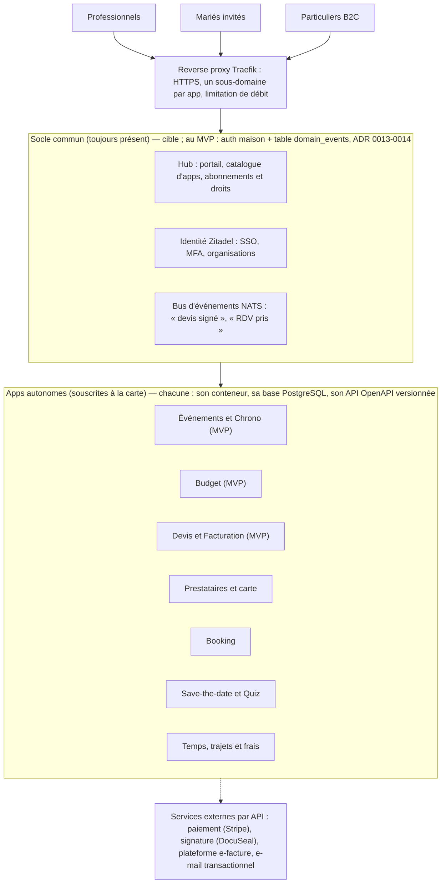
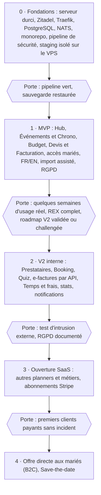

# Cahier des charges — Symbola, suite applicative pour l'événementiel

25 octobre 2026 · Julien

## 1. Vision et principes

Symbola est une suite d'applications SaaS : un hub central donne accès à des apps métier qui fonctionnent seules ou ensemble. Le premier client est l'activité de wedding planning, qui remplace aujourd'hui Wedding Plan.

**Cibles, par ordre d'arrivée**

| Cible | Ce qu'elle achète | Conséquence technique |
| --- | --- | --- |
| Wedding planners (dont le compte pilote) | Abonnement au hub + apps choisies | Multi-tenant : données de chaque planner isolées |
| Leurs clients (les mariés) | Rien : invités par le planner | Accès limité à leur événement, 1 compte par personne |
| Futurs mariés en direct (B2C) | Pack \~15 € : rétroplanning, budget, programme du jour J | Inscription et paiement en ligne, sans planner |
| Autres métiers (événementiel, coachs, artisans…) | Apps génériques : Booking, Devis, CRM | Le « mariage » est une couche métier, pas le socle |

**Principes directeurs**

1. **Une app = un produit autonome.** Elle a sa base de données, son déploiement et sa version. Elle tourne même si elle est la seule souscrite.
2. **Les apps se parlent par contrats, jamais par la base de données.** On utilise des API versionnées et des événements. Modifier l'intérieur d'une app ne casse rien ailleurs.
3. **Générique d'abord, métier ensuite.** Booking, Devis, Contacts et Tâches sont génériques. Le vocabulaire « mariage » vient d'un pack métier qui se configure par-dessus. Aucune donnée métier n'est codée en dur : listes, modèles, catalogue et régime de TVA sont des paramètres de chaque organisation.
4. **La sécurité est héritée, pas réinventée.** L'identité, la signature et les paiements reposent sur des briques éprouvées. Le code maison se limite au métier.
5. **Tout est testable automatiquement.** Chaque modification passe une batterie de tests fonctionnels et de sécurité avant d'atteindre la production.
6. **Bilingue dès le départ** (FR / EN), avec une structure prête pour d'autres langues.
7. **Développé avec Claude Code** sur une stack courante et très documentée, pour que l'IA comme un futur développeur s'y retrouvent.

## 2. Architecture de la suite

**Note de trajectoire (2026-10-26, ADR 0011-0014) :** l'architecture ci-dessous décrit la
**cible** — pertinente si un second client ou une équipe justifie l'isolation complète entre
modules. Pour le MVP, un seul développeur à temps partiel construit un **monolithe modulaire** :
une seule app Next.js, une seule base PostgreSQL à schémas logiques, une authentification
maison, des événements internes plutôt que NATS. Les frontières de code (modules, `service.ts`,
schémas RLS) sont posées dès le MVP exactement comme décrit ici, pour que la bascule vers la
cible soit une extraction plutôt qu'une réécriture. Voir `docs/adr/0011` à `0014` pour le détail
et le coût de chaque bascule. Le reste de cette section décrit la cible ; `CLAUDE.md` décrit ce
qu'on construit maintenant.

La suite repose sur un socle commun léger (hub, identité, bus d'événements) et des apps indépendantes, chacune dans son conteneur avec sa propre base. Tout tient sur le VPS Contabo : production et staging y tournent côte à côte, isolés (bases, sous-domaines et secrets distincts). Aucun autre serveur, aucun système de secours.

Un utilisateur se connecte une fois (SSO) et ne voit que les apps souscrites par son organisation.

**Stack recommandée (cible)** — voir plus haut : pour le MVP, remplacer les lignes « App »,
« Base de données », « Identité » et « Événements » par la colonne MVP de `CLAUDE.md` (ADR
0011-0014). Le reste de ce tableau s'applique dès le MVP.

| Brique | Choix (cible) | Pourquoi |
| --- | --- | --- |
| Langage | TypeScript partout | Un seul langage front et back, très bien maîtrisé par Claude Code |
| App (UI + API) | Next.js par app, en PWA installable sur mobile, + ORM Drizzle | Une app = un dépôt de code lisible, déployable seul — *au MVP : une seule app, modules internes (ADR 0011)* |
| Design commun | Paquet partagé (shadcn/ui + Tailwind) | Même look dans toutes les apps sans les coupler |
| Base de données | PostgreSQL, une base et un utilisateur par app | Une app ne peut pas lire les données d'une autre — *au MVP : une seule base, schémas logiques + RLS (ADR 0012)* |
| Identité | Zitadel (OIDC), alternative Keycloak | Multi-tenant natif par organisation, MFA, pages de connexion personnalisables — *au MVP : authentification maison (ADR 0013)* |
| Événements | NATS JetStream | Bus léger : une app publie, les autres s'abonnent si elles sont là — *au MVP : table `domain_events` (ADR 0014)* |
| Proxy | Traefik | HTTPS automatique, routage par sous-domaine |
| Fichiers | Stockage objet S3 (MinIO ou externe) | Plaquettes, RIB, devis signés hors du disque applicatif |
| Dépôt et CI | Monorepo pnpm + Turborepo, GitHub Actions | Code partagé au même endroit, mais build et image séparés par app |
| Déploiement | Docker Compose, un fichier par app | Redémarrer une app ne touche pas les autres — *au MVP : un seul fichier socle + app (ADR 0011)* |

**Règles de communication entre apps**

- **Lecture directe** : une app appelle l'API publique d'une autre, toujours une version explicite (`/v1/...`). Exemple : Devis lit la liste des Prestataires.
- **Réaction à un fait** : une app publie un événement, les autres réagissent. Exemples : `booking.rdv.cree` crée un prospect dans Événements ; `devis.signe` ouvre le budget.
- **Autonomie** : les droits de l'utilisateur listent les apps souscrites. Une fonction qui dépend d'une app absente est masquée, jamais en erreur.
- **Évolution** : une v2 d'API cohabite avec la v1 pendant la transition. Des tests de contrat en CI bloquent tout changement qui casserait un appelant.

**Multi-tenant** : chaque client professionnel est une organisation (dans l'authentification maison au MVP, dans Zitadel si la cible est activée — ADR 0013). Chaque ligne en base porte l'identifiant de l'organisation, et PostgreSQL filtre lui-même les lignes (Row-Level Security). Une erreur de code ne peut donc pas montrer les données d'un autre planner.

**Capacité du VPS** : socle et 6 apps tiennent en quelques Go de RAM (estimation à confirmer en test). Les 300 Go de disque suffisent pour les bases ; au départ, fichiers (MinIO) et sauvegardes restent sur le VPS. Les sauvegardes sont chiffrées (restic) et rangées dans un dossier séparé des données. Risque accepté : une panne totale du VPS ferait tout perdre. Une copie externe sera ajoutée plus tard, avant l'ouverture à d'autres clients.

## 3. Sécurité et maintenabilité

La sécurité tient en trois choses : des briques éprouvées pour les parties sensibles, une checklist reconnue, et des tests automatiques qui bloquent une mise en production. Aucune de ces trois choses ne demande d'être expert.

**Référentiel** : [OWASP ASVS](https://owasp.org/www-project-application-security-verification-standard/) niveau 2 sert de checklist pour chaque app, et l'OWASP Top 10 de liste des risques prioritaires. Le RGPD s'applique dès qu'il y a des données de mariés.

**Tests automatiques (pipeline CI)**

| Test | Outil (gratuit) | Quand | Ce qu'il attrape |
| --- | --- | --- | --- |
| Isolation entre clients | Tests maison : « un utilisateur de l'organisation A lit B » | Chaque modification | Fuite de données entre planners (le risque n°1 d'un SaaS) |
| Analyse du code | Semgrep | Chaque modification | Injections, failles XSS, mauvais usages connus |
| Secrets oubliés | Gitleaks | Chaque commit | Mots de passe et clés d'API poussés dans git |
| Dépendances | Renovate + OSV-Scanner | Quotidien | Bibliothèques avec failles publiées |
| Images Docker | Trivy | Chaque build | Paquets système vulnérables, mauvaise config |
| Contrats d'API | Tests de schéma OpenAPI | Chaque modification | Changement qui casserait une autre app |
| Attaque de l'app en marche | OWASP ZAP (rapide puis complet) | Chaque déploiement en staging, complet chaque semaine | Failles visibles de l'extérieur |
| Configuration HTTPS | testssl.sh + en-têtes de sécurité | Mensuel | TLS faible, en-têtes manquants |
| Audit relu par IA | Claude (audit statique) | Chaque version | Logique métier : droits, accès mariés, paiements |

Une alerte critique bloque le déploiement. Les alertes mineures vont dans un ticket.

**Mesures intégrées dès la conception**

- Aucune app ne gère de mot de passe : tout passe par Zitadel. Double authentification obligatoire pour les professionnels.
- Cloisonnement : Row-Level Security PostgreSQL, une base par app, droits minimaux.
- Fichiers (RIB, plaquettes) : stockage objet privé, liens à durée limitée, antivirus (ClamAV) à l'envoi.
- Journal d'audit : qui a vu ou modifié quoi, surtout sur les devis et paiements.
- Sauvegardes chiffrées quotidiennes, test de restauration chaque mois. Elles restent sur le VPS au démarrage ; une copie externe s'ajoutera avant l'ouverture à d'autres clients.
- Serveur : connexion SSH par clé uniquement, pare-feu (ports 80 et 443 seulement), CrowdSec, mises à jour automatiques, conteneurs non-root.
- RGPD : hébergement dans l'UE et module dédié aux droits des personnes (section 6).

**Maintenance sans effet de bord**

1. Chaque app a son numéro de version et son image Docker. On déploie une app à la fois.
2. Tout passe d'abord sur le staging (sur le VPS, isolé de la production), avec des données fictives, puis en production.
3. Retour arrière = relancer l'image précédente, en moins d'une minute.
4. Les migrations de base sont réversibles et ne touchent que la base de l'app concernée.
5. Avant d'ouvrir la suite à d'autres planners : un test d'intrusion réalisé par un prestataire externe.

## 4. Reverse engineering des solutions existantes

On ne copie pas ces outils. On garde ce qui est vraiment utilisé, on corrige ce qui manque, et on ne développe pas ce que les autres font mieux.

| Solution | Ce qu'on reprend | Ce qu'on fait mieux ou qu'on évite | App concernée |
| --- | --- | --- | --- |
| Wedding Plan (outil actuel) | Liste des événements comme porte d'entrée, chronologie, budget, catalogue de tarifs, signature des devis avec alerte e-mail, simulation de répartition du budget d'un prospect | On retire les menus inutilisés (Agence, e-mail interne, Documents). On ajoute un vrai tableau de bord, le statut par poste prestataire et la trésorerie à venir | Événements, Budget, Devis |
| [Aisle Planner](https://us.fitgap.com/products/aisle-planner) | Timeline visuelle, budget visible par les mariés, portail client, coordination des prestataires, mood boards | Plans de salle et plans de table : plus tard. Interface anglophone et coûteuse : on vise FR/EN et simple | Événements, Prestataires, Quiz |
| HoneyBook / Dubsado (CRM créatifs) | Pipeline de prospects, propositions avec signature et paiement, automatisations (« devis signé → facture d'acompte ») | Ces outils sont génériques et pas faits pour le jour J. Chez nous, l'automatisation passe par le bus d'événements | Devis, Hub |
| [TidyCal](https://www.jotform.com/blog/tidycal-vs-calendly/) | Types de RDV, RDV payants (Stripe/PayPal), rappels e-mail, sync Google/Apple/Office 365, Zoom/Meet | Pas d'automatisation avancée chez TidyCal. Chez nous, un RDV pris peut créer directement un prospect | Booking |
| [Calendly](https://www.jotform.com/blog/tidycal-vs-calendly/) | RDV collectifs et « round robin », rappels SMS, webhooks | 100+ intégrations : inutile au début, on expose des webhooks | Booking |
| [Cal.com](https://www.sourcepulse.org/projects/586523) | Modèle de données et ergonomie de référence pour le booking open source | Le cœur est sous licence AGPLv3 et les fonctions organisations, SSO et paiements sont payantes : mauvais socle pour un SaaS multi-tenant. On s'en inspire, on ne l'intègre pas | Booking |
| DocuSeal / Documenso / Yousign | Signature électronique (DocuSeal et Documenso open source, Yousign français et conforme eIDAS) | On ne développe jamais sa propre signature. Choix à faire selon la valeur légale voulue | Devis |
| Plateformes agréées de facturation électronique | Transmission des factures au format légal | La suite n'en devient pas une : elle s'y connecte par API. La réception est obligatoire depuis le 1er septembre 2026, l'émission le sera pour les PME et micro-entreprises le 1er septembre 2027 ([source](https://www.b2brouter.net/fr/facture-electronique-calendrier/)) | Devis |
| Typeform / Tally | Quiz pas à pas, logique conditionnelle | Le résultat du quiz déco alimente directement la fiche de l'événement | Quiz |
| Sites de save-the-date (Zola, Paperless Post…) | Modèles soignés, page publique, réponses des invités | Une option payante que le planner propose à ses mariés | Save-the-date |

HoneyBook, Dubsado, Zola et Paperless Post sont décrits de mémoire. Les autres lignes s'appuient sur les pages citées.

## 5. Catalogue des apps et user stories

Voici 9 apps, la brique d'import (5.9) et 76 user stories, chacune avec une priorité : **MVP** (remplace Wedding Plan), **V2** (avant l'ouverture à d'autres planners) ou **Plus tard**. Les critères d'acceptation seront rédigés app par app, au moment de la développer.

**Personas** : **Planner** (professionnelle abonnée), **Marié** (invité par le planner, 1 compte par personne), **Couple B2C** (sans planner), **Pro** (autre métier, utilise une app générique), **Admin** (Julien, opérateur de la suite).

### 5.1 Hub (socle)

| ID | User story | Priorité |
| --- | --- | --- |
| HUB-01 | En tant que Planner, je me connecte une seule fois (avec double authentification) et je vois les apps que j'ai souscrites | MVP |
| HUB-02 | En tant que Planner, j'ai un tableau de bord avec le calendrier annuel des week-ends pris, les tâches à échéance et les encaissements à venir ; chaque bloc vient de l'app concernée et n'apparaît que si elle est souscrite | MVP |
| HUB-03 | En tant qu'Admin, je crée une organisation cliente, j'active ses apps et je vois l'état de santé de chaque app | MVP |
| HUB-04 | En tant qu'utilisateur, je choisis ma langue (FR / EN) | MVP |
| HUB-05 | En tant que Planner, je souscris ou résilie une app à la carte et je paie par carte | V2 |
| HUB-06 | En tant que Planner, j'invite des collaborateurs avec un rôle (admin, membre, lecture seule) | V2 |
| HUB-07 | En tant que Planner, je mets mon logo et mes couleurs, visibles par mes mariés | V2 |
| HUB-08 | En tant que Planner, je reçois au même endroit les notifications de toutes mes apps (devis signé, RDV pris…) | V2 |
| HUB-09 | En tant que Planner, j'exporte ou je supprime toutes les données d'un client (RGPD) | V2 |
| HUB-10 | En tant que Planner, je vois mes statistiques : source des prospects, devis signés vs réalisés, motifs de refus | V2 |

### 5.2 Événements et Chrono

| ID | User story | Priorité |
| --- | --- | --- |
| EVT-01 | En tant que Planner, je vois la liste de mes événements triée par date, avec les prénoms et le lieu | MVP |
| EVT-02 | En tant que Planner, je fais avancer un événement dans ses étapes : prospect, devis envoyé, confirmé, réalisé, ou perdu avec un motif | MVP |
| EVT-03 | En tant que Planner, je vois sur la fiche de l'événement le statut de chaque poste prestataire : à trouver, devis demandé, devis reçu, réservé | MVP |
| EVT-04 | En tant que Planner, je génère un rétroplanning depuis un modèle (J-12 mois, J-6 mois…) et j'ajuste les tâches et leurs échéances | MVP |
| EVT-05 | En tant que Planner, je construis le programme du jour J heure par heure et je l'exporte en PDF pour les prestataires | MVP |
| EVT-06 | En tant que Marié, j'ai mon propre accès : je vois le rétroplanning, mes tâches et le programme du jour J | MVP |
| EVT-07 | En tant que Planner, je note la source de chaque prospect (Instagram, bouche-à-oreille, salon…) | MVP |
| EVT-08 | En tant que Planner, je duplique un événement passé comme modèle | V2 |
| EVT-09 | En tant que Couple B2C, je crée mon rétroplanning et mon programme du jour J sans planner | Plus tard |

### 5.3 Budget

| ID | User story | Priorité |
| --- | --- | --- |
| BUD-01 | En tant que Planner, je simule la répartition du budget d'un prospect par type de prestataire, à partir de pourcentages modèles | MVP |
| BUD-02 | En tant que Planner, je suis le budget prévu, réel et l'écart, par poste et au total | MVP |
| BUD-03 | En tant que Planner, je joins le devis validé d'un prestataire à sa ligne de budget | MVP |
| BUD-04 | En tant que Marié, je consulte le budget, en lecture seule | MVP |
| BUD-05 | En tant que Planner, je vois l'échéancier des paiements prestataires que les mariés doivent régler | V2 |
| BUD-06 | En tant que Couple B2C, je suis mon budget seul | Plus tard |

### 5.4 Devis et Facturation

| ID | User story | Priorité |
| --- | --- | --- |
| DEV-01 | En tant que Planner, je compose un devis en choisissant des lignes dans mon catalogue de tarifs | MVP |
| DEV-02 | En tant que Marié, je signe le devis en ligne ; le planner reçoit une alerte par e-mail | MVP |
| DEV-03 | En tant que Planner, je fixe les dates d'acompte dans le devis et je vois mes encaissements à venir par date | MVP |
| DEV-04 | En tant que Planner, j'émets mes factures d'acompte et de solde au format électronique légal (Factur-X), à déposer sur ma plateforme agréée ; envoi automatique par API dès qu'une plateforme le permet | MVP (API : V2, avant sept. 2027) |
| DEV-05 | En tant que Pro, j'envoie un devis à un simple contact, sans l'app Événements | V2 |
| DEV-06 | En tant que Marié, je paie mon acompte en ligne | Plus tard |

### 5.5 Prestataires et carte interactive

L'app Prestataires est le référentiel de la planner. Elle a trois volets : des fiches dont les champs dépendent du type de prestataire, l'historique des prestations réalisées avec leurs prix exacts, et une carte interactive pour filtrer, chercher autour d'un lieu et estimer les trajets.

**Champs paramétrables par type** : la planner crée ses types et leurs champs (nombre, texte, heure, montant, liste de choix, oui/non) et choisit lesquels servent de filtres. Les coordonnées sont communes à tous les types et ne servent pas de filtre. Exemples de départ, modifiables :

| Type | Champs proposés |
| --- | --- |
| Lieu de réception | Capacité assise et debout, nombre de couchages, heure de fin de soirée imposée (bruit), tarif de location, traiteur imposé ou libre, repli en cas de pluie, parking, accessibilité PMR |
| Hôtel / hébergement | Nombre de chambres et de couchages, tarif par nuit, petit-déjeuner, navette possible |
| Traiteur | Prix par couvert, type de cuisine, régimes gérés, service inclus |
| Photographe, vidéaste, DJ, fleuriste… | Tarif de base, styles, zone d'intervention en km, frais de déplacement |

| ID | User story | Priorité |
| --- | --- | --- |
| PRE-01 | En tant que Planner, je tiens une fiche par prestataire : coordonnées, plaquettes, RIB (chiffré), tags, note interne | V2 |
| PRE-02 | En tant que Planner, je crée mes types de prestataires et leurs champs, et je choisis ceux qui servent de filtres | V2 |
| PRE-03 | En tant que Planner, l'adresse saisie est placée automatiquement sur la carte ; je peux corriger le point à la main | V2 |
| PRE-04 | En tant que Planner, je vois mes prestataires sur une carte, avec une couleur par type et un regroupement quand ils sont nombreux. La liste à côté suit ce qui est affiché | V2 |
| PRE-05 | En tant que Planner, je combine des filtres : type, champs paramétrés (couchages ≥ 50, fin de soirée ≥ 2 h, tarif ≤ X), tags, « déjà travaillé avec » | V2 |
| PRE-06 | En tant que Planner, je choisis un lieu existant ou un point sur la carte, je trace un cercle de N km, et la liste se trie par distance au centre | V2 |
| PRE-07 | En tant que Planner, j'estime la distance et la durée de trajet entre deux points, ou du lieu central vers tous les résultats (ex. lieu vers hôtels) | V2 |
| PRE-08 | En tant que Planner, je vois la zone accessible en N minutes de voiture autour d'un lieu (isochrone) | Plus tard |
| PRE-09 | En tant que Planner, j'ouvre la fiche d'un prestataire et je vois toutes les prestations réalisées avec lui : événement, date, prestation, prix devisé et prix final | V2 |
| PRE-10 | En tant que Planner, j'ajoute un prestataire de la carte à la présélection d'un poste d'événement ; sans cette app, le poste reste un champ texte | V2 |
| PRE-11 | En tant que Planner, j'exporte une sélection (PDF ou CSV) pour la proposer aux mariés | V2 |
| PRE-12 | En tant que Planner, je partage aux mariés une carte en lecture seule (ex. hôtels autour du lieu pour les invités) | Plus tard |
| PRE-13 | En tant que Planner, j'affiche aussi sur la carte les lieux de mes événements passés et à venir | Plus tard |

**Historique et prix exacts** : quand une ligne de budget ou de devis est rattachée à un prestataire, le prix est figé à la date de la prestation. La fiche affiche cet historique et le prix moyen pratiqué. Sans les apps Budget ou Devis, la planner saisit l'historique à la main.

**Choix techniques (sans service payant)**

| Besoin | Solution | Remarque |
| --- | --- | --- |
| Fond de carte | MapLibre GL + fichier de tuiles Protomaps (PMTiles) limité à la zone utile, servi par le VPS | Pas d'abonnement à Google Maps ou Mapbox ; taille du fichier à mesurer, compatible avec les 300 Go |
| Adresse vers point (géocodage) | [API Géocodage de la Géoplateforme IGN](https://www.data.gouv.fr/posts/lapi-adresse-de-la-base-adresse-nationale-est-transferee-a-lign-10), qui remplace l'API Adresse | France uniquement ; pour l'étranger, Photon/Nominatim (OpenStreetMap) |
| Cercle, distance, filtres | PostGIS (extension PostgreSQL) | Recherche « à moins de N km » faite par la base, rapide même avec beaucoup de fiches |
| Estimation de trajet (V2) | Distance à vol d'oiseau × coefficient de détour, ÷ vitesse moyenne | Gratuit, instantané, volontairement approximatif ; affiché « estimation » |
| Trajet réel et isochrones (plus tard) | Moteur de calcul d'itinéraire auto-hébergé sur les données OpenStreetMap (Valhalla ou GraphHopper, qui gèrent les isochrones) | Mémoire et disque à mesurer d'abord, sur un poste de dev |

### 5.6 Booking (façon TidyCal)

| ID | User story | Priorité |
| --- | --- | --- |
| BOO-01 | En tant que Pro, je crée des types de RDV : durée, visio ou sur place, questions à poser | V2 |
| BOO-02 | En tant que Pro, je synchronise mon agenda Google ou Outlook pour éviter les doubles réservations | V2 |
| BOO-03 | En tant que visiteur, je réserve sur une page publique aux couleurs du pro, puis j'annule ou je déplace moi-même | V2 |
| BOO-04 | En tant que visiteur, je reçois une confirmation et des rappels par e-mail | V2 |
| BOO-05 | En tant que Planner, un RDV pris crée automatiquement un prospect si j'ai l'app Événements | V2 |
| BOO-06 | En tant que Pro, je fais payer un RDV à la réservation | Plus tard |
| BOO-07 | En tant qu'équipe, on répartit les RDV entre plusieurs personnes (round robin) | Plus tard |

### 5.7 Quiz déco

| ID | User story | Priorité |
| --- | --- | --- |
| QUI-01 | En tant que Planner, je construis un quiz en images avec des choix multiples | V2 |
| QUI-02 | En tant que Marié, je réponds au quiz et j'obtiens mon profil déco avec une planche d'inspiration | V2 |
| QUI-03 | En tant que Planner, le résultat s'attache à la fiche de l'événement | V2 |
| QUI-04 | En tant que visiteur du site de la planner, je fais le quiz et je laisse mes coordonnées, ce qui crée un prospect | V2 |

### 5.8 Save-the-date

| ID | User story | Priorité |
| --- | --- | --- |
| STD-01 | En tant que Marié, je crée un save-the-date numérique soigné à partir de modèles | Plus tard |
| STD-02 | En tant que Marié, je partage une page publique et je collecte les réponses des invités | Plus tard |
| STD-03 | En tant que Planner, j'active cette option payante pour un couple | Plus tard |

### 5.9 Import de données (brique du socle)

L'import est une brique commune : le hub fournit l'écran, et chaque app reçoit ses lignes par son API. Il sert pour Wedding Plan aujourd'hui, et demain pour tout client qui arrive d'un autre outil.

| ID | User story | Priorité |
| --- | --- | --- |
| IMP-01 | En tant que Planner, j'importe un fichier CSV, Excel ou JSON ; l'encodage et le séparateur sont détectés seuls | MVP |
| IMP-02 | En tant que Planner, l'outil reconnaît les colonnes (par leur nom et leur contenu) et me propose une correspondance que je valide ou corrige | MVP |
| IMP-03 | En tant que Planner, l'outil me propose les rapprochements avec mes données existantes (même couple, même prestataire) ; je les valide un par un ou en lot, et j'en ajoute à la main | MVP |
| IMP-04 | En tant que Planner, je vois un rapport des écarts : colonnes sans équivalent (gardées en « champs libres » ou ignorées, à mon choix) et lignes rejetées avec leur motif | MVP |
| IMP-05 | En tant que Planner, je vois un aperçu avant d'importer et je peux annuler un import entier après coup | MVP |
| IMP-06 | En tant que Planner, je réutilise un modèle de correspondance enregistré (« Export Wedding Plan », « Export Excel maison ») | V2 |
| IMP-07 | En tant que Pro, j'importe aussi mes contacts, prestataires et catalogue de tarifs | V2 |

Sécurité de l'import : fichiers analysés par l'antivirus, taille limitée, et neutralisation des formules dans les cellules (injection CSV).

### 5.10 Temps, trajets et frais

Cette app mesure ce que coûte réellement chaque client ou prospect : heures passées, kilomètres et dépenses. Ces chiffres nourrissent la révision annuelle des tarifs. Une tâche hebdomadaire, désactivable, fait la saisie en quelques minutes.

| ID | User story | Priorité |
| --- | --- | --- |
| TPS-01 | En tant que Planner, je saisis un temps passé sur un événement ou un prospect, au quart d'heure près, avec une catégorie (RDV, visite de lieu, préparation, administratif, jour J) | V2 |
| TPS-02 | En tant que Planner, je saisis un trajet : départ et arrivée choisis parmi mes adresses, les prestataires ou le lieu de l'événement, aller-retour ou non. La distance est calculée automatiquement et reste modifiable | V2 |
| TPS-03 | En tant que Planner, les frais kilométriques sont calculés selon mon véhicule (puissance fiscale, thermique ou électrique) et le barème en vigueur | V2 |
| TPS-04 | En tant que Planner, je saisis une dépense avec la photo du justificatif (péage, parking, repas, achat déco) | V2 |
| TPS-05 | En tant que Planner, je coche « refacturable » sur un trajet ou une dépense : il apparaît comme ligne de frais sur la prochaine facture du client si j'ai l'app Devis, sinon dans un export | V2 |
| TPS-06 | En tant que Planner, une tâche « Mes temps de la semaine » est créée chaque semaine, le jour de mon choix ; je peux la désactiver | V2 |
| TPS-07 | En tant que Planner, cette tâche ouvre un questionnaire qui liste les événements et prospects des semaines et mois à venir, plus ceux de la semaine écoulée. Il est pré-rempli avec mes RDV et visites connus. Je complète ou je réponds « rien cette semaine » en un clic | V2 |
| TPS-08 | En tant que Planner, je fixe la valeur de mon heure et mon coût kilométrique, et je vois par événement : chiffre d'affaires signé, temps valorisé, frais, marge | V2 |
| TPS-09 | En tant que Planner, je vois ce que m'ont coûté les prospects non signés (temps et frais), par source de prospect | V2 |
| TPS-10 | En tant que Planner, ma revue annuelle montre les heures moyennes par type de prestation et le coût réel comparé au prix facturé, pour réviser mes tarifs | Plus tard |
| TPS-11 | En tant que Planner, je lance un chronomètre depuis mon téléphone pendant un RDV | Plus tard |

**Règles de calcul**

- Le barème kilométrique fiscal est stocké comme paramètre et mis à jour chaque année. Celui de 2026 est identique à ceux de 2023 à 2025 : par exemple, 0,636 €/km pour une voiture thermique de 5 CV jusqu'à 5 000 km par an ([source](https://www.moneyvox.fr/impot/actualites/108318/impots-2026-le-bareme-kilometrique-est-gele-pour-la-3eme-annee-consecutive)).
- Le barème est dégressif sur le kilométrage annuel. On utilise donc deux taux : un **taux de refacturation** fixe par km, choisi par la planner et inscrit dans ses conditions de vente (par défaut, le premier taux du barème pour son véhicule) ; et le **calcul annuel exact** du barème pour valoriser son coût réel.
- La distance vient du service de cartographie de l'app Prestataires (estimation, puis itinéraire réel plus tard). Sans cette app, la planner saisit les kilomètres.
- Point à valider avec un comptable : en micro-entreprise, les frais refacturés entrent normalement dans le chiffre d'affaires (et dans la TVA si elle y est assujettie), sauf vrais débours.
- Justificatifs : conservés 10 ans, comme les pièces comptables (section 6).

**Autonomie** : seule, l'app fonctionne avec une simple liste de dossiers. Elle s'enrichit si d'autres apps sont souscrites : Événements (liste des mariages à venir), Prestataires (adresses et distances), Devis (refacturation), Booking (RDV pré-remplis), Hub (tâche hebdomadaire).

### 5.11 Onboarding et aide intégrée (socle, MVP)

Un questionnaire d'entrée règle l'organisation : identité, régime de TVA, métier, et pour chaque liste ou modèle le choix entre un modèle de départ, zéro ou un import. Chaque module a une visite guidée, une aide contextuelle et un essai sur des données de test, effacées automatiquement ensuite. Le détail (ONB-01, ONB-02, AIDE-01 à AIDE-04) est dans le PRD du MVP.

## 6. Conformité RGPD : module « Données personnelles »

Le RGPD est géré par le socle, pas app par app. Chaque app déclare ses données personnelles. Le hub trouve une personne partout, traite ses demandes et purge ce qui a dépassé sa durée de conservation. Les statistiques sont gardées grâce à l'anonymisation.

**Rôles**

| Rôle | Qui | Droits dans le module |
| --- | --- | --- |
| Responsable de traitement | Le titulaire du compte (souvent l'auto-entrepreneur) | Tout, tant qu'aucun DPO n'est désigné |
| DPO (optionnel) | Désigné par le titulaire | Lister les données et interactions d'une personne, exporter, rectifier, anonymiser, supprimer, valider les purges, tenir le registre |
| Collaborateur | Membre de l'organisation | Aucun accès au module ; peut transmettre une demande reçue |
| Opérateur de la suite | Julien (sous-traitant au sens du RGPD) | Aucun accès aux données clients par défaut ; maintient les règles et l'outil |

**Durées de conservation appliquées par défaut** (règles modifiables par le titulaire, à faire valider par un juriste avant l'ouverture SaaS)

| Données | En base active | Ensuite | Fondement |
| --- | --- | --- | --- |
| Prospect sans suite | 3 ans après le dernier contact venant du prospect (ouvrir un e-mail ne compte pas) | Demande d'accord ; sans réponse positive, anonymisation | [Référentiel CNIL gestion commerciale](https://Cnil.fr/sites/cnil/files/atoms/files/referentiel_traitements-donnees-caractere-personnel_gestion-activites-commerciales.pdf) |
| Client (mariés) | Durée de la relation, jusqu'au solde de la prestation | Archivage intermédiaire à accès restreint ; prospection possible 3 ans après la fin de la relation | Référentiel CNIL |
| Factures et pièces comptables | Durée de la relation | Archivage 10 ans, puis anonymisation | Obligation comptable citée par la CNIL |
| Devis signés et contrats | Durée de la relation | Archivage le temps de la prescription applicable, puis anonymisation | Référentiel CNIL (preuve) ; durée exacte à confirmer par un juriste |
| Compte d'accès des mariés inactif | 2 ans sans connexion, avec un avertissement avant | Suppression du compte | Référentiel CNIL |
| Pièce d'identité fournie pour une demande de droits | Jusqu'au traitement de la demande | Suppression | Référentiel CNIL |
| Demande d'exercice de droits | Jusqu'à son traitement | Réponse gardée comme preuve pendant la prescription | Référentiel CNIL |

Le critère que tu proposais (« plus de 3 ans sans interaction ») correspond aux prospects. Pour un client, les 3 ans courent à partir de la fin de la relation, et les factures restent 10 ans quoi qu'il arrive. Une demande d'oubli ne peut donc pas effacer une facture : elle est archivée à accès restreint, puis anonymisée à l'échéance.

**Traitement d'une demande** (réponse sous 1 mois, prolongeable de 2 mois si la demande est complexe)

1. La demande est enregistrée : formulaire public, espace marié ou saisie par le titulaire. L'échéance s'affiche aussitôt.
2. Recherche transverse : le hub interroge chaque app souscrite par e-mail, téléphone et nom. Il affiche toutes les données et interactions de la personne (événements, budgets, devis, RDV, quiz, échanges).
3. Selon le droit exercé : export lisible (PDF) et réutilisable (JSON/CSV) pour l'accès et la portabilité, correction pour la rectification.
4. Pour l'oubli, un aperçu classe chaque donnée : **supprimée**, **anonymisée** ou **conservée**, avec le motif légal et la date de fin de conservation.
5. Le titulaire ou le DPO valide. Chaque app exécute sa part et renvoie un accusé.
6. Une preuve horodatée est générée, avec un modèle de réponse à envoyer à la personne.

**Purge automatique** : chaque mois, le module liste les personnes dont la durée est échue. Le titulaire ou le DPO valide la liste en un clic, ou exclut une ligne avec un motif. Rien n'est supprimé sans validation humaine.

**Anonymiser sans perdre les statistiques**

- **Supprimé** : nom, prénoms, e-mail, téléphone, adresse, notes en texte libre, pièces jointes, commentaires du quiz.
- **Généralisé** : date du mariage ramenée au mois, lieu ramené au département, budget ramené à une tranche.
- **Gardé** : source du prospect, statut (signé, refusé, réalisé), motif de refus (catégorie), types de prestataires, montants pour les totaux.
- **Contrôle** : une anonymisation n'est valable que si on ne peut plus isoler une personne, relier ses données ni en déduire des informations ([les 3 critères](https://www.donneespersonnelles.fr/pseudonymisation-anonymisation-rgpd)). Le module refuse d'afficher une statistique quand un groupe compte trop peu d'événements (seuil à fixer). Remplacer le nom par un code ne suffit pas : c'est une pseudonymisation, toujours soumise au RGPD.

**Côté technique**

- Chaque app publie un « registre de données » : pour chaque champ personnel, sa catégorie, sa règle de conservation et sa règle d'anonymisation. La CI bloque tout nouveau champ personnel non déclaré.
- Chaque app implémente le même contrat `privacy/v1` : rechercher, exporter, anonymiser, supprimer une personne.
- Les sauvegardes contiennent encore les données effacées jusqu'à leur rotation. La durée de rétention des sauvegardes est fixée et documentée.
- Le registre des traitements du titulaire est pré-rempli à partir des registres de données des apps souscrites.

**User stories**

| ID | User story | Priorité |
| --- | --- | --- |
| RGPD-01 | En tant que titulaire ou DPO, je cherche une personne et je vois toutes ses données et interactions dans toutes mes apps | MVP |
| RGPD-02 | En tant que titulaire ou DPO, j'exporte ces données en PDF et en JSON/CSV (droits d'accès et de portabilité) | MVP |
| RGPD-03 | En tant que titulaire ou DPO, je traite une demande d'oubli avec l'aperçu supprimé / anonymisé / conservé et son motif, puis j'obtiens une preuve | MVP |
| RGPD-04 | En tant que titulaire ou DPO, je suis mes demandes en cours et leur échéance légale | MVP |
| RGPD-05 | En tant que titulaire ou DPO, je valide chaque mois la liste des personnes à purger | MVP |
| RGPD-06 | En tant qu'Admin, la CI refuse tout champ personnel non déclaré dans le registre de l'app | MVP |
| RGPD-07 | En tant que titulaire, je désigne un DPO qui obtient les droits du module | V2 |
| RGPD-08 | En tant que Marié ou prospect, je fais ma demande depuis mon espace ou un formulaire public | V2 |
| RGPD-09 | En tant que titulaire, j'obtiens un registre des traitements pré-rempli | V2 |

## 7. Empreinte numérique (transverse)

L'empreinte carbone numérique de la plateforme est gérée par le socle, pas app par app — même logique que le RGPD (section 6). Périmètre : l'empreinte de Symbola elle-même (serveur, stockage, requêtes), pas celle des événements organisés par les clientes (hors périmètre).

**Méthodologie (ADR 0017)**

- Cadre de calcul : SCI (*Software Carbon Intensity*, norme ISO/IEC 21031:2024, Green Software Foundation) — `SCI = ((E × I) + M) / R`.
- E (énergie) et M (empreinte matérielle incorporée) : méthodologie ouverte Boavizta, à partir des caractéristiques du VPS Contabo.
- I (intensité carbone du réseau électrique) : valeur publiée et sourcée, figée pour l'année — jamais une API temps réel. VPS Contabo au Luxembourg : méthode consommation (imports inclus, ≈ 300 gCO2eq/kWh), jamais la seule production domestique luxembourgeoise (≈ 123 gCO2eq/kWh, trompeuse) — détail complet et sources dans l'ADR 0017. Revue annuelle.
- Allocation par organisation : compteurs d'usage légers (requêtes, octets de réponse) captés une seule fois au niveau de la requête HTTP, pas module par module.
- Tous les paramètres (I, hypothèses M, poids d'allocation) sont versionnés dans un fichier de méthodologie, jamais codés en dur (section 5, règle « aucune donnée métier codée en dur »). Un bilan publié est immuable ; une correction passe par une nouvelle version documentée.
- Aucune donnée personnelle dans cette brique : compteurs agrégés par organisation, jamais par personne.

**User stories**

| ID | User story | Priorité |
| --- | --- | --- |
| CARB-01 | En tant que socle, je collecte dès le lot 0 les compteurs d'usage (requêtes, octets) par organisation, pour qu'un historique existe quand le bilan sera construit | MVP (lot 0, SOC-13) |
| CARB-02 | En tant que titulaire, je consulte le bilan carbone mensuel de mon organisation (SCI détaillé, hypothèses affichées) | V2 |
| CARB-03 | En tant que titulaire, j'exporte le bilan annuel en PDF, à présenter à mes clients ou dans un dossier RSE/CSRD | V2 |
| CARB-04 | En tant que visiteur, je consulte une page de méthodologie publique expliquant le calcul et ses hypothèses | V2 |

## 8. MVP, roadmap et questions ouvertes

Le MVP remplace Wedding Plan avec l'import assisté, le module RGPD et quatre briques : Hub, Événements et Chrono, Budget, Devis et Facturation. Il passe d'abord par une phase de fondations, qui installe le socle et la chaîne de sécurité une fois pour toutes.

Les phases ne sont pas datées : la durée dépendra du temps que tu peux y consacrer. Une porte non franchie bloque la phase suivante.

**Passage du MVP à la V2**

1. Ta femme utilise le MVP sur ses événements réels pendant quelques semaines. Les bugs sont corrigés au fil de l'eau, sans attendre.
2. Pendant cette période, elle note ce qui la gêne ou lui manque, dans l'outil ou dans un simple fil de commentaires.
3. À la fin, on fait un REX complet avec elle : ce qui marche, ce qui gêne, ce qu'elle n'utilise pas, ce qui manque.
4. On lui présente ensuite la roadmap V2 de ce document. Elle peut la valider ou la challenger : ajouter, retirer, réordonner.
5. La V2 ne démarre qu'après cet arbitrage. Les priorités « V2 » et « Plus tard » de la section 5 sont donc des propositions, pas des engagements.

**Questions ouvertes (à trancher avant le développement du MVP)**

- [ ] « Chronologie », très utilisée : est-ce le rétroplanning des tâches, le déroulé du jour J, ou les deux ? Réponse : les deux.
- [ ] Les mariés peuvent-ils modifier le budget, ou seulement le consulter ? Consulter.
- [ ] Reprise des données : Wedding Plan permet-il un export (CSV, PDF) ? Combien d'événements en cours faut-il reprendre ? à vérifier, mais ce type de reprise doit être anticipée avec la prise en charge de multiples formats classiques et reconnaissance automatique des colonnes et rapprochement automatique proposé avec validation humaine des rapprochements et rapprochements complémentaires possibles comme l'écart de certaines données en cas d'absence dans notre app.
- [ ] Signature : Yousign (payant, valeur légale eIDAS, français) ou Documenso (gratuit, auto-hébergé) ? Documenso gratuit auto hébergé quel est l'impact majeur ?
- [ ] Facturation électronique : quelle plateforme agréée (celle de la banque ?) et propose-t-elle une API ? Si ma banque le propose oui, on partira la dessus : Crédit Mutuel -> mais pars sur une connexion API à n'importe quelle plateforme PA pour d'autres clients demain.
- [ ] Mobile : un site responsive installable (PWA) suffit-il, ou faut-il une app dans les stores ? On démarre par du PWA (avec une cible selon le nombre de client vers une app dans les stores)
- [ ] Jour J : faut-il un accès au programme hors connexion (lieux sans réseau) ? pourquoi pas mais non prioritaire : le programme sera souvent voir toujours imprimé... donc si c'est lourd à prévoir ou que ça génère des difficultés en terme de sécurité etc... on évite.
- [ ] Commercialisation : quelle structure facture les abonnements SaaS, et avec quelles CGV ? Je n'y ai pas réfléchi : je n'ai rien monté pour le moment, mais si l'app plait à ma femme et que je lui vois un potentiel commercial, je monterai une société pour l'occasion : certainement quelque chose de simple au départ : SAS SASU pour éviter les charges trop importantes.
- [ ] Nom de la suite et nom de domaine. Aide moi à trouver un nom qui ne soit pas déjà utilisé, qui soit simple à retenir et qui permette de souscrire un nom de domaine associé. Il y a déjà Indy pour tous les entrepreneurs, on va se spécialiser dans l'organisation d'évènements dans l'idée, même si les briques sont utilisables par d'autres métiers : on sera plutôt spécialisés sur ce type de métier au départ.
- [ ] Budget mensuel acceptable pour les services externes (e-mail, signature, stockage, sauvegardes). Il faut imaginer qu'un Wedding plan coute 700€ l'année, je ne sais pas combien coute Indy dès qu'on ajoute des solutions en cascade, mais dans l'idée, je veux être moins cher que ces plateformes historiques avec de nombreux collaborateurs... c'est malheureux à dire, mais j'ai l'avantage d'arriver après : donc je veux me positionner moins cher sans être totalement hors course -> donc plutôt 20% moins cher que ces plateformes dans l'idée.

### Réponses aux points soulevés

**Décisions intégrées au document** : chronologie = rétroplanning + jour J (EVT-04, EVT-05) ; budget en lecture seule pour les mariés (BUD-04) ; import multi-format avec validation humaine (5.9) ; PWA d'abord, app dans les stores selon le nombre de clients ; pas de mode hors connexion, le programme s'exporte en PDF pour l'impression ; sauvegardes locales au démarrage ; Devis et Facturation passe dans le MVP.

**Signature : DocuSeal ou Documenso ?**

Les deux sont open source (AGPL-3.0), auto-hébergeables et produisent une signature électronique simple, suffisante pour des devis. Leur différence tient à l'exploitation et à ce qui est gratuit.

| Critère | DocuSeal | Documenso |
| --- | --- | --- |
| Licence | AGPL-3.0, licence commerciale disponible | AGPL-3.0, licence commerciale disponible |
| Technologie | Ruby on Rails | TypeScript / Next.js, la même stack que la suite |
| Exploitation | Un seul conteneur ; SQLite possible pour une petite installation, PostgreSQL ensuite | Plus de composants à faire tourner |
| Éditeur de modèles | Mature : champs de formulaire, plusieurs signataires | Plus limité pour construire des formulaires |
| API et webhooks (auto-hébergé) | Gratuits | API documentée en détail |
| Payant en auto-hébergé | Pro, 240 $ par utilisateur et par an : logo et marque blanche, rappels automatiques, vérification par SMS, envoi en masse, champs conditionnels, SSO, rôles. Signature intégrée (embedding) facturée 0,20 $ par document signé | Édition Enterprise : SSO, journaux d'audit avancés, et utilisation sans publier le code |
| Niveau de signature | Simple et avancée selon la configuration ; qualifiée en option payante, par signature | Certificat PKCS#12 au format PAdES ; simple et avancée possibles |
| Expérience | Tu l'as déjà utilisé et apprécié | À découvrir |
| Étoiles GitHub (sept. 2026) | 18 357 | 14 704 |

**Ce qui compte pour nous** : l'app Devis pilote la signature par API, puis envoie elle-même les e-mails et les rappels. Avec DocuSeal, on n'a donc besoin que de ce qui est gratuit : API, webhooks et modèles. Limite : la page de signature porte la marque DocuSeal, pas celle de la planner, tant qu'on ne prend pas Pro.

**Décision proposée** : DocuSeal pour le MVP. Tu le connais, il est plus léger à exploiter, et ce dont on a besoin est gratuit. Il est branché derrière l'interface « fournisseur de signature » : passer à Documenso ou Yousign plus tard ne touchera pas l'app Devis. À vérifier avant la porte 3 : les conditions de la licence Pro quand un seul DocuSeal sert plusieurs organisations clientes.

Sources : [DocuSeal auto-hébergé](https://www.docuseal.com/on-premises) · [Comparatif WZ-IT](https://wz-it.com/en/blog/documenso-vs-docuseal-comparison/) · [Comparatif Verdocs (concurrent, biais déclaré)](https://verdocs.com/blog/docuseal-vs-documenso) · [Documenso Community Edition](https://docs.documenso.com/docs/policies/community-edition)

**Facturation électronique** : le Crédit Mutuel et le CIC sont plateformes agréées via Euro-Information, avec l'offre HBS e-factures, proposée depuis le 12 février 2026 et intégrée à la banque en ligne ([communiqué](https://www.creditmutuel.fr/fr/alliancefederale/presse/communiques-de-presse/facturation-electronique-des-entreprises.html)). Le communiqué ne mentionne pas d'API. L'app Devis aura donc un connecteur générique, avec un adaptateur par plateforme agréée. Elle produira aussi un fichier Factur-X à déposer à la main dans HBS e-factures, en attendant une API.

**Prix cible** : tu estimes Wedding Plan à environ 700 € par an. Avec 20 % de moins, la suite complète équivalente (Hub, Événements, Budget, Devis, Prestataires) vise environ 560 € par an, soit environ 47 € par mois. Les apps à la carte doivent rester sous ce total une fois cumulées. Les coûts externes par client (e-mail, stockage) doivent rester marginaux, d'où le choix de l'auto-hébergement.

**Commercialisation** : la question est reportée à la porte 3. Une SASU sera créée si le potentiel se confirme. Il faudra alors des CGV et un accord de sous-traitance RGPD (DPA) pour chaque client.

**Nom retenu : Symbola.** Le *symbolon* grec était un objet brisé en deux, dont les moitiés s'emboîtent pour prouver une alliance ou un contrat : des modules qui s'assemblent, et l'alliance du mariage. Il a passé le test de la première cliente. Aucune marque gênante n'a été trouvée à l'INPI. Le Y, ambigu à l'oral, devient la signature du logo (deux branches qui se rejoignent).

- [ ] Acheter symbola.fr (et simbola.app en redirection)
- [ ] Réserver les comptes Instagram et LinkedIn
- [ ] Déposer la marque à l'INPI (classes 9, 35, 42) à la création de la SASU

Les pistes étudiées avant ce choix sont conservées ci-dessous pour mémoire.

**Nom de la suite** : positionnement événementiel, sans enfermer dans le mariage. Les domaines ci-dessous étaient libres le 25 octobre 2026, après vérification RDAP en .com, .fr et .app. Aucune marque n'est apparue à la recherche web.

| Nom | Idée | Domaines libres |
| --- | --- | --- |
| **Regisseo** (recommandé) | Le régisseur orchestre l'événement en coulisses ; la suite est ta « régie ». Parle aux métiers de l'événementiel, pas qu'au mariage | regisseo.com, .fr, .app |
| Coulisso | Les coulisses de tes événements ; doux, facile à retenir | coulisso.com, .fr, .app |
| Entractio | L'entracte, le moment où tout se prépare | entractio.com, .fr, .app |
| Fetello | Fête + sonorité italienne ; se prononce bien en anglais | fetello.com, .fr, .app |
| Regissia | Variante plus douce de Regisseo | regissia.com, .fr, .app |
| Ouiplan | Le « oui » du mariage : très mémorable mais très mariage | ouiplan.fr et .app seulement (.com pris) |

Avant d'acheter un domaine : vérifier la marque sur [data.inpi.fr](https://data.inpi.fr) et l'EUIPO (classes 9, 35 et 42). Les domaines peuvent être pris à tout moment.

**Deuxième piste : noms issus de langues anciennes** (univers « bijou, détail invisible, assemblage »). Domaines vérifiés le 25 octobre 2026.

| Nom | Histoire | .fr | Verdict |
| --- | --- | --- | --- |
| **Harmos** | Grec « harmos » : la jointure qui assemble deux pièces. C'est la racine d'« harmonie » : des modules qui s'emboîtent et un événement réussi | Libre (.app pris) | À écarter : une SASU HARMOS édite déjà des logiciels (APE 5829C, Nord). Une dénomination sociale antérieure dans la même activité peut s'opposer à notre marque |
| Aurifex | Latin : l'orfèvre, artisan du détail qui assemble les pièces précieuses | Libre (.app pris) | Très « bijou », un peu plus difficile à dire. Nom commercial « Thomas Aurifex » déjà utilisé par un joaillier : autre secteur, mais même univers |
| Amatl | Papier végétal des Aztèques, utilisé pour les calendriers et les comptes | Libre (+ .app) | Belle histoire, mais le « tl » final se dicte mal |
| Kosmion | Dérivé du grec « kosmos », qui veut dire à la fois l'ordre et la parure | Libre (+ .app) | À tester avant de trancher : à l'oral, K ou C est ambigu, et cosmion.fr appartient à quelqu'un d'autre ; l'association avec la cosmétique est réelle. Une seule société KOSMION, dans l'immobilier (Lisieux), donc hors de notre secteur. Joli double sens, nom inventé donc plus facile à protéger |
| Kemet | Égypte ancienne | Pris (.com et .app aussi) | À écarter : marque KEMET, grand fabricant mondial d'électronique |
| Tessera | Tesselle de mosaïque, jeton d'entrée aux spectacles | Pris (.com et .app aussi) | À écarter : déjà un logiciel de billetterie pour salles de spectacle |
| Kairos | Grec : le moment opportun | Pris (.com et .app aussi) | À écarter : nom saturé (plusieurs logiciels Kairos en France, dont un SIRH) |

**Troisième piste : dans l'esprit de Harmos, sans son conflit** (vérifié le 25 octobre 2026 : domaines par RDAP, sociétés via l'annuaire des entreprises, recherche web)

| Nom | Histoire | Domaines libres | Sociétés / conflits | Points d'attention |
| --- | --- | --- | --- | --- |
| **Hormos** | Grec ancien : le collier fait de pièces enfilées (Homère), la couronne tressée, la ronde dansée, et aussi le port, l'abri sûr ([dictionnaire Liddell](https://atlas.perseus.tufts.edu/dictionaries/entry/urn:cite2:scaife-viewer:dictionary-entries.atlas_v1:middle-liddell.perseus-eng2-n23638/)) | .fr seulement (.com et .app pris) | Aucune société de ce nom (seulement un nom de famille) | Proche de HARMOS à une lettre près, dans le même secteur : avis juridique avant de déposer. H muet (ormos.fr est pris). Possible écho « hormone » |
| Symbola | Le « symbolon » grec : un objet brisé en deux dont les moitiés s'emboîtent, preuve d'une alliance ou d'un contrat | .fr seulement (.com et .app pris ; simbola.fr pris, simbola.app libre) | Aucune société en France ; une fondation italienne et une police de caractères portent ce nom | Y ou I à l'oral |
| Meandra | Le méandre grec, frise d'ornement : une seule ligne qui se replie sans jamais se rompre. Logo tout trouvé | .fr seulement (.com et .app pris) | Une association en santé mentale, aucun logiciel | « Les méandres », c'est aussi la complication, l'opposé de la promesse |

**Prochaine étape** : le nom est choisi. On rédige maintenant le PRD du MVP avec les critères d'acceptation de chaque story. Ensuite on lance la phase 0 avec Claude Code.

Le PRD du MVP, avec les critères d'acceptation de chaque story, est dans l'onglet PRD du MVP.

**Sources** : [OWASP ASVS](https://owasp.org/www-project-application-security-verification-standard/) · [Calendrier facturation électronique (B2Brouter)](https://www.b2brouter.net/fr/facture-electronique-calendrier/) · [Keycloak vs Zitadel (Cerbos)](https://www.cerbos.dev/blog/keycloak-vs-zitadel) · [TidyCal vs Calendly (Jotform)](https://www.jotform.com/blog/tidycal-vs-calendly/) · [Aisle Planner (FitGap)](https://us.fitgap.com/products/aisle-planner) · [Cal.com / cal.diy (SourcePulse)](https://www.sourcepulse.org/projects/586523)

[Référentiel CNIL gestion commerciale](https://Cnil.fr/sites/cnil/files/atoms/files/referentiel_traitements-donnees-caractere-personnel_gestion-activites-commerciales.pdf) · [Anonymisation vs pseudonymisation](https://www.donneespersonnelles.fr/pseudonymisation-anonymisation-rgpd) · [Documenso Community Edition](https://docs.documenso.com/docs/policies/community-edition) · [Crédit Mutuel / CIC plateforme agréée](https://www.creditmutuel.fr/fr/alliancefederale/presse/communiques-de-presse/facturation-electronique-des-entreprises.html)
