# Lot 74h — rejeu local de la première vague du patron des réglages (L74-D12)

Rejeu par Claude Code le 28/11/2026, sur une base locale neuve (`symbola_lot74h`), données fictives
seulement (« Atelier 74h », titulaire « Camille », collègue « Bastien »). Ce n'est pas une recette de la
planner : c'est le regard sur le patron que Julien porte avant que les vagues 74i et 74j partent.

## Ce qui a été rejoué

| Parcours | Tailles | Résultat |
| --- | --- | --- |
| `e2e/lot-74h-patron.spec.ts` (critères 1 à 7, axe-core, abus) | 1 440, 911 × 512, 375 | passe |
| `e2e/lot-74g-menu-parametres.spec.ts` (38 rubriques, premier réglage dans le premier écran) | 1 440, 911 × 512, 375, 360 | passe |
| `lot-62b-ecrans-de-reglage`, `hub-15-gc-02-notifications-radar`, `lot-61-retours-recette-staging`, `lot-66a-heure-envoi`, `lot-66b-rappel-jour-j`, `chr-02-03-hub-08-lot-63d-taches`, `hub-27-abonnement` (mis à jour) | ordinateur et 375 | passent |
| `app/parametres/lot-74h-patron.integration.test.ts` (base réelle) | — | 7 sur 7 |

Non rejoués en local : `hub-03-planner`, `hub-04-equipe-et-sessions` (second facteur) et
`onb-01-02-onboarding`, qui passent par le fournisseur d'identité (Logto, port 3000 occupé par une autre
session) ; la CI les joue.

## Captures (1 440 et 375 px)

| Écran | 1 440 px | 375 px |
| --- | --- | --- |
| Fiche de l'entreprise, deux champs modifiés : la barre les nomme | 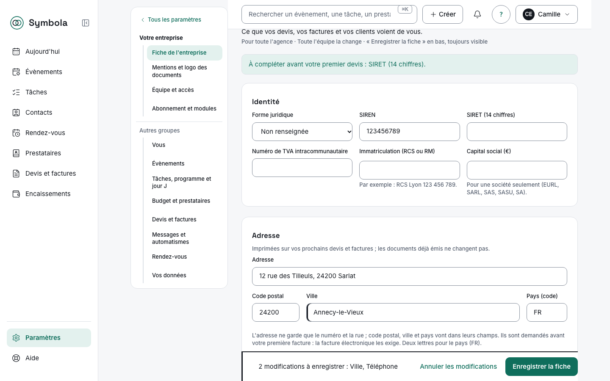 | 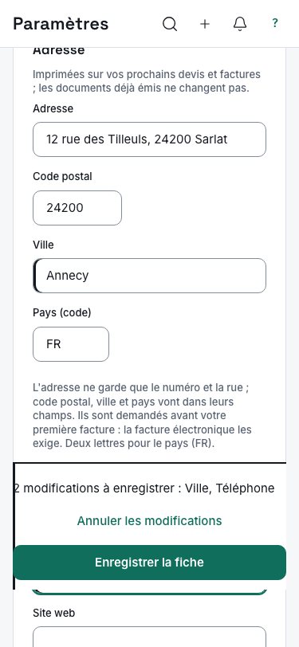 |
| Tâches : seuil « 45 » refusé, l'erreur sous le champ | 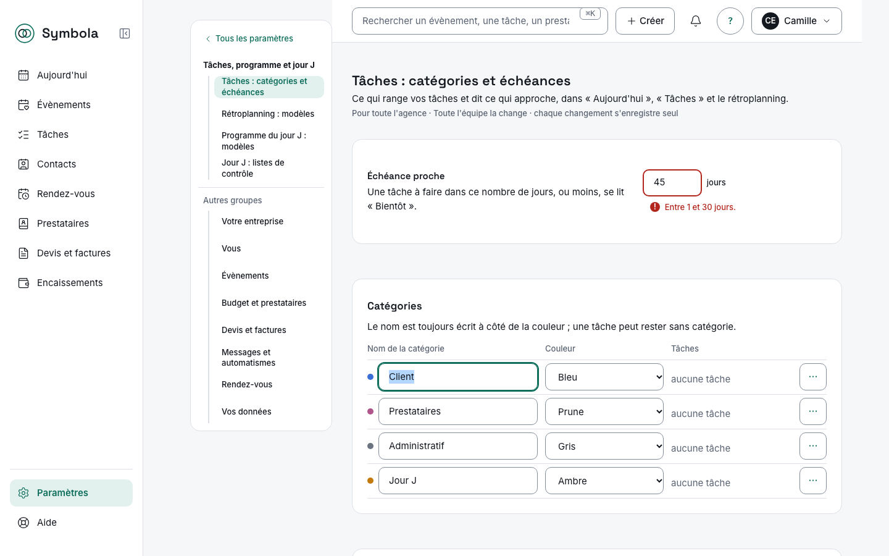 | 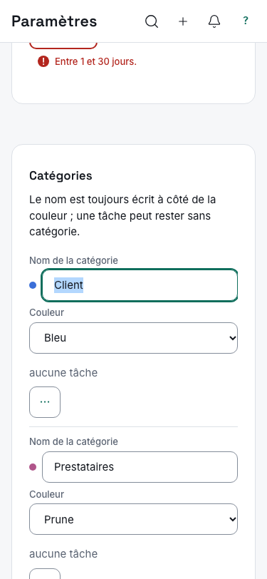 |
| Tâches : seuil « 10 », « ✓ Enregistré » à côté | 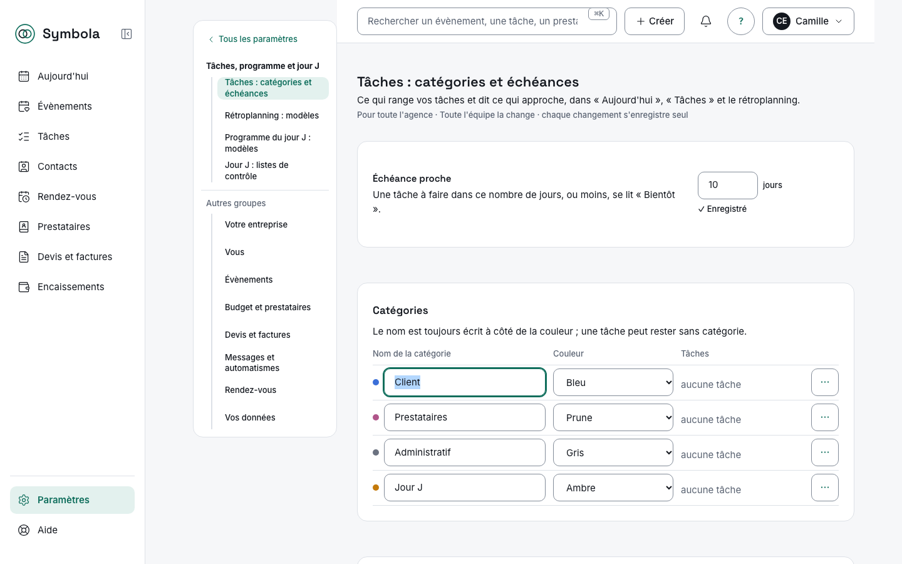 | 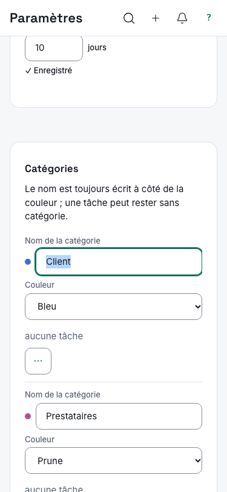 |
| Automatismes : le radar coupé, depuis quand, par qui | 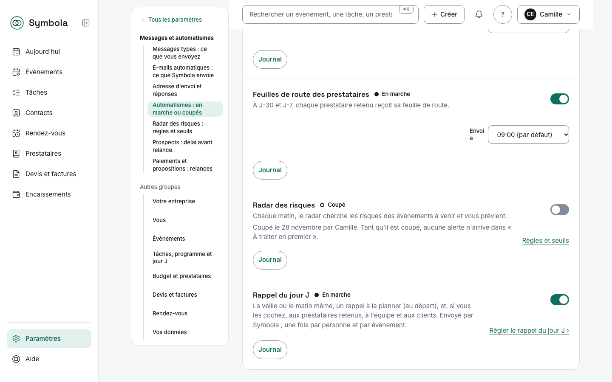 | 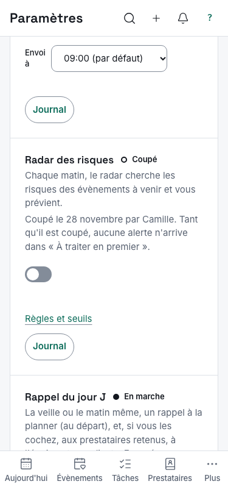 |
| Radar : « À vérifier » en tête, « Remettre le radar en marche » | 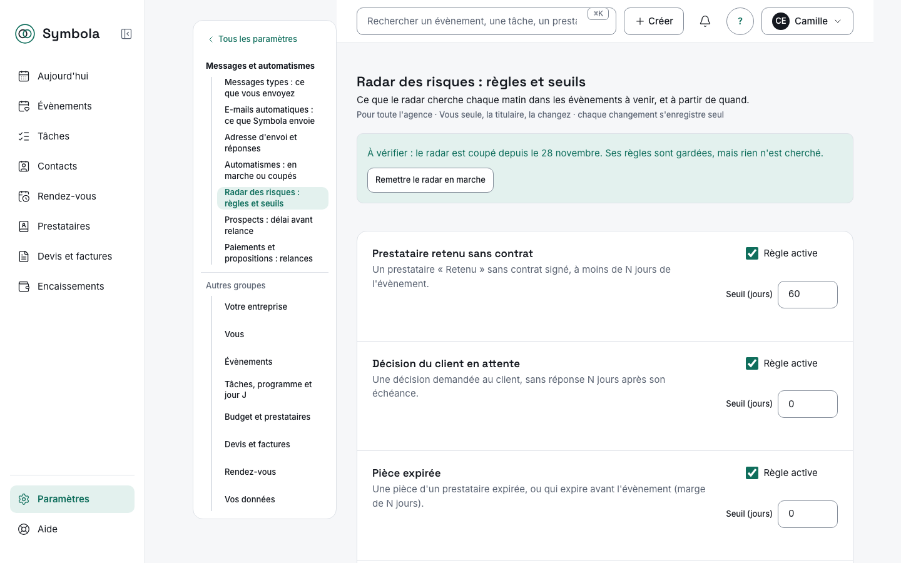 | 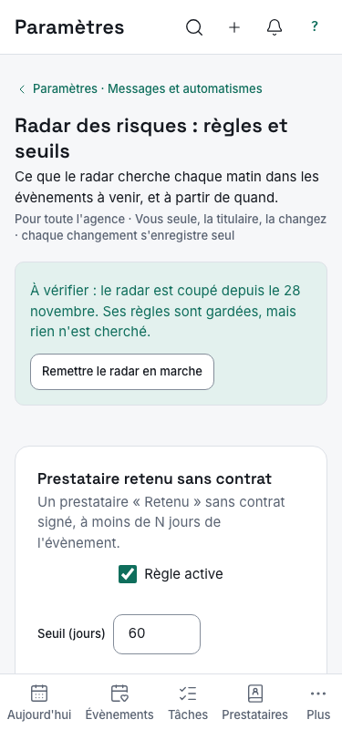 |
| Vos notifications (chaque case s'enregistre seule) | 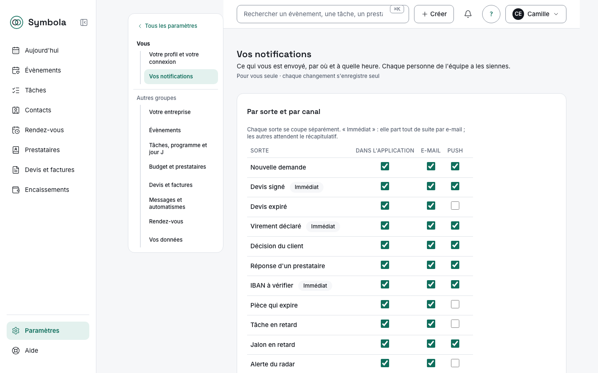 | 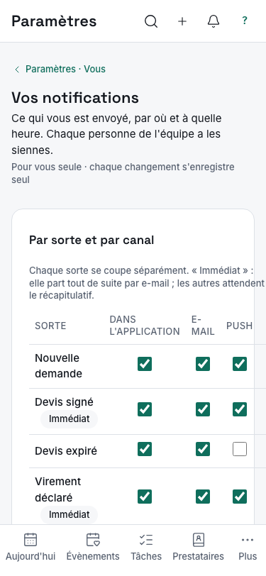 |
| Mentions et logo des documents | 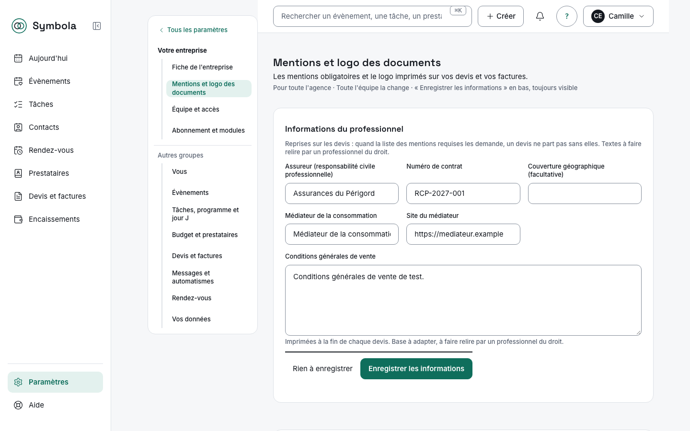 | 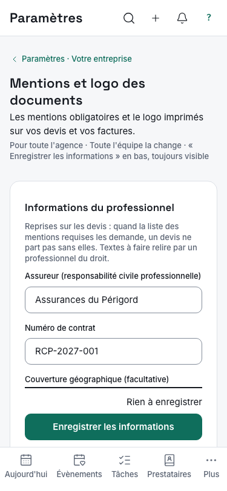 |
| Équipe et accès (inviter en premier) | 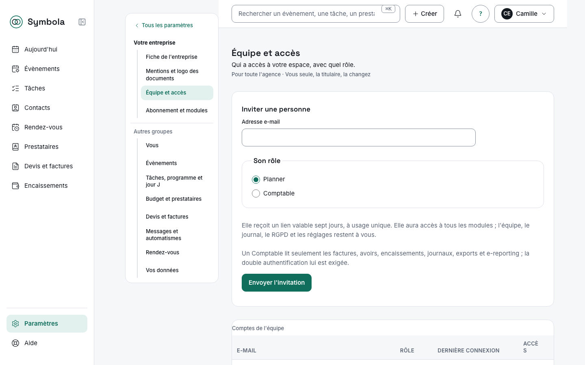 | 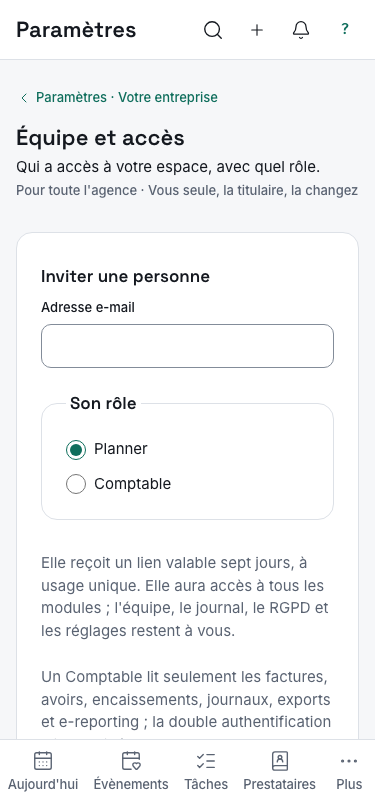 |
| Votre profil et votre connexion | 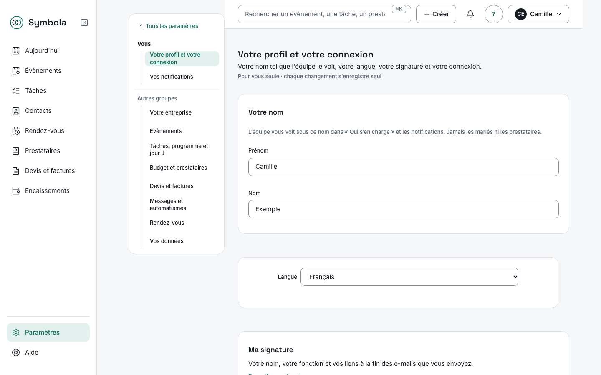 | 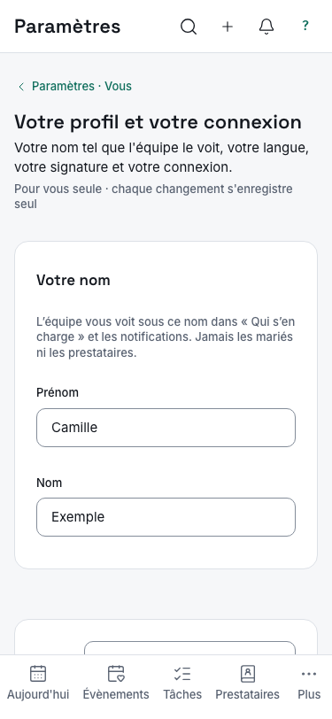 |

## Ce qu'il faut regarder

- L'en-tête : titre, phrase, puis la ligne de portée (« Pour toute l'agence · Seule la titulaire la
  change · chaque changement s'enregistre seul »).
- « ✓ Enregistré » en encre, à côté du réglage, effacé après quatre secondes.
- La barre de la fiche, collée en bas, au-dessus de la barre d'onglets du téléphone.
- « Coupé le 28 novembre par Camille. Tant qu'il est coupé, aucune alerte n'arrive dans « À traiter en
  premier ». »
